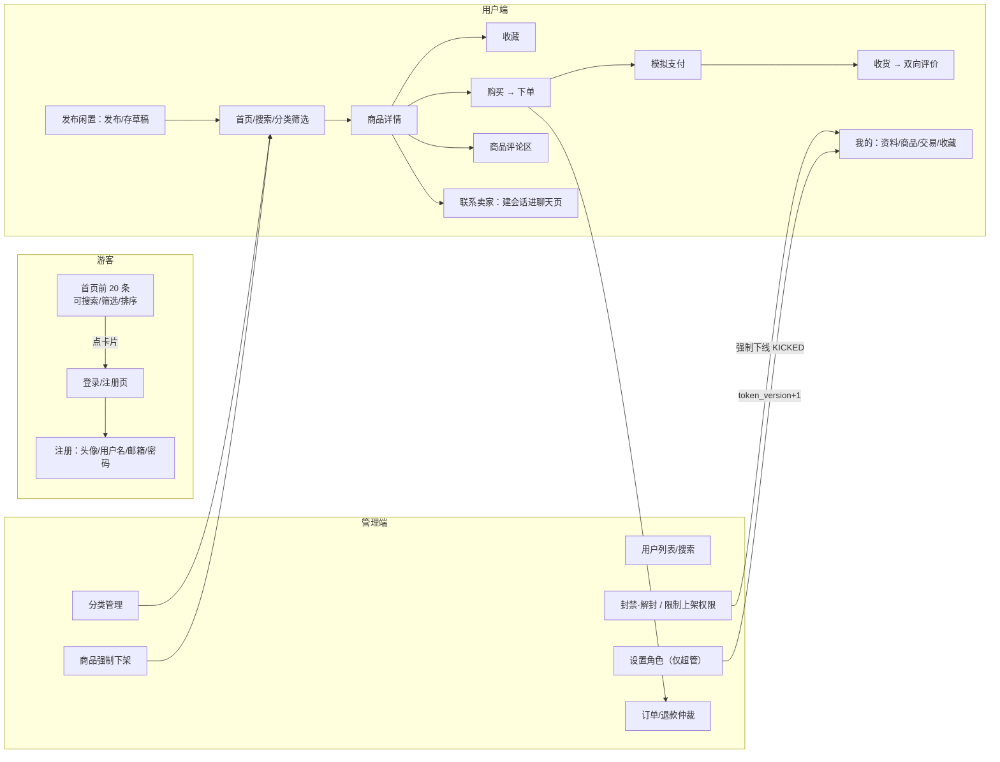
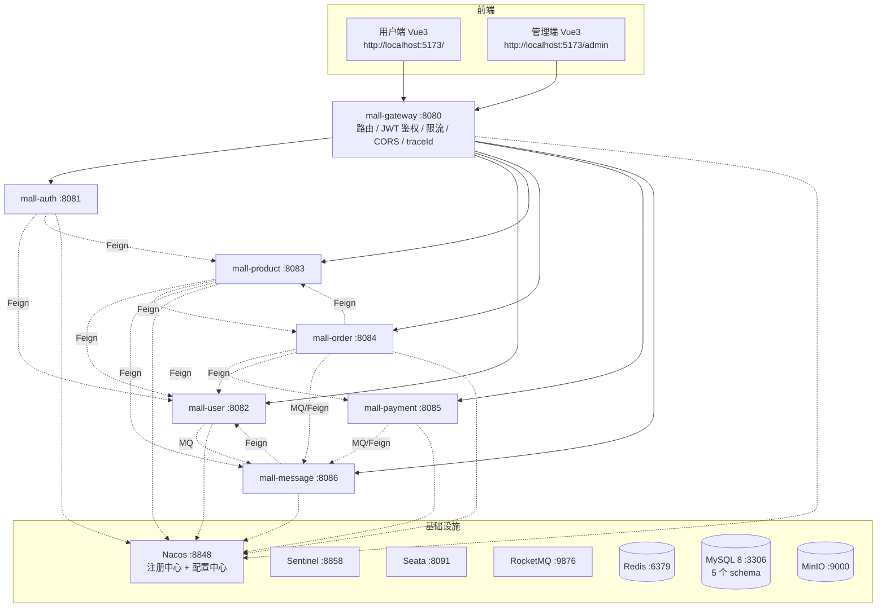
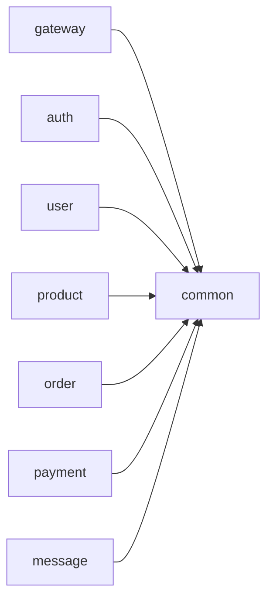
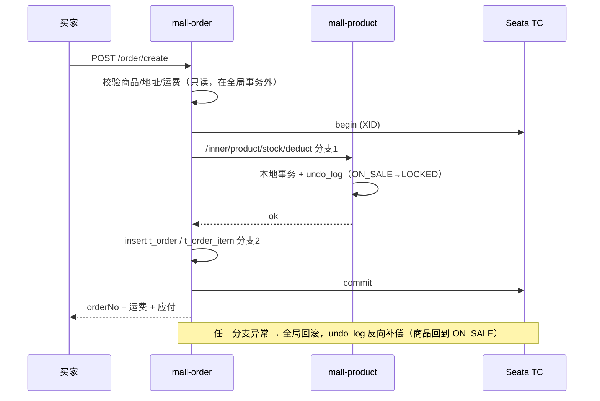
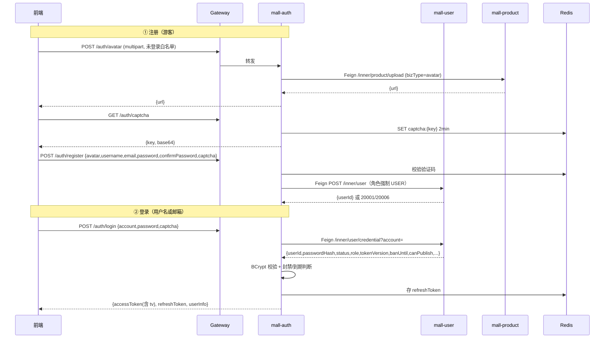
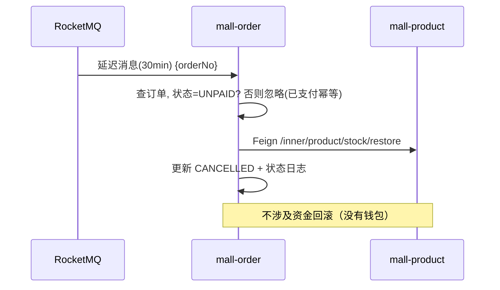

# 晴川二手市场 · 校园二手交易平台 — 总体开发文档

| 项 | 内容 |
|---|---|
| 文档编号 | MALL-DOC-01 |
| 版本 | v1.3（聊天：独立聊天页 / 联系卖家建会话 / 订单状态卡片 / WS CARD 帧；账号治理见 §1.3、§9.2） |
| 编写日期 | 2026-10-26 |
| 技术基线 | JDK 21 / Spring Boot 3.5.16 / Spring Cloud 2025.0.3 / Spring Cloud Alibaba 2025.0.0.0 |
| 前端基线 | Vue 3.5 / Vite 7 / Element Plus 2.11 |
| 配套文档 | `02-数据库设计.md`、`03-接口设计.md`、`04-前端设计文档.md` |
| 文档定位 | 只描述**技术框架、模块边界、接口契约与扩展点**，不含工期与排期 |

---

## 1 项目概述

### 1.1 背景

校园内二手物品（教材、数码、自行车、生活用品、乐器等）流转需求长期存在，但交易过程分散在班级群、贴吧、朋友圈：信息易沉底、无信用体系、无订单履约记录、纠纷无据可查。本项目以校园为封闭场景，做一个"发布—交易—评价—沟通"闭环的二手交易平台。

### 1.2 定位

- **场景封闭**：以同城/校内为主，交易多为线下自提，天然降低物流复杂度（运费按同城 5 元 / 跨城 10 元固定两档，不做真实物流对接）。
- **双身份**：同一账号既是买家也是卖家，不区分注册类型。
- **轻治理，无审核**：发布即上架，不存在"待审核"状态；平台的商品治理手段只有两个——管理员建分类、管理员强制下架违规商品。**账号治理**则有三件：封禁/解封、限制上架权限、提升为管理员。
- **半开放浏览**：未登录用户只能看到首页**前 20 条**商品，点开详情必须登录；注册需要头像与邮箱，登录支持用户名或邮箱。
- **平台角色**：平台**不介入真实资金流**，支付采用"一步模拟支付"（点一下就成功），资金域只保留支付单记录用于订单状态流转与退款演示。
- **技术定位**：以业务为载体，完整落地一套 **Spring Cloud 微服务治理方案**（注册发现、配置中心、网关、服务调用、熔断限流、分布式事务、消息驱动、缓存与锁、实时通信），并为后续单体化/集群化改造预留结构。

### 1.3 角色与权限

| 角色 | 标识 | 能力 |
|---|---|---|
| 游客 | 无 token | **只能**：首页看前 20 条商品（可搜索/分类筛选，不能翻页）、看分类树、验证码、注册、登录。**不能**看商品详情/评论、不能收藏、下单、聊天 |
| 普通用户 | `USER` | 发布/存草稿/编辑/上下架自己的商品、收藏、发表评论、下单、模拟支付、发货、收货、双向评价、**聊天（建会话/收发消息/看订单卡片）**、退款申请、维护资料与地址 |
| 普通管理员 | `ADMIN` | USER 全部能力 + 后台：看全部用户/商品/订单、**封禁/解封用户**、**限制/恢复上架权限**、建分类、强制下架违规商品、退款仲裁、数据概览 |
| 超级管理员 | `SUPER_ADMIN` | ADMIN 全部能力 + **设置角色**（`USER ↔ ADMIN`）。**全系统唯一**，只由初始化 SQL 插入，注册与后台都不能创建/删除 |

> **权限模型**：**角色（SUPER_ADMIN / ADMIN / USER / 游客）+ 资源归属（owner）** 两层。网关判"是否登录、token 是否有效、账号是否被封禁"，细粒度角色由各服务 `@RequireRole` 二次校验，"是不是你自己的商品/订单"由业务层校验（详见 §7.3、§9.1）。
>
> **三条硬约束**（写代码时不要破坏）：
> 1. 注册接口**永远**落 `role=USER`，即使请求体里传了 `role` 也忽略；"管理员不能被注册"。
> 2. `SUPER_ADMIN` 只能来自初始化 SQL，任何接口都不允许写入这个角色（返回 20008）。
> 3. 管理员**不能**操作超级管理员，任何人都**不能**对自己执行封禁/降级（20008 / 20009）。

### 1.4 术语

| 术语 | 含义 |
|---|---|
| 商品（Product） | 一件具体二手物品，库存恒为 1，售出即 `SOLD`；可先存为 `DRAFT` 草稿 |
| 商品评论（Comment） | 商品详情页下方的一级评论与二级回复，与"订单评价"是两件事 |
| 订单评价（Review） | 交易完成后买卖双方互评，1~5 星，可带图；`direction` 区分方向 |
| 会话（Conversation） | 买卖双方围绕某商品建立的聊天通道，唯一键 `(user_a_id, user_b_id, product_id)`；同一对用户同一商品只有一条 |
| 全局事务（XID） | Seata 全局事务标识，贯穿下单链路的多个分支事务 |
| 逻辑删除 | `deleted = 1` 标记删除，查询自动过滤 |
| 内部接口（Inner API） | 仅服务间 Feign 调用，网关不对外暴露，路径统一 `/inner/**` |

---

## 2 需求说明

### 2.1 功能架构



> 图里没有"审核"节点：**发布即上架**。也没有"购物车"与"钱包"：二手一件一单，详情页直接买。
> 游客与登录用户的分界就是"点卡片"这一步：游客能看见 20 条，但看不到任何商品详情；管理端的三个动作（强制下架 / 封禁 / 改角色）都会立刻影响在线用户。

### 2.2 功能清单

| 编号 | 模块 | 功能 | 角色 | 优先级 | 说明 |
|---|---|---|---|---|---|
| F-01 | 账号 | 注册 / 登录 / 退出 | 游客 | P0 | 注册需**头像、用户名、邮箱、密码、确认密码**；登录支持**用户名或邮箱**；图形验证码；BCrypt 存密码 |
| F-02 | 账号 | Token 刷新（无感续期） | 全部 | P0 | refreshToken 存 Redis，一次性轮换 |
| F-03 | 账号 | 修改密码 / 头像 / 资料 / **个性签名** | USER | P0 | 签名 ≤ 200 字，展示在"我的"页 |
| F-04 | 用户 | 收货地址增删改查、设默认 | USER | P0 | 省/市/区三段 + 详细地址；下单时快照 |
| F-05 | 用户 | 卖家主页（头像、城市、注册时长、上次登录、卖出件数、评分） | 登录 | P1 | 7 个展示位由 `/user/{id}` 一次返回 |
| F-06 | 商品 | 发布（1~5 图、分类、成色、价格、原价、运费方式、发货地） | USER | P0 | **发布即上架，无审核** |
| F-07 | 商品 | Split Button：发布 / 存草稿 | USER | P0 | 草稿箱可继续编辑后发布 |
| F-08 | 商品 | 编辑 / 下架 / 重新上架 / 草稿发布 | USER | P0 | `PUT /product/{id}/publish` |
| F-09 | 商品 | 分类树、分页搜索（关键词/价格/地区/成色/6 种排序） | 游客 | P0 | 首页 5 列瀑布流 + 左侧固定分类 + 右侧固定排序；**游客最多 20 条、不能翻页** |
| F-10 | 商品 | 详情（大图、缩略图列、卖家卡片、相似推荐、评论数） | 登录 | P0 | 走 Redis 缓存；**游客点卡片跳登录，后端 P2 直接 10002** |
| F-11 | 商品 | 收藏 / 取消收藏 / 我的收藏 | USER | P1 | |
| F-12 | 商品 | 图片上传 | USER | P0 | MinIO |
| F-13 | 商品 | **商品评论区**（一级评论 + 回复 + 删自己的） | USER | P0 | 与订单评价分离 |
| F-14 | 交易 | 下单（算运费 + Seata 扣库存 + 建单） | USER | P0 | **Seata 全局事务** |
| F-15 | 交易 | **模拟支付一步到位**（待付款 → 点一下 → 已付款） | USER | P0 | 无钱包、无充值 |
| F-16 | 交易 | 30 分钟未支付自动取消 | 系统 | P0 | **RocketMQ 延迟消息** |
| F-17 | 交易 | 发货（填物流）/ 确认收货 | USER | P0 | 自提订单物流号可空 |
| F-18 | 交易 | 取消订单（未发货前） | USER | P1 | 库存回滚 |
| F-19 | 交易 | 退款申请 / 卖家或管理员处理 | USER/ADMIN | P2 | |
| F-20 | 交易 | **双向评价**（买家评卖家、卖家评买家，1~5 星 + 文字 + 图 + 匿名） | USER | P1 | 影响信用分；卖家主页评分取平均 |
| F-21 | 消息 | **聊天页**：会话列表 + 双方实时文字/图片聊天（WebSocket），未读数、离线补拉、断线重连去重 | USER | P0 | 入口：顶部「消息」按钮 / 详情页「联系卖家」 |
| F-22 | 消息 | 系统通知（订单事件、退款结果、商品被下架） | 系统 | P1 | |
| F-23 | 后台 | **分类管理**（新建/改名/图标/排序/启停/删除） | ADMIN | P0 | 用户需求明确要求管理员能建分类 |
| F-24 | 后台 | **商品管理**（列表、强制下架违规商品） | ADMIN | P0 | 平台治理手段 |
| F-25 | 后台 | 用户列表、搜索、封禁/解封、限制上架权限 | ADMIN | P0 | 支持定时解封与永久封禁；在线用户被踢下线并弹窗 |
| F-26 | 后台 | 订单列表、退款仲裁 | ADMIN | P1 | |
| F-27 | 后台 | 后台首页数据概览（用户/商品/订单/成交额） | ADMIN | P2 | 聚合各服务统计接口：`U12`（用户数，`total`）+ `P26`（商品概览）+ `O18`（订单概览），后台首页 3 个请求并发发起，任一失败显示"--"不阻断 |
| F-28 | 账号 | **游客访问限制**（只 20 条、不能进详情、点卡片跳登录） | 游客 | P0 | 前端守卫 + 后端 10002 双保险 |
| F-29 | 账号 | **三角色与唯一超管**（USER / ADMIN / SUPER_ADMIN，超管只由 SQL 创建） | 系统 | P0 | 注册永远 USER；管理员只能被提升 |
| F-30 | 账号 | **封禁 / 解封 + 强制下线** | ADMIN | P0 | `token_version+1` + Redis 封禁标记 + WS `KICKED`；登录 20003 带解封时间 |
| F-31 | 账号 | **上架权限限制 / 恢复** | ADMIN | P0 | `can_publish=0` + `publish_ban_until`；发布时 30009 带解禁时间 |
| F-32 | 后台 | **设置角色**（普通用户 ↔ 普通管理员） | SUPER_ADMIN | P0 | 唯一能改角色的入口；禁止设超管、禁止改超管与自己 |
| F-33 | 消息 | **订单状态卡片**：下单/付款/发货/收货/取消/退款七种事件自动给对方发卡片消息 | 系统 | P0 | 服务端产生（用户不可伪造）；卡+站内通知双通道；失败不阻塞主流程 |
| F-34 | 账号 | **找回密码**：邮箱收 6 位验证码 → 重置密码 | 游客 | P0 | 未登录可用（白名单放行）；验证码存 Redis 10 分钟、同邮箱 1 小时 3 次；重置成功 `token_version+1`，旧会话全部失效 |
| F-35 | 账号 | **收货地址管理**：列表 / 新增 / 编辑 / 删除 / 设默认 | 用户 | P0 | 地址在"我的"页独立维护，不只在购买页临时新增；上限 10 条 |

### 2.3 核心业务规则

| 编号 | 规则 | 落地位置 |
|---|---|---|
| BR-01 | 用户名唯一；密码 8~20 位且含字母数字 | mall-user 唯一索引 |
| BR-02 | 商品库存恒为 1，售出即锁定，不允许重复购买 | mall-product 乐观锁 |
| BR-03 | 不能购买自己发布的商品 | mall-order 下单校验 |
| BR-04 | 商品必须 `ON_SALE` 才能下单；下单瞬间转 `LOCKED` | mall-order → mall-product |
| BR-05 | 订单创建后 30 分钟未支付 → `CANCELLED`，库存回滚（不涉及资金回滚） | RocketMQ 延迟消息 |
| BR-06 | 草稿（`DRAFT`）只有作者可见，不出现在首页/搜索/他人主页 | mall-product 查询条件 |
| BR-07 | 未支付可取消；已发货不可直接取消，走退款 | 订单状态机 |
| BR-08 | **双向评价**：一单两个方向各一次（`uk_order_direction`），评分 1~5，≤2 星扣信用分；评价提交后不可改 | t_review 唯一索引 |
| BR-09 | **运费规则**：包邮 0；按距离 同城 5 元 / 跨城 10 元；自提 0 且仅限同城（跨城自提下单返回 40004） | mall-order 下单计算，快照进 `t_order.freight` |
| BR-10 | 被封禁用户 token 立即失效 | Redis 封禁标记 + `token_version` + 网关校验 |
| BR-11 | **发布即上架，无审核**；管理员治理手段是"强制下架 + 建分类" | 无审核状态，只有 `OFF_SHELF` |
| BR-12 | 商品被强制下架后，**已成交的订单照常履约**，只是不能再被下单 | mall-order 只校验下单瞬间状态 |
| BR-13 | 支付为模拟支付，一笔订单只允许一张支付单（`uk_order_no`），重复支付直接返回已成功 | t_payment 唯一索引 |
| BR-14 | **游客只能看首页前 20 条**，可搜索/筛选但结果固定 20 条、不能翻页；**商品详情一律要求登录** | 网关白名单 + P1 强制分页 + P2 校验 |
| BR-15 | 注册必填**头像、用户名、邮箱**；**用户名与邮箱各自全局唯一**；登录账号既可以是用户名也可以是邮箱 | `uk_username` + `uk_email`，20001 / 20006 |
| BR-16 | **注册永远是 USER**；ADMIN 只能由超管从现有用户提升（`USER ↔ ADMIN`）；SUPER_ADMIN 唯一且只能来自初始化 SQL | mall-user U17 与注册接口硬编码 |
| BR-17 | **封禁**有解封时间（定时或永久 9999-12-31 23:59:59）：封禁后立即强制下线并弹窗；解封后必须重新登录 | `status/ban_until/ban_reason` + `token_version` + Redis 标记 + WS `KICKED` |
| BR-18 | **上架权限被限制**时仍可登录、浏览、下单，只是不能发布/草稿发布/重新上架，点"发布闲置"即弹窗提示解禁时间 | `can_publish=0` + `publish_ban_until`；接口 30009 |
| BR-19 | 管理员不能操作超级管理员；任何人都不能对自己执行封禁/降级/改角色 | 20008 / 20009 |
| BR-20 | **会话唯一**：同一对用户 + 同一商品只有一条会话（`uk_conv`），建会话幂等；**卡片只由服务端产生**（客户端传 PRODUCT/ORDER 一律拒，60004）；同一订单同一卡类型只写一条 | 60002 / 60004 / `orderNo+cardType` 去重 |
| BR-21 | **售后期窗口**：`UNSHIPPED` 随时可退、`UNRECEIVED` 收货前可退、`COMPLETED` 从 `finish_time` 起 **7 天内**可申请售后；一单只能申请一次（`t_refund.uk_order`） | 40007 / 40008 + `uk_order` |
| BR-22 | 退款/售后被**拒绝**时，订单按**申请前状态**回退（`t_refund.before_status`），不写死 | O13 + `before_status` |
| BR-23 | **信用分**：注册 100 分；收到 ≤2 星评价 -2；退款成功 -1；下限 0。信用分只在个人页与后台可见，**不参与任何权限判断** | `t_user.credit_score` |

### 2.4 非功能需求

| 维度 | 指标 | 实现手段 |
|---|---|---|
| 响应 | 商品详情 P95 < 200ms；列表 P95 < 300ms | Redis 缓存、索引优化、分页 |
| 并发 | 单接口限流 100 QPS，热点接口 20 QPS | Sentinel + 网关 Redis 限流 |
| 一致性 | 下单链路强一致（要么全成要么全回滚） | Seata AT |
| 可用性 | 单服务故障不影响非依赖链路；Feign 超时降级 | Sentinel 熔断 + fallback |
| 安全 | 密码不可逆；越权 100% 拦截；上传白名单 | BCrypt + owner 校验 + 类型校验 |
| 可维护 | 新增一个业务服务不改动既有服务代码 | 契约化 common + 网关按前缀路由 |
| 可观测 | 全链路 traceId；关键链路日志可检索 | MDC + Feign 透传 + 统一日志格式 |

---

## 3 技术选型

### 3.1 版本矩阵

**后端**

| 组件 | 版本 | 说明 |
|---|---|---|
| JDK | 21（本机 Oracle 21.0.6） | LTS，虚拟线程可用但本设计未启用 |
| Spring Boot | 3.5.16 | 3.x 线最新稳定版 |
| Spring Cloud | 2025.0.3 | 与 Boot 3.5.x 对应 |
| Spring Cloud Alibaba | 2025.0.0.0 | 官方适配表：SC 2025.0.x + Boot 3.5.0 |
| Nacos | Server 3.0.3（本机已备，standalone/derby）/ Client 3.0.3 | 注册 + 配置；`D:\nacos\conf\application.properties` 的 `nacos.console.port` **已改为 8090 并验证**（避开网关 8080） |
| Sentinel | 客户端 1.8.9（SCA 自带）/ Dashboard 1.8.10（本机已备） | 限流熔断，规则持久化到 Nacos；Dashboard 小版本高于客户端，语义兼容 |
| Seata | 2.5.0（Server + Client，本机已备） | AT 模式；**已定：注册到 Nacos + `store.mode=db`（库 `mall_seata`）**，改法见附录 D.2 |
| Zipkin | 3.6.1（本机已备，jar 直启 :9411） | 链路追踪：`micrometer-tracing-bridge-brave` + `zipkin-reporter-brave` |
| RocketMQ | Server 5.3.1 / 客户端 `rocketmq-spring-boot-starter` 2.3.4 | 延迟消息、异步解耦 |
| MyBatis-Plus | 3.5.x（`mybatis-plus-spring-boot3-starter`） | 单表 CRUD、分页、逻辑删除、自动填充 |
| MySQL | 8.x（本机 8.1） | utf8mb4 / InnoDB |
| Redis | 7.x（本机服务已运行） | 缓存、会话、验证码、分布式锁、限流 |
| Redisson | 3.4x（redisson-spring-boot-starter） | 分布式锁、布隆过滤器（可选） |
| MinIO | 8.5.x | 对象存储（本机 9000/9001） |
| Knife4j | 4.5.x（`knife4j-openapi3-jakarta-spring-boot-starter`） | 接口文档 + 网关聚合 |
| JJWT | 0.12.x | JWT 签发与校验 |
| Hutool | 5.8.x | 工具类 |
| Lombok / MapStruct | 1.18.x / 1.6.x | 简化代码与对象转换 |
| easy-captcha | 1.6.2 | 图形验证码 |

> **为什么不留在 Boot 4.1.2**：Spring Cloud Alibaba 适配表只到 Boot 4.0.0（`2025.1.0.0`），4.1.x 无对应 SCA 版本，Nacos/Sentinel/Seata 的 starter 在 Boot 4.1 上属于未验证组合，生态教程几乎为零。课程项目应优先选"官方适配表能对上"的组合。

**前端**

| 组件 | 版本 | 说明 |
|---|---|---|
| Node.js | 22.x（本机 22.23.2） | |
| Vue | 3.5.x | Composition API + `<script setup>` |
| TypeScript | 5.x | 全量类型 |
| Vite | 7.x | 构建、代理 |
| Element Plus | 2.11.x | UI 组件（按需引入） |
| Pinia | 3.x | 状态管理（含持久化插件） |
| Vue Router | 4.5.x | 路由 + 守卫 |
| Axios | 1.x | 请求封装、拦截器 |
| Sass | 1.x | 样式变量 |
| ECharts | 5.x | 管理端概览图（可选） |

### 3.2 选型理由

| 决策 | 理由 |
|---|---|
| 微服务而非单体 | 课程目标即微服务；且二手交易的"商品与分类治理 / 交易履约 / 支付资金 / 消息"天然可切分 |
| SCA 而非 Netflix 系 | Netflix 组件（Eureka/Hystrix/Ribbon）已停更，国内生态与文档以 Alibaba 为主 |
| MyBatis-Plus 而非 JPA | 单表操作为主，SQL 可控，分页/逻辑删除开箱即用，便于答辩时讲 SQL |
| 一实例多 schema | 保留"服务数据私有"的边界，同时避免本机跑 5 个 MySQL 实例 |
| Seata AT | 对业务代码侵入最小（一个 `@GlobalTransactional`），Demo 效果直观 |
| RocketMQ 而非 RabbitMQ | 原生延迟消息，正好覆盖"30 分钟未支付取消"，少写一套延迟队列 |
| 前端 TS + Element Plus | 类型安全 + 后台管理组件齐全，减少样式工作量 |

### 3.3 运行环境

| 项 | 要求 |
|---|---|
| 操作系统 | Windows 10/11（本项目开发机）/ macOS / Linux 均可 |
| 内存 | ≥ 16GB（7 个 JVM + 6 个中间件同时运行） |
| 磁盘 | ≥ 20GB（Maven 仓库 + 中间件 + 镜像） |
| JDK | 21（`JAVA_HOME` 指向 21） |
| Node | ≥ 20（本机 22） |
| Maven | 3.9+（项目自带 `mvnw` 可不装） |
| Docker | 可选，用于中间件（本机未安装，走本地进程启动） |

### 3.4 端口规划

| 组件 | 端口 | 备注 |
|---|---|---|
| mall-gateway | 8080 | 前端唯一入口 |
| mall-auth | 8081 | |
| mall-user | 8082 | |
| mall-product | 8083 | |
| mall-order | 8084 | |
| mall-payment | 8085 | |
| mall-message | 8086 | 含 WebSocket `/ws/**` |
| 前端 dev server | 5173 | Vite 代理到 8080 |
| Nacos Server | 8848（gRPC 9848/9849） | **控制台 8090**（避开网关 8080） |
| MySQL | 3306 | |
| Redis | 6379 | |
| RocketMQ NameServer | 9876 | |
| RocketMQ Broker | 10911（主）/ 10909（VIP） | |
| RocketMQ Dashboard | 8088 | |
| Sentinel Dashboard | 8858 | |
| Seata Server | 8091 | 本机 Seata 2.5.0 |
| Seata Namingserver | 7091 | Seata 自带的注册中心；**本项目已改用 Nacos 注册，该端口不再使用** |
| Zipkin | 9411 | 链路查询 UI |
| MinIO API / Console | 9000 / 9001 | |

---

## 4 系统架构

### 4.1 总体架构



### 4.2 服务职责

| 服务 | 端口 | 职责边界 | 拥有的数据 |
|---|---|---|---|
| mall-gateway | 8080 | 路由、JWT 校验、白名单、**token_version 与封禁标记校验**、限流、跨域、traceId 生成、接口文档聚合 | 无 |
| mall-auth | 8081 | 验证码、注册、登录（用户名或邮箱）、**注册头像上传转发**、token 签发/刷新/注销、当前用户信息 | 无独立库（凭证经 Feign 取 mall-user） |
| mall-user | 8082 | 账号凭证、用户资料、**个性签名**、地址、信用分、**后台用户管理与治理（列表搜索/封禁/解封/上架权限/角色）**、卖家主页 | mall_user |
| mall-product | 8083 | 分类（含管理员维护）、商品、图片、收藏、**商品评论区**、库存、搜索、文件上传（含头像转存） | mall_product |
| mall-order | 8084 | 订单、订单状态机、运费计算、**双向评价**、退款 | mall_order |
| mall-payment | 8085 | 支付单、**一步模拟支付**、退款执行、模拟回调 | mall_payment |
| mall-message | 8086 | 会话与聊天消息、**订单状态卡片**、系统通知、WebSocket 长连接、**封禁 KICKED 推送** | mall_message |

**边界原则（重要）**

1. **一个数据表只被一个服务写**，跨服务只能读接口或订阅消息。
2. 网关**不含业务逻辑**，不做聚合、不改报文；但**登录态、token_version、封禁标记**这三项必须在网关做（否则每个服务都要重复查一次 Redis）。
3. `mall-auth` 故意不建库：账号凭证的唯一来源是 `mall-user`，避免"两份用户表"的经典错误。注册时的头像文件由 auth 收后转发给 `mall-product` 的 `/inner/product/upload` 落 MinIO，auth 自己不留文件。
4. **商品评论归 mall-product，订单评价归 mall-order**：前者是"这件东西看着咋样"的公开讨论（不需要买过），后者是"这次交易咋样"的履约凭证（必须买过）。两者表不同、接口不同、权限不同，别混。
5. **账号治理归 mall-user**：封禁/解封/上架权限/角色都写 `t_user` 并递增 `token_version`、写 Redis 标记；`mall-message` 只负责把 `KICKED` 帧推给在线连接，不改用户状态。
6. **聊天与卡片归 mall-message**：会话、消息、卡片都是 message 的数据；`mall-order` 只在状态变化时发 `mall-order-status` MQ 或调 `POST /inner/message/card`，**不直接写 message 表**；卡片写失败只重试，不影响订单主流程（发货、收货照常成功）。

### 4.3 服务依赖矩阵

| 调用方 \ 被调方 | user | product | order | payment | message |
|---|---|---|---|---|---|
| auth | ✅ 取凭证 / 建账号 | ✅ 头像转存 | | | |
| user | | | | | ✅ 封禁 KICKED（MQ） |
| product | ✅ 卖家信息 | | ✅ 订单统计（卖出件数/评分） | | ✅ 下架通知 |
| order | ✅ 地址/买家 | ✅ 商品/库存 | | ✅ 退款 | ✅ 订单事件通知 |
| payment | | | ✅ 订单校验 | | ✅ 支付通知 |
| message | ✅ 头像昵称 | ✅ 商品卡片 | ✅ 订单卡片 | | |

> 说明：`payment → order` 与 `order → payment` 是**双向**的，容易形成循环依赖。约定：**订单状态只能由 mall-order 写**，payment 只回调/发消息，不回写订单表（详见 §7.6、§7.8）。Feign 依赖发生在"同步强校验"场景，异步结果一律走 MQ。

### 4.4 部署拓扑（开发期）

单机 7 个 JVM + 6 个中间件。JVM 建议 `-Xms256m -Xmx512m`，RocketMQ Broker `-Xms512m -Xmx512m`，Nacos `-Xms512m -Xmx512m`。

### 4.5 数据架构

- 一个 MySQL 实例，5 个业务 schema：`mall_user`、`mall_product`、`mall_order`、`mall_payment`、`mall_message`；另加 `mall_seata` 存放 Seata 服务端表。
- 跨库查询一律禁止；需要"订单详情带商品标题"时，**下单时快照**到 `t_order_item`。
- 每个涉及分支事务的库都建 `undo_log` 表（Seata AT 必需）。

### 4.6 前端架构

- 单仓库单应用，按路由分「用户端 `/`」与「管理端 `/admin`」两个布局（`UserLayout` / `AdminLayout`）。
- 状态：`userStore`（登录态/资料/个性签名/上架权限）、`productStore`（首页筛选条件：分类/排序/关键词/城市）、`chatStore`（会话列表、当前会话消息、未读总数、WS 连接状态）。**没有 cartStore**（无购物车）。
- 请求：统一 `utils/request.ts`，token 注入、401 刷新、错误码提示（`20003` 封禁 / `30009` 上架受限单独处理）。
- 长连接：`utils/socket.ts` 单例，心跳 30s、断线重连（指数退避）；聊天页与通知共用一条连接。
- 聊天是**独立路由页 `/chat`**（不是右下浮层）：左侧会话列表 + 右侧消息流 + 底部输入框，卡片消息按 `cardType` 渲染。
- 详见 `04-前端设计文档.md`（页面布局、组件拆分、路由、Pinia、交互细节）。

---

## 5 工程结构

### 5.1 仓库目录

```
spring_Cloud_QiMo/
├── pom.xml                     # 聚合父 pom（packaging=pom）
├── mall-common/                # 公共契约
├── mall-gateway/               # 网关
├── mall-auth/
├── mall-user/
├── mall-product/
├── mall-order/
├── mall-payment/
├── mall-message/
├── frontend/mall-web/          # Vue3 工程
├── sql/                        # 建库、建表、初始化数据
├── docker/                     # docker-compose（可选）
└── 文档归类/                   # 本项目文档
```

### 5.2 模块依赖



`mall-common` **只放契约，不放业务**：统一返回、错误码、异常基类、分页对象、常量、JWT 工具、Feign 拦截器、Jackson 配置、Swagger 配置。任何"业务工具类"都不得下沉到 common，否则会退化成大泥球。

### 5.3 单服务包结构（以 mall-product 为例）

```
com.campus.mall.product
├── ProductApplication.java
├── config/            # 本服务专属配置（MyBatis、MinIO、Sentinel 资源）
├── controller/        # 对外 REST + 内部 Inner API
│   ├── ProductController.java
│   ├── CommentController.java
│   ├── CategoryController.java
│   ├── FavoriteController.java
│   ├── FileController.java
│   ├── AdminProductController.java
│   ├── AdminCategoryController.java
│   └── inner/ProductInnerController.java
├── service/           # 接口 + impl
├── mapper/            # MyBatis-Plus Mapper
├── entity/            # PO，与表一一对应
├── dto/               # 入参（含校验注解）
├── vo/                # 出参（前端展示）
├── convert/           # MapStruct：DTO/VO/PO 转换
├── feign/             # 对外 Feign 客户端 + fallback
├── mq/                # 生产者 / 消费者
├── cache/             # 缓存 Key 与操作封装
├── job/               # 定时任务（可选）
└── constant/          # 枚举、常量
```

### 5.4 依赖管理约定

- 所有版本在父 pom `<dependencyManagement>` 锁定，子模块不写 `<version>`。
- 子模块只引自己用得到的 starter；`mall-common` 用 `provided` 关系被依赖，避免传递污染。
- 禁止 `latest` / `RELEASE` 版本号。

### 5.5 分支与提交

| 分支 | 用途 |
|---|---|
| `main` | 可运行基线 |
| `dev` | 集成分支 |
| `feat/xxx` | 功能分支 |
| `fix/xxx` | 缺陷修复 |

提交信息：`feat(order): 支持下单 Seata 全局事务`（约定式提交，中文正文可）。

---

## 6 通用设计规范

### 6.1 统一返回体

```java
public class R<T> {
    private int code;        // 0 成功
    private String message;  // 提示语
    private T data;          // 业务数据
    private String traceId;  // 链路标识
    private long timestamp;  // 毫秒时间戳
    public static <T> R<T> ok(T data) { ... }
    public static <T> R<T> fail(int code, String message) { ... }
}
```

```json
{ "code": 0, "message": "ok", "data": { }, "traceId": "b7f3c2...", "timestamp": 1793000000000 }
```

### 6.2 错误码规范

段位：`0` 成功；`1xxxx` 通用；`2xxxx` 用户；`3xxxx` 商品；`4xxxx` 订单；`5xxxx` 支付；`6xxxx` 消息。

| 码 | 含义 | 抛出位置 |
|---|---|---|
| 10001 | 参数校验失败 | 全局异常处理 |
| 10002 | 未登录 / token 无效 | 网关 |
| 10003 | 无权限 | 网关 / 服务 |
| 10004 | 资源不存在或不属于你 | 各服务 |
| 10005 | 业务状态不允许当前操作 | 各服务 |
| 10006 | 重复提交 | 幂等校验 |
| 10007 | 服务繁忙/已降级 | Sentinel fallback |
| 10008 | 文件上传失败（类型/大小不合规） | product / auth |
| 10009 | 内部调用凭据无效 | Feign internal-token 拦截 |
| 20001 | 用户名已存在 | user |
| 20002 | 用户名/邮箱或密码错误 | auth |
| 20003 | **账号已被封禁**（`data` 带 `banUntil`/`reason`，`message` 含解封时间，前端弹窗用） | auth / gateway |
| 20004 | 验证码错误或过期 | auth |
| 20005 | 原密码错误 / 两次密码不一致 | auth |
| 20006 | **邮箱已被注册** | user（`uk_email`） |
| 20007 | 头像地址不合法（非本站域名 / 无法解码） | auth |
| 20008 | **不能操作超级管理员账户 / 不能设置为超级管理员** | user |
| 20009 | **不能对自己执行该操作**（封禁/改角色/限制上架） | user |
| 20010 | 地址数量已达上限（10 条） | user |
| 30001 | 商品不存在 | product |
| 30002 | 商品已下架/已售出/是草稿 | product |
| 30003 | 库存已被他人锁定（抢单失败） | product |
| 30004 | 草稿信息不完整，无法发布（message 携带缺失字段名） | product |
| 30005 | 不是本人发布的商品 | product |
| 30006 | 分类不存在 | product |
| 30007 | 该分类下仍有商品，不能删除 | product |
| 30008 | 分类层级超限（最多两级） | product |
| 30009 | **上架权限已被限制**（`data` 带 `publishBanUntil`，前端弹窗用） | product |
| 40001 | 订单不存在 | order |
| 40002 | 订单状态不允许该操作 | order |
| 40003 | 不能购买自己发布的商品 | order |
| 40004 | 仅自提商品不支持跨城收货 | order |
| 40005 | 该方向已评价过（评价不可重复、不可修改） | order |
| 40006 | 订单已超时关闭 | order |
| 40007 | 该订单已申请过退款/售后（`uk_order` 挡重复申请） | order |
| 40008 | 已超出售后期限（完成后 7 天内可申请） | order |
| 50001 | 支付单创建失败 / 支付渠道不可用 | payment |
| 50002 | 订单当前不是待付款状态 | payment |
| 50003 | 支付单不存在 | payment |
| 50004 | 退款金额超出可退额度 | payment |
| 60001 | 会话不存在 | message |
| 60002 | 不能给自己发消息 / 不能和自己建会话 | message |
| 60003 | 该用户已被封禁，暂时无法收发消息 | message |
| 60004 | 消息类型不支持（卡片只能由服务端产生） | message |
| 60005 | 消息内容不合法（超长 / 图片地址非法） | message |
| 60006 | 发送过于频繁，请稍后再试 | message |
| 60007 | 消息发送失败 | message |

### 6.3 分页

请求：`pageNum`（从 1 开始）、`pageSize`（默认 10，最大 50）。
响应：

```json
{ "records": [], "total": 128, "pageNum": 1, "pageSize": 10, "pages": 13 }
```

统一使用 MyBatis-Plus `Page<T>`，包装为 `PageResult<T>` 后返回。

### 6.4 全局异常处理

`@RestControllerAdvice` 统一捕获：

| 异常 | 处理 |
|---|---|
| `MethodArgumentNotValidException` | 取第一个字段错误 → 10001 |
| `BizException(code, msg)` | 原样返回 code |
| `AccessDeniedException` | 10003 |
| `DuplicateKeyException` | 10006 |
| `Exception` | 记 error 日志（含 traceId）→ 10007，不外泄堆栈 |

### 6.5 参数校验

- DTO 上用 Jakarta Validation：`@NotBlank`、`@Size`、`@Min`、`@Pattern`、`@DecimalMin`。
- Controller 参数加 `@Validated`；分组校验用 `Create` / `Update` 接口。
- 禁止把校验写进 Service 的 if-else 堆里（业务规则除外）。

### 6.6 序列化约定

| 约定 | 原因 |
|---|---|
| `Long` 主键统一序列化为字符串（`ToStringSerializer`） | JS `Number` 精度 2^53，雪花 ID 会丢精度 |
| 时间格式 `yyyy-MM-dd HH:mm:ss`，时区 `GMT+8` | 前后端一致 |
| `null` 字段保留（不 `NON_NULL`） | 前端判空更稳 |
| 枚举以 `name()` 输出（如 `ON_SALE`），并提供字典接口 | 前端展示中文由字典表映射 |

### 6.7 日志与链路

- 网关生成 `X-Trace-Id`（UUID 去横线），放响应头与 MDC。
- Feign `RequestInterceptor` 透传 `X-Trace-Id`、`X-User-Id`、`X-User-Role`。
- 日志格式：`%d{HH:mm:ss.SSS} [%thread] [%X{traceId}] %-5level %logger{36} - %msg%n`。
- 关键链路打点：下单（orderNo、XID）、支付（payNo）、商品发布/下架（productId）、消息（conversationId）。
- MyBatis-Plus 开启 `p6spy` 或 `StdOutImpl` 打印慢 SQL（仅 dev）。

### 6.8 接口文档

- 各服务引入 Knife4j，`/doc.html`。
- 网关聚合：`springdoc` + `knife4j-gateway-spring-boot-starter`，统一入口 `http://localhost:8080/doc.html`。
- 注解要求：`@Tag`（模块）、`@Operation`（方法）、`@Parameter`（参数）、`@Schema`（模型字段）。

### 6.9 配置管理

- 每个服务 `bootstrap.yml` 只写：`spring.application.name`、`spring.profiles.active`、Nacos 地址、namespace、group。
- 业务配置全部放在 Nacos：`mall-{service}-{profile}.yaml` + 共享 `mall-common-{profile}.yaml`。
- 需要热更新的开关（如 `mall.captcha.enabled`、`mall.mq.enabled`、限流阈值）配 `@RefreshScope`。

### 6.10 数据访问约定

- 实体继承 `BaseEntity`（`id`、`createTime`、`updateTime`、`deleted`），`MetaObjectHandler` 自动填充。
- 逻辑删除：`@TableLogic`，全局配置 `logic-delete-value: 1`。
- 分页插件：`PaginationInnerInterceptor(DbType.MYSQL)`，单页上限 500。
- 复杂查询写 XML，禁止在 Service 里拼 SQL 字符串。
- 金额统一 `BigDecimal`，禁止 `double`。

---

## 7 微服务治理设计

### 7.1 注册发现与配置中心

| 项 | 值 |
|---|---|
| Nacos 地址 | `127.0.0.1:8848` |
| namespace | `mall-dev`（隔离不同环境） |
| group | `MALL_GROUP` |
| 服务名 | `mall-gateway` / `mall-auth` / … （与 `spring.application.name` 一致） |
| 临时实例 | 是（`ephemeral=true`），服务下线自动摘除 |

配置清单：

| DataId | 内容 |
|---|---|
| `mall-common-dev.yaml` | 公共 Jackson、日志、MyBatis-Plus、Swagger、Redis 通用配置 |
| `mall-gateway-dev.yaml` | 路由表、限流规则、白名单 |
| `mall-{service}-dev.yaml` | 数据库连接、端口、业务开关 |
| `sentinel-{service}-rules.json` | Sentinel 流控/熔断规则（dynamic datasource） |

### 7.2 网关设计

**路由表**

| 路径断言 | 目标 | 说明 |
|---|---|---|
| `/auth/**` | `lb://mall-auth` | 登录注册 |
| `/user/**` | `lb://mall-user` | 资料地址 |
| `/product/**`、`/category/**`、`/favorite/**` | `lb://mall-product` | 商品域 |
| `/order/**` | `lb://mall-order` | 交易域 |
| `/payment/**` | `lb://mall-payment` | 支付域 |
| `/message/**`、`/ws/**` | `lb://mall-message` | 消息域（含 WebSocket） |
| `/doc/**` | 聚合文档 | |

> 内部接口 `/inner/**` **不配置路由**，外部访问直接 404；服务间通过 `lb://` 直连。

**过滤器链（顺序）**

1. `TraceIdFilter`（-100）：生成/复用 traceId 写 MDC 与响应头。
2. `AuthFilter`（-50）：白名单放行；否则依次校验：JWT 签名与过期 → `tv`（token_version）与 Redis `mall:user:tv:{userId}` 一致 → Redis `mall:user:banned:{userId}` 不存在 → 注入 `X-User-Id`、`X-User-Role`、`X-User-Name`，并**删除客户端伪造的同名头**。
   - `tv` 不一致（被改角色/被解封后旧 token）→ 10002，提示重新登录；
   - 封禁标记存在 → **20003**，`data` 带 `{banUntil, reason}`，HTTP 200（不是 401，前端要靠 `data` 弹窗）。
3. `AdminFilter`（-40）：**按路径段匹配 `/**/admin/**`**（后台接口是 `/user/admin/**`、`/product/admin/**`、`/category/admin/**`、`/order/admin/**`、`/payment/admin/**`，写成 `/admin/**` 一条都匹配不到），要求 `ADMIN` 或 `SUPER_ADMIN`；`PUT /user/admin/{id}/role` 额外要求 `SUPER_ADMIN`（其余后台接口 ADMIN 即可），否则 10003。
4. `RequestRateLimiter`（Redis 令牌桶）：按 IP + 路径维度限流，超限返回 429 + `R.fail(10007)`。
5. `CorsWebFilter`：允许 `http://localhost:5173`，暴露 `X-Trace-Id`。
6. `GlobalExceptionHandler`：网关层异常统一返回 `R`。

**白名单**（无需登录，v1.2 收紧）

```
/auth/captcha, /auth/register, /auth/login, /auth/refresh, /auth/avatar
/auth/reset-code, /auth/reset-password        ← 找回密码（v1.3，未登录可用）
/payment/callback/**                          ← 模拟支付回调，靠签名校验，不走 JWT
/product/page          ← 游客只拿前 20 条（服务端强制分页）
/category/tree         ← 首页左侧分类栏
/doc/**, /v3/api-docs/**
```

> **`/payment/callback/**` 必须在白名单里**：它是第三方（这里是模拟渠道）回调，带上不了 `Authorization` 头，鉴权靠 `sign` 验签（`mall.payment.mock.secret`），放进白名单后**仍要在 payment 服务里自校验签名**，否则任何人 relpay 一次就能把单改成已支付。
> **不再放行**：`/product/{id}`（详情）、`/product/{id}/similar`、`/product/{id}/comments`、`/user/{id}`（卖家主页）。游客想看得先登录——这是"未登录不能进详情页"的后端兜底，前端的路由守卫是第一道。
> 白名单按**精确路径 + 方法**匹配（`/product/page` 精确，不能写成 `/product/**`），否则详情页会被一起放行。

### 7.3 认证与授权

**JWT 结构**（HS256，密钥放 Nacos `mall-security.secret`，长度 ≥ 32）

```json
{ "sub": "10086", "username": "alice", "role": "USER", "tv": 3, "jti": "9f2c...", "iat": 1793000000, "exp": 1793007200 }
```

| Token | 有效期 | 存储 | 用途 |
|---|---|---|---|
| accessToken | 2h | 前端内存/localStorage | 业务请求 |
| refreshToken | 7d | Redis `mall:auth:refresh:{userId}` | 无感续期，一次性使用后轮换 |

**登录流程**

1. 校验验证码（Redis `mall:auth:captcha:{key}`）。
2. `Feign → mall-user /inner/user/credential?account=` 取凭证（`account` 含 `@` 按邮箱查，否则按用户名查），`BCryptPasswordEncoder.matches` 比对。
3. 查状态：`BANNED` 且未到期 → **20003**（带 `banUntil/reason`）；已到期 → 先自动解封再放行。同时检查 `can_publish/publish_ban_until`，到期则顺手恢复。
4. 生成 access + refresh（access 里带 `tv = tokenVersion`），refresh 存 Redis（value 含 jti，用于单点失效）。
5. 返回 token + 精简用户信息（含 `role`、`canPublish`、`publishBanUntil`）。

**注销 / 封禁 / 强制下线**

| 动作 | 实现 |
|---|---|
| 注销 | `jti` 写 Redis 黑名单 `mall:auth:blacklist:{jti}`，TTL = 剩余有效期 |
| 封禁生效 | mall-user 更新 `t_user`（`status=BANNED`、`ban_until`、`token_version+1`）→ 写 `mall:user:banned:{userId}`（含 banUntil/reason）与 `mall:user:tv:{userId}`（新值）→ 发 MQ `mall-user-banned` |
| 在线强制下线 | mall-message 消费 `mall-user-banned` → 对该用户所有 WS 连接推 `KICKED` 帧（`{reason:"BANNED", banUntil, message}`）→ 前端弹窗并清本地登录态；即使 WS 断了，下一个 REST 请求也会被网关以 20003 拒绝 |
| 解封 | 清 `status/ban_until/ban_reason`、`token_version+1`、删 Redis 封禁标记；用户需**重新登录**（旧 token 已作废） |
| 角色变更 | `token_version+1` → 被改的人下一次请求 10002，重新登录后拿到新 `role` 的能力 |

**越权校验**（服务层，不可省）

- 商品编辑/下架/重新上架/发布草稿：`entity.sellerId == currentUserId`，否则 30005。
- 订单发货：`order.sellerId == currentUserId`；确认收货：`order.buyerId == currentUserId`。
- 地址/收藏/评论：SQL 条件带 `user_id`，不靠前端传。
- 用户治理：目标 `role=SUPER_ADMIN` → 20008；目标是自己 → 20009；改角色接口要求调用者 `SUPER_ADMIN`。

### 7.4 服务调用（OpenFeign）

```java
@FeignClient(name = "mall-product", path = "/inner/product", fallbackFactory = ProductClientFallbackFactory.class)
public interface ProductClient {
    @PostMapping("/stock/deduct")
    R<Boolean> deductStock(@RequestBody StockDeductDTO dto);
}
```

| 约定 | 值 |
|---|---|
| 超时 | connect 2s / read 5s |
| 重试 | 关闭（`Retryer.NEVER_RETRY`），避免非幂等重复扣减 |
| 降级 | 统一 `fallbackFactory`，返回 `R.fail(10007, "商品服务不可用")` |
| 透传 | `X-Trace-Id`、`X-User-Id`、`internal-token` |
| 内部鉴权 | 请求头 `internal-token` 与服务端配置比对，防止绕过网关直调 |
| DTO 位置 | 放在**被调方服务的 api 包**或 `mall-common` 的 `contract` 子包，禁止调用方自造 |

### 7.5 熔断与限流（Sentinel）

| 资源 | 规则 | 效果 |
|---|---|---|
| `GET:/product/{id}` | QPS 200，匀速排队 | 削峰 |
| `POST:/order/create` | QPS 50 | 保护下游库存/支付 |
| `productClient:deductStock` | 异常比例 > 50% 且 ≥ 5 次，熔断 10s | 库存服务雪崩保护 |
| `paymentClient:pay` | 慢调用 RT > 1000ms 比例 > 60%，熔断 15s | |
| 热点参数 `productId` | 单商品 QPS 20 | 防爆款打穿 |

- 控制台：`http://localhost:8858`，规则持久化到 Nacos（`sentinel-datasource-nacos`）。
- 降级返回：`R.fail(10007, "当前访问人数过多，请稍后重试")`，前端统一 toast。

### 7.6 分布式事务（Seata AT）

**适用场景**：下单 = 扣库存并锁定商品（mall_product 库）+ 建单（mall_order 库），**跨 2 个库**。

> v1.1 起没有钱包，所以下单事务里**不再有支付库分支**：资金只在"支付那一下"发生，且是模拟的、单库本地事务。Seata 在这里的价值是"商品被别人抢先买走时，已写下的订单不能留下脏数据"，参与者从 3 个降为 2 个，链路更短，也更容易讲清楚。

**方案**：AT 模式，`@GlobalTransactional(timeoutMills = 30000, name = "create-order")`。

| 项 | 值 |
|---|---|
| Seata Server | 2.5.0，注册到 Nacos，`store.mode=db`（库 `mall_seata`） |
| 事务分组 | `mall-tx-group` → `default` 集群 |
| 各库准备 | `undo_log` 表（mall_product、mall_order） |
| 隔离级别 | 读未提交 + 全局锁（AT 默认） |

> 服务端 `application.yml` 改法（注册 Nacos + `store.mode=db`）与客户端 `seata:` 配置样板，见**附录 D.2**；`mall_app` 账号需额外授权 `mall_seata` 库（见数据库设计文档 §3）。

**执行链路**



**防护措施**

- 幂等：`t_order.order_no` 唯一索引 + 请求头 `Idempotency-Key`（Redis `SETNX`，10 分钟）。
- 空回滚/悬挂：分支事务记录 `xid + branch_id`，回滚前先判存在（AT 由框架处理，业务侧只保证幂等）。
- 兜底：定时任务扫描"商品 `LOCKED` 但无对应未取消订单"的记录，自动回补为 `ON_SALE`（见 §8.6）。

### 7.7 分布式锁与防超卖

三层防护，从快到慢：

| 层 | 手段 | 作用 |
|---|---|---|
| L1 | Redis Lua 预扣 `mall:product:stock:{id}` | 挡住 99% 无效流量，不落库 |
| L2 | Redisson 锁 `mall:lock:product:{id}`（waitTime 3s，leaseTime 10s） | 保证"查库存—改状态"临界区串行 |
| L3 | DB 乐观锁 `UPDATE t_product SET status='LOCKED', version=version+1 WHERE id=? AND status='ON_SALE' AND version=?` | 最终防线，影响行数 0 即失败 |

- 锁释放用 `tryLock/finally`，禁止手写 `DEL`（防误删他人锁）。
- 下单失败要**回补** L1 的 Redis 库存计数。
- 预扣与 DB 状态不一致时，以 DB 为准并异步修正 Redis（定时校准任务）。

### 7.8 消息队列（RocketMQ）

**Topic 规划**

| Topic | 生产者 | 消费者组 | 用途 | 消息体 |
|---|---|---|---|---|
| `mall-order-timeout` | order | `GID_order_timeout` | 延迟 30 分钟取消未支付订单（回滚商品为 `ON_SALE`） | `{orderNo, createTime}` |
| `mall-order-paid` | payment | `GID_order_paid`、`GID_product_sold` | 支付成功 → 订单转待发货 / 商品转 `SOLD` | `{orderNo, payNo, payAmount}` |
| `mall-order-refunded` | payment | `GID_order_refunded` | 退款完成 → 订单转 `REFUNDED`，通知买家 | `{orderNo, refundNo, amount}` |
| `mall-product-off-shelf` | product | `GID_message_off_shelf` | 管理员强制下架 → 通知卖家 | `{productId, sellerId, reason}` |
| `mall-user-banned` | user | `GID_message_user_banned` | 封禁生效 → `mall-message` 推 WS `KICKED` 强制下线；`mall-auth` 不消费（网关已验证） | `{userId, banUntil, reason, operatorId}` |
| `mall-notice` | 各服务 | `GID_message_notice` | 通用站内通知 | `{userId, type, title, content, bizId}` |
| `mall-order-status` | order | `GID_message_order_card` | 订单状态卡片 → `mall-message` 写卡片消息并 WS 推送（消费失败由 M13 兜底） | `{orderNo, buyerId, sellerId, productId, cardType, statusText, actionText}` |

**约定**

- 消息体带 `msgId`（UUID）+ `traceId`，消费端以 `msgId` 做幂等（Redis `SETNX` 24h）。
- 消费失败重试 3 次后进死信队列 `%DLQ%{consumerGroup}`，人工/定时补偿。
- 顺序消息仅用于"同一订单状态变更"，按 `orderNo` 分区。
- 发送失败落 `t_mq_local_msg`（本地消息表）由定时任务重发（可选，见 §13.3）。
- **`mall-order-timeout` 的延迟级别 = 30 分钟**；本机没装 RocketMQ 时，用"Redis ZSet + `@Scheduled` 补偿扫描"作为降级实现（接口契约不变，见附录 D.3）。

### 7.9 缓存设计

| Key | 类型 | TTL | 说明 |
|---|---|---|---|
| `mall:product:detail:{id}` | String(JSON) | 30min + 随机 0~5min | 商品详情 |
| `mall:product:null:{id}` | String | 60s | 空值缓存，防穿透 |
| `mall:product:stock:{id}` | String | 无（下单后重建） | 预扣库存（抢单用） |
| `mall:product:list:{md5(条件)}` | String(JSON) | 5min | 首页列表缓存（可选，条件含 pageNum） |
| `mall:product:hot` | ZSet | 1h | 热度榜（`productId → view_count + favorite_count*3`）。**写入方**：`P1` 列表命中 `sort=hot` 时读；`view_count` 由浏览量异步任务每 5 分钟 `INCRBY`，`favorite_count` 在 `P15/P16` 收藏/取消时 `INCRBY`，两者都顺手 `ZADD` 更新该商品的 score |
| `mall:category:tree` | String(JSON) | 1h | 分类树（管理员改动后主动删） |
| `mall:auth:captcha:{key}` | String | 2min | 验证码 |
| `mall:auth:reset:{email}` | String | 10min | 找回密码的 6 位邮箱验证码（`A9` 写、`A10` 读并删除），同邮箱 1 小时最多 3 次 |
| `mall:auth:refresh:{userId}` | String | 7d | 刷新令牌 |
| `mall:auth:blacklist:{jti}` | String | 剩余有效期 | 登出黑名单 |
| `mall:user:tv:{userId}` | String | 7d（与 access 同寿命即可） | 令牌版本缓存，网关每次比对 JWT 的 `tv`；封禁/改角色时更新 |
| `mall:user:banned:{userId}` | String(JSON) | 封禁剩余时长（永久=7d，靠 DB 兜底） | 封禁标记 `{banUntil, reason}`，网关命中直接 20003 |
| `mall:msg:unread:{userId}` | Hash | 7d | 聊天未读（`conversationId → count`），顶部红点是它的总和 |
| `mall:msg:online:{userId}` | String | 连接存活期间（心跳续期 90s） | 在线标记，供 `M2` 的 `peerOnline` 与 `ONLINE/OFFLINE` 帧使用 |
| `mall:lock:product:{id}` | — | 10s | Redisson 锁 |
| `mall:limit:{path}:{ip}` | — | 1s 窗口 | 网关限流 |

> `mall:user:tv` 与 `mall:user:banned` 是"强制下线"的两根支柱：前者让旧 token 失效（包括改角色、解封后的旧会话），后者让网关无需查库就能回 20003 并带上解封时间。
> 两者都由 mall-user 写、网关只读；**不要让 auth 写**，否则封禁一次要改三个地方。

**缓存模式**

- **旁路缓存**：读 → 命中返回；未命中查库 → 写缓存（含空值）。
- **更新**：先更新 DB，再删缓存，再延迟 500ms 二次删（延迟双删）。
- **热点防击穿**：详情缓存存 `{data, expireAt}` 逻辑过期字段，过期后异步重建，读线程先返回旧值。
- **雪崩**：TTL 加随机抖动；分类等全局 key 使用互斥锁重建。

### 7.10 文件存储（MinIO）

| 项 | 值 |
|---|---|
| Endpoint | `http://127.0.0.1:9000` |
| Bucket | `mall`（public-read 仅读，写入走服务端） |
| 路径规范 | `product/{yyyyMM}/{uuid}.{ext}`、`avatar/{userId}/{uuid}.{ext}`、`review/{yyyyMM}/{uuid}.{ext}` |
| 上传限制 | ≤ 5MB；仅 `jpg/jpeg/png/webp`；服务端校验 magic number |
| 返回 | 完整 URL 存库；前端直连 MinIO 读 |

**扩展点**：定义 `FileStorage` 接口（`upload`/`delete`/`getUrl`），MinIO 是一种实现，后续接阿里云 OSS / 七牛只需新增实现类 + 配置切换。

### 7.11 实时通信（WebSocket）

**握手**：`ws://localhost:8080/ws/chat?token={accessToken}`，网关 `AuthFilter` 对 `/ws/**` 做 token 校验（query 参数形式），校验通过后转发给 mall-message，把 `X-User-Id` 注入 header。

**协议**（JSON 文本帧）

```json
{ "type": "CHAT", "clientMsgId": "c-1", "toId": "10087", "conversationId": "5",
  "contentType": "TEXT", "content": "你好，还在吗？", "createTime": "2026-10-26 20:15:00" }
```

> 帧里的字段名与时间格式和 HTTP 接口完全一致：接收人叫 `toId`（**不是 `toUserId`**）、回执叫 `ACK`（**不是 `CHAT_ACK`**）、时间是 `createTime` 字符串（**不是毫秒 `ts`**）、主键一律字符串（Long → String）。前后端照这三条写，联调不会出现"ACK 永远匹配不上"。

| type | 方向 | 说明 |
|---|---|---|
| `CHAT` | C→S→C | 私聊文本/图片消息（`contentType` 只允许 `TEXT`/`IMAGE`；`PRODUCT`/`ORDER` 卡片由服务端产生，客户端传了返回 60004） |
| `ACK` | S→C | 服务端已落库回执，含 `msgId`、`clientMsgId`、`createTime`（前端按 `clientMsgId` 去重并把"发送中"改"已发送"） |
| `READ` | C→S | 上报已读：`{conversationId, lastReadMsgId}`，清自己未读 |
| `READ` | **S→C** | 对方已读回执：`{conversationId, lastReadMsgId, readerId}`，收到后把自己发出的消息标"已读"（没有这一帧，气泡永远停在"已送达"） |
| `CARD` | S→C | 服务端推送商品/订单卡片（`contentType=ORDER|PRODUCT` + `cardType`，前端可单独放"新卡片"提示音） |
| `ONLINE` / `OFFLINE` | S→C | 对方在线状态 |
| `NOTICE` | S→C | 系统通知推送 |
| `KICKED` | S→C | 强制下线（封禁 / 异地登录），前端弹窗后清登录态 |
| `PING` / `PONG` | 双向 | 心跳，30s |

**多实例**：单机单实例即可；若扩多实例，用 Redis Pub/Sub（channel `mall:ws:user:{userId}`）广播，网关按 `userId` 一致性哈希（可选）。

**离线消息**：消息全量落 `t_message`，客户端上线后调 `GET /message/history` 拉增量（`lastId` 游标）。

---

## 8 核心业务流程

### 8.1 注册 / 登录



**关键点**

1. **头像先前置上传**：注册表单里选完头像立刻调 A8 拿 URL，提交注册时只传 URL；这样注册接口始终是纯 JSON，不用处理 multipart 与"两个字段的事务"。
2. **角色不可注入**：注册请求体忽略 `role`，`mall-user` 的 `POST /inner/user` 也不接受 `role`，落库恒为 `USER`。
3. **登录账号二选一**：`account` 含 `@` → 按 `email` 查，否则按 `username` 查；查不到统一 20002。
4. **封禁与到期的即时判断**：登录时若 `status=BANNED` 且 `ban_until > now` → 20003（带解封时间）；若 `ban_until <= now` → 先自动解封再放行；`can_publish=0` 且 `publish_ban_until <= now` 同样顺手恢复。
5. **刷新 token 也要校验**：A4 刷新时重新查一次状态（封禁/角色/tv），防止用 refreshToken 绕过封禁。

### 8.2 商品发布 / 草稿 / 强制下架

**没有审核环节**，发布即上架。

1. 卖家在发布页传图（先 `POST /product/upload` 拿 URL，1~5 张）。
2. 点 Split Button：
   - 左半边"发布" → `POST /product`（不带 status 或 `ON_SALE`）→ 落库 `ON_SALE`，初始化 Redis 库存计数 `mall:product:stock:{id}=1`，**立刻出现在首页**。
   - 右半边"存草稿" → `POST /product`（`status=DRAFT`）→ 只在"我的商品—草稿箱"可见，首页/搜索/他人主页都看不到（BR-06）。
3. **发布前的上架权限闸门**：`POST /product`、`PUT /product/{id}/publish`、`PUT /product/{id}/on-shelf` 三个入口先查 `can_publish` 与 `publish_ban_until`：
   - 被限制且未到期 → **30009**，`data.publishBanUntil` 给前端弹窗；**不落库、不建草稿**。
   - 已到期 → 先恢复 `can_publish=1` 再继续（用户无感）。
   - 前端还会在点"发布闲置"按钮时就拦截（读 `userStore.canPublish`），后端这道是防绕过。
4. 草稿补全后可 `PUT /product/{id}/publish`：此时才做完整校验，缺项返回 **30004 + 缺失字段名**，前端把这些字段标红。
5. 编辑已上架商品：直接 `PUT /product/{id}`，**不退回草稿、不下架**（改完立即生效，删缓存）。
6. 管理员强制下架：`PUT /product/admin/{id}/off-shelf` → `status=OFF_SHELF` + 删 `product:detail` 缓存 + 发 `mall-product-off-shelf` 通知卖家。已成交的订单照常履约（BR-12）。

### 8.3 商品详情的读路径

```mermaid
flowchart LR
  A[请求 /product/{id}] --> B{Redis 命中?}
  B -- 是 --> C[返回]
  B -- 否 --> D{空值标记?}
  D -- 是 --> E[30001 不存在]
  D -- 否 --> F[查 DB]
  F --> G{存在且非 DRAFT?}
  G -- 否 --> H[写空值 60s] --> E
  G -- 是 --> I[Feign 组装卖家卡片 + 订单统计] --> J[写缓存 30min+抖动] --> C
```

> 卖家卡片那 7 个展示位（头像、用户名、城市、上次登录、注册时长、卖出件数、评分）**由 mall-product 后端一次组装**：Feign 调 `/inner/user/{id}` + `/inner/order/statistics/{userId}`，不让前端拼 4 个请求（见 03 文档 U3）。

### 8.4 下单（Seata 全局事务）

见 §7.6 时序图。补充业务细节：

1. 前置校验：商品 `ON_SALE`（草稿/已下架返回 30002）、`sellerId != 当前用户`（40003）、地址属于本人（10004）。
2. **算运费**：`FREE_SHIPPING` → 0；`SELF_PICKUP` → 0（且要求收货地址与商品同城，否则 40004）；`DISTANCE` → 同城 5.00 / 跨城 10.00。
3. L1 预扣库存（Redis Lua）→ L2 Redisson 锁 → L3 DB 乐观锁改 `LOCKED`——这三层都在 mall-product 的 `stock/deduct` 分支里。
4. 落 `t_order`（`UNPAID`，含 `freight`/`pay_amount` 快照）、`t_order_item`（商品标题/图/单价快照）、`t_order_status_log`。
5. 提交后发延迟消息 `mall-order-timeout`（30 min）。
6. 返回 `orderNo` + `payAmount`，前端跳"我的订单"并弹支付窗。

### 8.5 模拟支付（一步到位）

1. 前端在支付弹窗点"确认支付" → `POST /payment/pay {orderNo}`（带 `Idempotency-Key`）。
2. `mall-payment` 校验订单归属与 `UNPAID` 状态 → 生成 `payNo`，落 `t_payment`（`channel=MOCK`）。
3. **没有第三方跳转、没有回调等待**：内部"模拟网关"立刻把支付单写成 `SUCCESS` + `trade_no=MOCK-xxxx`。
4. 发 `mall-order-paid` → `mall-order` 消费改 `UNSHIPPED`；`mall-product` 消费改 `SOLD`。
5. 接口同步返回 `{status: SUCCESS, payTime}`，前端弹"支付成功"并刷新订单列表。
6. 兜底：MQ 不可用时 `mall-payment` 直接调 `/inner/order/{orderNo}/notify-paid`（幂等，不重复改状态）。

> 重复支付不会报错：`uk_order_no` 保证一单一张支付单，已支付则原样返回成功的支付单。

### 8.6 超时取消



另有兜底定时任务（每 5 分钟）：扫 `t_product.status='LOCKED'` 且**没有**对应"未取消订单"的商品，自动回补 `ON_SALE`（防 Seata 回滚失败留下死锁商品）。

### 8.7 确认收货与双向评价

- 卖家发货：`UNSHIPPED → UNRECEIVED`，写物流单号（`SELF_PICKUP` 可为空）。
- 买家确认：`UNRECEIVED → COMPLETED`，`receive_time` 落库，双方同时获得评价资格。
- 评价：`POST /order/{orderNo}/review`，**方向由调用者角色自动判定**（买家 → 评卖家，卖家 → 评买家）；`uk_order_direction` 防同一方向重复（40005）。
- 评分 1~5，可带 ≤3 张图、可匿名；**提交后不可修改**。
- ≤2 星扣被评方信用分（异步，走 `/inner/user/{id}/credit`）。
- 展示：卖家主页的 `avgRating` 只取"BUYER_TO_SELLER"方向；买家的同理只取"SELLER_TO_BUYER"。

### 8.8 商品评论区（与订单评价无关）

- 任何登录用户都能在详情页发一级评论（1~500 字，≤3 图）。
- 回复：`POST /product/{id}/comments` 带 `parentId`，只做一级嵌套（回复的回复挂在同一条一级评论下）。
- 删除：只能删自己的（管理员可删任意），逻辑删除 + `comment_count - 1`。
- 限流：同一用户 1 分钟最多 3 条（Sentinel 热点参数限流）。
- 列表按 `create_time desc` 分页，一级评论带其回复列表（最多展示 3 条 + "查看更多"）。

### 8.9 退款

| 场景 | 流程 |
|---|---|
| 未支付取消 | 买家取消 → `CANCELLED` → 调 product 恢复 `ON_SALE`（无资金动作） |
| 未发货退款 | 买家申请 → `REFUNDING` → 卖家同意/管理员仲裁 → `mall-payment` 改支付单 `REFUNDED` + 发 `mall-order-refunded` → 订单 `REFUNDED` + 商品**恢复 `ON_SALE`**（还能再卖） |
| 已发货/已收货售后 | 同一套 O12→O13 流程；同意后订单 `REFUNDED`，但商品**保持 `SOLD`**（东西在买家手上，不能回到货架） |
| 拒绝 | 订单**按申请前状态回退**：申请前是 `UNSHIPPED` 就回 `UNSHIPPED`，是 `UNRECEIVED` 就回 `UNRECEIVED`（用 `t_refund.before_status` 记录，**不要写死 `UNRECEIVED`**），理由通知买家 |

> 退款**不走 Seata 全局事务**：支付单与订单分属两个库，但两边都是"单向状态推进 + MQ 补偿"，用本地事务 + `mall-order-refunded` 消息即可，避免长事务；因此 `undo_log` 只建在 `mall_product` 与 `mall_order` 两个库（见 §7.6）。

### 8.10 聊天与会话（私聊）

**入口有三个，都先拿 `conversationId` 再进聊天页**

| 入口 | 动作 |
|---|---|
| 首页/顶部导航「消息」按钮（带未读红点） | 直接进 `/chat`，右侧显示最近会话 |
| 商品详情页「联系卖家」 | `POST /message/conversation`（`peerId`+`productId`+`openWithProductCard=true`）→ `/chat?cid=xxx` |
| 订单卡片里的「联系卖家 / 回复」 | 复用订单所属商品已有的会话，直接进 `/chat?cid=xxx` |

**流程**

1. `getOrCreateConversation(a, b, productId)`：`user_a_id < user_b_id` 强制排序，`uk_conv` 兜底；并发插入冲突就回查已有记录（幂等，返回 `created=false`）。
2. 首次建会话且 `openWithProductCard` → 服务端自动写一条 `PRODUCT` 卡片（图片/标题/价格），对方点卡片能跳商品详情。**这条卡片是服务端写的，绕过 60004 的客户端限制。**
3. 发消息：WebSocket `CHAT` 帧（或 HTTP `POST /message/send` 兜底）→ 校验（会话归属 60001 / 不能发给自己 60002 / 收件人封禁 60003 / 类型 60004 / 内容 60005 / 频率 60006）→ 落 `t_message` → 更新 `t_conversation.last_msg/last_time/unread_*` → 对方在线则推送并置 `DELIVERED`，不在线只累加未读。
4. 已读：进会话页发 `READ` → `unread_*` 清零，`status` 改 `READ`，并通知对方（对方的气泡从"已送达"变"已读"）。
5. 断线重连：`clientMsgId` 去重（重发不产生重复气泡）；上线后 `GET /message/history?lastId=` 补拉增量。
6. 未读总数（顶部红点）用 Redis Hash `mall:msg:unread:{userId}` 计数，DB 只是兜底重建来源。

**约束**

- 不能给自己建会话/发消息（60002）；被封禁用户能收历史消息但不能发送（网关 20003 先拦）。
- 聊天内容不做敏感词过滤（课程项目不做内容审核，见 §13.10 取舍），保留 `t_message.deleted` 便于管理员后续处理。
- 消息发送限流：单用户 1 秒 3 条（Redis 令牌桶），防脚本刷屏。

### 8.11 订单状态卡片（自动化消息）

订单每走一步，双方聊天窗口里就多一张卡片——这是"用户不用盯订单列表也知道进展"的关键。

| 业务事件 | 卡片 `cardType` | 发件人 → 收件人 | 文案 | 按钮 |
|---|---|---|---|---|
| 下单成功 | `ORDER_CREATED` | 买家 → 卖家 | 买家已下单，等待付款 | 查看订单 |
| 模拟支付成功 | `ORDER_PAID` | 买家 → 卖家 | 买家已付款，请尽快发货 | 去发货 |
| 卖家发货 | `ORDER_SHIPPED` | 卖家 → 买家 | 卖家已发货，请注意查收 | 查看订单 |
| 买家确认收货 | `ORDER_RECEIVED` | 买家 → 卖家 | 买家已确认收货 | 去评价 |
| 取消 / 超时关闭 | `ORDER_CANCELLED` | 买家 → 卖家 | 订单已取消 | 查看订单 |
| 申请退款 | `REFUND_APPLIED` | 买家 → 卖家 | 买家申请退款，请处理 | 处理退款 |
| 退款完成 | `REFUND_DONE` | 卖家 → 买家 | 退款已完成 | 查看订单 |

**触发链路（两种通道，先到先用）**

1. **主通道**：`mall-order` 状态变更后发 MQ `mall-order-status`（`{orderNo,buyerId,sellerId,productId,cardType,statusText,actionText}`）→ `mall-message` 消费 → 取/建会话 → 写 `content_type=ORDER` 卡片 + 推 WS `CARD` + 收件人未读 +1。
2. **兜底**：MQ 不可用（本机没装 RocketMQ 的降级模式）时，`mall-order` 直接同步调 `POST /inner/message/card`（M13），契约不变。
3. **幂等**：以 `orderNo + cardType` 去重，MQ 重投或两条通道同时到达都只写一条卡片。
4. **通知兜底**：同一事件同时写一条 `t_notice`（type=ORDER），用户不点开聊天也能在通知里看到——卡片负责"即时感"，通知负责"不漏看"。
5. **不阻塞主流程**：卡片写失败只记日志 + 落 `t_mq_local_msg` 重试，**绝不让发货/收货因为发消息失败而回滚**。

---

## 9 安全设计

### 9.1 认证 / 授权 / 越权

- 认证：JWT（网关统一校验），业务服务信任网关注入的 `X-User-Id`。JWT 里带 `tv`（token_version），网关每次比对 Redis `mall:user:tv:{userId}`——封禁、解封、改角色都靠它让旧 token 一次性失效。
- **防伪造**：网关先删除请求里所有 `X-User-*`、`internal-token` 头，再注入自己的。
- 授权：角色（网关）+ 归属（服务层），归属校验必须写在 SQL 条件里。
- 内部接口：校验 `internal-token`（Nacos 配置的随机串，服务间共享），拒绝浏览器直连。

### 9.2 账号治理（封禁 / 上架权限 / 角色）

**三条硬约束**（这三条错了，整个权限模型就崩）：

1. **注册永远落 `USER`**：注册请求体的 `role` 被忽略，`/inner/user` 也不接受 `role`。
2. **`SUPER_ADMIN` 只来自初始化 SQL**：任何接口都不允许把角色设成它；超管账户不参与"封禁/改角色"（返回 20008）。
3. **不能操作自己**（20009）：防止管理员把自己封了、或超管把自己降级导致系统失治。

| 治理动作 | 接口 | 谁能调 | 副作用 |
|---|---|---|---|
| 列出/搜索用户 | `U12 GET /user/admin/page` | ADMIN | — |
| 封禁（定时或永久） | `U14 PUT /user/admin/{id}/ban` | ADMIN | `status=BANNED`、`ban_until`、`ban_reason`、`token_version+1`、写 Redis 封禁标记、发 MQ → WS `KICKED` |
| 解封 | `U15 PUT /user/admin/{id}/unban` | ADMIN | 清封禁字段、`token_version+1`、删 Redis 标记；用户需重新登录 |
| 限制/恢复上架 | `U16 PUT /user/admin/{id}/publish-permission` | ADMIN | `can_publish`、`publish_ban_until` |
| 设置角色 | `U17 PUT /user/admin/{id}/role` | **SUPER_ADMIN** | 只能 `USER↔ADMIN`；`token_version+1` + 站内通知 |

**封禁的时间语义**

- 定时封禁：`ban_until = 指定时间`（前端填天数或选时间），到期由每小时定时任务自动解封。
- 永久封禁：`ban_until = '9999-12-31 23:59:59'`，**不是 NULL**——这样"是否封禁"只需一个判断（`ban_until > now`），不用写两套逻辑。
- 判断顺序永远是"先看到期没有，再看状态"：`now >= ban_until` 即视为已解封，顺手修库。

**强制下线的三条通道**

| 通道 | 生效时机 | 用户看到什么 |
|---|---|---|
| 下一次 REST 请求 | 立即（网关读 Redis 封禁标记） | 20003 + 弹窗「您因违反用户规则已被封禁，解封时间…」 |
| WS `KICKED` 帧 | 立即（在线时） | 同一个弹窗，同时清本地登录态 |
| accessToken 自然过期 | 2h 内必然失效 | 重新登录时 20003 |

三条都在，是因为任何一条都可能断（Redis 抖、WS 没连、token 还没过期），叠加才保证"封了就真的进不来"。

### 9.3 游客与越权边界

- 游客（无 token）**只能**：验证码、注册、登录、刷新、头像上传、首页列表（前 20 条）、分类树、接口文档。
- **详情页、卖家主页、评论区、收藏、地址**一律要求登录——前端路由守卫第一道，后端 `AuthFilter` 白名单第二道（白名单是精确路径匹配，`/product/page` 不会连带放行 `/product/{id}`）。
- 游客列表的服务端强制：忽略请求里的 `pageNum/pageSize`，固定第 1 页 20 条，响应 `pages=1`、`hasMore=false`、`guestLimited=true`。**不要指望前端不翻页**——绕过前端直接改 URL 是最常见的演示翻车点。
- 水平越权：所有"我的资源"查询在 SQL 里带 `user_id = #{currentUserId}`，不接受前端传 userId；管理端接口额外校验角色，且对超管账户的保护优先于角色判断。

### 9.4 数据安全

| 项 | 措施 |
|---|---|
| 密码 | BCrypt（strength 10），永不出接口 |
| 手机号 | 列表/详情脱敏 `138****8888`，仅本人可见全量 |
| 邮箱 | 后台用户列表中脱敏 `ab***@qq.com`，仅超管可见全量 |
| 身份证/学号 | 本期不采集 |
| 日志 | 不打印密码、token、完整手机号 |
| 数据库 | 应用账号最小权限（仅 DML + 指定库） |

### 9.5 网关与传输

- CORS 白名单，不用 `*` + `allowCredentials`。
- 请求体大小限制 10MB（图片走单独接口）。
- 上传：扩展名 + MIME + magic number 三重校验，随机文件名，禁止 `../`。
- XSS：前端输出转义 + 后端富文本白名单（本期描述为纯文本，禁用 HTML）。
- SQL 注入：MyBatis `#{}`，禁 `${}`（排序字段用白名单枚举）。
- 限流：网关 IP 维度 + Sentinel 接口维度；登录/注册/头像上传额外按 IP 限次（验证码 1 分钟 5 次、头像 1 分钟 5 次）。

### 9.6 审计

- 管理端所有写操作记录 `operator_id`、时间、IP（`t_order_status_log`、`t_product.off_shelf_reason`、`t_user.ban_reason`）。
- 封禁/解封/改角色/改上架权限属于**敏感操作**：除落库外，统一给被操作者发一条 `SYSTEM` 站内通知（本期最省成本的留痕方式，用户也能感知）。
- 登录失败 5 次锁定 10 分钟（Redis 计数）。

### 9.7 上线前 checklist

- [ ] 默认超管密码 `Qingchuan@2026` 已改，`secret` 不在代码库
- [ ] 初始化 SQL 里的 BCrypt 占位已替换为真实哈希
- [ ] Swagger 在 prod profile 关闭
- [ ] Actuator 仅暴露 `health`
- [ ] MySQL/Redis/MinIO 不对公网开放
- [ ] 日志文件按天滚动，保留 15 天

---

## 10 部署与运行

### 10.1 中间件清单

| 组件 | 版本 | 启动方式 | 关键配置 |
|---|---|---|---|
| MySQL | 8.x | 本机服务 `MySQL81` | 建 5 个业务库 + `mall_seata` |
| Redis | 7.x | 本机服务 `Redis` | 设密码（可选），`maxmemory-policy allkeys-lru` |
| Nacos | 3.0.3 | `startup.cmd -m standalone` | `conf/application.properties` 的 `nacos.console.port=8090`（**已改并验证**；控制台默认 8080 与网关冲突） |
| Sentinel Dashboard | 1.8.10 | `java -jar sentinel-dashboard.jar --server.port=8858` | 账号 sentinel/sentinel |
| Seata Server | 2.5.0 | 用 JDK 21 直接起（见 D.2；`bin\seata-server.bat` 取 PATH 里的 java 且带废弃的 `-Xloggc`） | **先把 `mysql-connector-j-8.4.0.jar` 放进 `lib\jdbc\`**（发行包该目录为空，否则启动报驱动找不到）；注册到 Nacos，`store.db` 指向 `mall_seata`（**已改并验证**） |
| RocketMQ | 5.3.1 | `mqnamesrv.cmd` → `mqbroker.cmd -n 127.0.0.1:9876 -c broker.conf` | `brokerIP1=127.0.0.1`，`-Xms512m -Xmx512m` |
| RocketMQ Dashboard | 最新 | `java -jar rocketmq-dashboard.jar --server.port=8088` | |
| MinIO | 最新 | `minio.exe server D:\minio-data --console-address :9001` | 建桶 `mall`，设 public-read |

### 10.2 数据库初始化

```bash
mysql -uroot -p < sql/01-schema.sql      # 建库 + 建表
mysql -uroot -p < sql/02-init-data.sql   # 分类、管理员、测试账号
mysql -uroot -p < sql/03-seata.sql       # Seata 服务端表（或用官方脚本）
```

### 10.3 启动顺序

```bash
1. MySQL / Redis
2. Nacos（等控制台 8090 可访问）
3. Sentinel Dashboard / Seata Server / MinIO / Zipkin  （RocketMQ 见下）
4. mall-user → mall-product → mall-order → mall-payment → mall-message → mall-auth → mall-gateway
5. 前端 npm run dev
```

> 先起被调方再起调用方，避免 Feign 首次调用 503（有重试也不再重试非幂等接口）。
>
> **本机没装 RocketMQ**：先用 `mall.mq.enabled=false` + 定时任务补偿跑通全链路（订单 30 分钟超时、支付后置动作都由定时任务兜底），装上 RocketMQ 后把开关改回 `true` 即可，业务代码和接口契约都不变（取舍见附录 D.3）。

### 10.4 打包

```bash
mvn -T 1C clean package -DskipTests          # 后端：各模块 target/*.jar（本机无 PATH mvn，用 ./mvnw 或 mvnw.cmd）
cd frontend/mall-web && npm i && npm run build   # 前端：dist/
```

演示环境直接 `java -jar mall-xxx.jar` 逐个启动；`docker/docker-compose.yml` 为可选项（本机未装 Docker）。

### 10.5 常见问题

| 现象 | 原因 | 处理 |
|---|---|---|
| Nacos 3 启动后 8080 被占 | 控制台默认 8080 | 改 `nacos.console.port=8090` |
| 服务注册不上 | namespace/group 不一致 | 统一 `mall-dev` / `MALL_GROUP` |
| Seata `no available service 'default'` | 事务分组名或注册中心配置错 | 核对 `service.vgroupMapping.mall-tx-group` |
| RocketMQ 消费者连不上 Broker | `brokerIP1` 是内网 IP | broker.conf 固定 `127.0.0.1` |
| 下单报 `undo_log` 不存在 | 参与全局事务的库缺表 | `mall_product` 与 `mall_order` 两个库建（退款不走全局事务，`mall_payment` 不需要） |
| 前端 401 循环 | refresh 接口也被拦截 | 白名单加 `/auth/refresh` |
| 端口冲突 8080 | 网关 `mall-gateway` 与 Nacos 控制台 | Nacos 改 `nacos.console.port=8090`（Dashboard 在 8858，不占 8080） |
| 内存吃紧 | 7 JVM + 6 中间件 | JVM 降到 `-Xmx384m`，Sentinel 控制台按需启 |

---

## 11 前后端协作约定

### 11.1 风格

- RESTful：资源用名词复数，动作用 HTTP 方法；**状态流转用子资源 + POST**（如 `POST /order/{orderNo}/ship`）。
- 统一前缀即服务域：`/auth`、`/user`、`/product`、`/order`、`/payment`、`/message`。
- 不加版本号前缀（课程项目无多版本诉求），如需演进见 §13.1。

### 11.2 请求头

| Header | 谁写 | 说明 |
|---|---|---|
| `Authorization: Bearer {accessToken}` | 前端 | 除白名单外必带 |
| `X-Trace-Id` | 网关（前端可传，服务端覆盖） | 链路 |
| `Idempotency-Key` | 前端 | 下单/支付必带，UUID |
| `X-User-Id` / `X-User-Role` | 网关 | **前端不得伪造**（网关会清除） |

### 11.3 查询参数命名

`pageNum`、`pageSize`、`keyword`、`sort`（`new|oldest|price_asc|price_desc|hot|nearby`）、`categoryId`、`priceMin`、`priceMax`、`city`、`conditionLevel`、`status`、`role`、`canPublish`（后两个仅后台用户列表）。

> **登录态差异**：游客请求 `GET /product/page` 时，`pageNum/pageSize` 被服务端忽略（固定 1/20），只返回前 20 条且不提供翻页；登录后同样的参数才生效。前端不需要拼两套请求，但要读 `guestLimited` 决定是否显示"登录查看更多"。

### 11.4 前端工程规范

```
frontend/mall-web/src
├── api/            # 按服务拆分：auth.ts user.ts product.ts order.ts payment.ts message.ts
├── assets/
├── components/     # 通用组件（WaterfallCard、SplitButton、RegionCascader、StarRating…）
├── layout/         # UserLayout / AdminLayout
├── router/         # index.ts（守卫）
├── stores/         # user / product / chat
├── styles/         # 变量、全局
├── types/          # 接口类型定义（与 03 接口文档对应）
├── utils/          # request.ts socket.ts format.ts auth.ts
└── views/
    ├── user/       # home detail publish mine purchase orders chat login
    └── admin/      # dashboard category product users orders
```

- 组件命名 `PascalCase`，文件同名；页面放 `views`，可复用放 `components`。
- `request.ts`：baseURL 取 `VITE_API_BASE`，请求拦截注入 token 与 traceId；响应拦截统一解包 `R`，非 0 抛 `BizError`；401 静默刷新一次，失败跳登录。
- 路由守卫：`meta.requiresAuth` + `meta.roles`；管理端未登录跳 `/admin/login`。
- WebSocket 单例封装：`connect(token)`、`send(msg)`、`on(type, cb)`、自动重连、心跳。
- 完整页面布局与交互（5 列瀑布流、左侧分类、右侧排序、球形发布按钮、Split Button、地址横向卡片）见 `04-前端设计文档.md`。

---

## 12 测试与验收要点

### 12.1 分层测试

| 层 | 范围 | 工具 |
|---|---|---|
| 单元 | Service 核心逻辑（状态机、价格计算） | JUnit 5 + Mockito |
| 接口 | Controller 契约（MockMvc） | `@SpringBootTest` + MockMvc |
| 集成 | 跨服务链路（下单、支付回调） | 手工 + Postman/Apifox 集合 |
| 压测 | 详情页、下单 | JMeter（可选） |

### 12.2 必测用例

| 编号 | 用例 | 预期 |
|---|---|---|
| T-01 | 两个用户并发下单同一商品 | 仅 1 单成功，另 1 返回 30003（库存已被锁定） |
| T-02 | 下单时故意让 order 分支抛异常 | 全局回滚，商品恢复 `ON_SALE`，`t_order` 无脏数据 |
| T-03 | 购买自己的商品 / 购买草稿商品 | 40003 / 30002 |
| T-04 | 30 分钟内不支付 | 到期自动 `CANCELLED`，商品恢复 `ON_SALE`（不涉及资金） |
| T-05 | 已支付订单再收延迟消息 | 幂等忽略，状态不变 |
| T-06 | 超阈值刷详情接口 | 429 + 10007，Sentinel 控制台可见 |
| T-07 | 停掉 mall-product 再访问详情 | 网关/Feign 降级提示，不 500 堆栈 |
| T-08 | A 用户改 B 用户商品 | 30005 |
| T-09 | 重复提交下单（同 Idempotency-Key） | 返回同一订单号 |
| T-10 | 断网后重连 WebSocket | 自动重连并补拉离线消息 |
| T-11 | 发布时点"存草稿" | 不出现在首页/搜索；"我的商品—草稿箱"可见；点发布后补齐校验 |
| T-12 | 草稿缺图直接发布 | 30004 + message 里带缺失字段名，前端标红 |
| T-13 | 同城自提 / 跨城自提下单 | 同城运费 0 正常；跨城返回 40004 |
| T-14 | 模拟支付点两下 | 只生成一张支付单（`uk_order_no`），第二次直接返回 SUCCESS |
| T-15 | 买家评卖家后，卖家再评买家 | 两个方向都成功；同一方向重复提交返回 40005 |
| T-16 | 管理员强制下架后 | 首页/详情不再出现（缓存已删）；卖家收到通知；已成交订单照常 |
| T-17 | 删除还有商品的分类 | 30007 |
| T-18 | 未登录打开首页 | 只显示 20 条，无翻页；`guestLimited=true`；能搜索/切分类，结果仍 20 条 |
| T-19 | 未登录直接访问 `/product/123` | 前端跳登录页；直接 curl 后端返回 10002（白名单未放行） |
| T-20 | 游客点商品卡片 | 跳 `/login?redirect=/product/123`，登录后回到该商品 |
| T-21 | 注册（含头像、邮箱） | 头像先上传成功 → 注册成功 → 用**邮箱**登录成功；同邮箱再注册返回 20006 |
| T-22 | 请求体里塞 `role: ADMIN` 注册 | 落库仍是 `USER`，后台看不到管理员 |
| T-23 | 普通管理员尝试设置角色 | 10003（仅超管可调） |
| T-24 | 超管把自己降级 / 管理员封禁超管 | 20009 / 20008 |
| T-25 | 封禁一个在线用户 | 该用户 3 秒内弹窗「您因违反用户规则已被封禁，解封时间…」并被踢出；刷新页面无法登录（20003） |
| T-26 | 永久封禁后登录 | 20003，`banUntil=9999-12-31 23:59:59`；后台显示"永久" |
| T-27 | 定时封禁到期 | 到点后无需手动操作即可登录；后台状态已自动恢复 |
| T-28 | 解封后仍用旧 token 请求 | 10002（`token_version` 已变），重新登录可用 |
| T-29 | 限制某用户上架权限后点发布 | 前端直接弹「您因违反用户规则暂时无法上架商品，解封时间…」；绕过前端直接调 `POST /product` 返回 30009 |
| T-30 | 上架权限到期后 | 自动恢复，能正常发布，无需管理员操作 |
| T-31 | 详情页点"联系卖家" | 自动建会话并收到一条商品卡片；同一商品再点一次仍是同一个 `conversationId`（`created=false`，不产生第二条会话） |
| T-32 | 下单 → 支付 → 发货 → 收货 全流程 | 双方聊天窗口依次出现 4 张卡片（买家已下单 / 买家已付款 / 卖家已发货 / 买家已确认收货），顺序、文案、按钮跳转都对 |
| T-33 | 两个浏览器在线互聊 | 消息 1 秒内到达；未读红点即时 +1，点开对话后清零；断网恢复后重发不产生重复气泡（`clientMsgId` 去重） |
| T-34 | 用 WS 手工发一帧 `contentType=ORDER` 的假卡片 | 服务端拒绝并回 60004，对方窗口不会出现伪造卡片 |
| T-35 | 同一订单的 `mall-order-status` 消息重投 2 次 | 卡片只有一条（`orderNo + cardType` 幂等） |
| T-36 | 未发货订单申请退款 → 卖家拒绝 | 订单**回到 `UNSHIPPED`**（不是 `UNRECEIVED`），买家收到"卖家拒绝退款"通知 |
| T-37 | 已收货订单在 `finishTime` 第 8 天申请售后 | 返回 **40008**；第 7 天内申请成功 |
| T-38 | 同一订单重复申请售后 | 第一次成功后 `t_refund.uk_order` 挡第二次，返回 **40007** |
| T-39 | 未发货订单退款成功 | 订单 `REFUNDED` 且商品**恢复 `ON_SALE`**，首页能重新看到；已收货售后退款成功后商品仍是 `SOLD` |
| T-40 | 管理员在后台仲裁退款（同意/拒绝） | 同意 → 支付单 `REFUNDED` + 订单 `REFUNDED`；拒绝 → 订单回 `before_status`，双方都收到站内通知 |
| T-41 | 忘记密码全流程 | A9 收码 → A10 改密 → 旧密码登录失败、新密码成功；改密后旧 token 立即 10002 |
| T-42 | 上传非法文件（.exe / 3MB 图） | 返回 **10008**，MinIO 里不产生对象 |

### 12.3 演示脚本（答辩用）

1. 登录 → 发布页传图 → **Split Button 点"发布"** → 商品立刻出现在首页（讲"发布即上架，无审核"）。
2. 再发一件并点"存草稿" → 首页看不到 → 去"我的商品—草稿箱"补全后发布（讲草稿态与二次校验）。
3. 另一个账号搜索/分类筛选/价格排序找到商品 → 详情（第二次明显更快，命中缓存；卖家卡片 7 个字段）→ 在评论区留一条评论。
4. 点"购买"→ 选地址（省市区 Cascader）→ 看到运费（同城 5 元）→ 下单（讲 Seata 两分支）。
5. 点"立即支付"→ 一步成功 → 订单变待发货（讲"模拟支付 + MQ 解耦"）。
6. 卖家发货 → 买家确认收货 → **买家评卖家、卖家评买家** → 卖家主页评分变化。
7. 打开 Sentinel 控制台，压测详情接口触发限流，展示降级返回。
8. 打开 Nacos 配置，把某个开关（如 `mall.captcha.enabled`）改掉，不改代码即时生效（`@RefreshScope`）。
9. 不支付等待/手动缩短延迟，展示定时任务（或 MQ）自动取消并回滚商品。
10. 两个浏览器开聊天页（顶部「消息」按钮进入）：A 从详情页点"联系卖家"，先收到一条商品卡片；A 打字，B 那边 1 秒内冒出气泡、红点 +1；B 点开对话红点清零。
11. 接着走"下单 → 支付 → 卖家发货 → 买家收货"，聊天窗口依次冒出四张订单卡片（讲"卡片由服务端产生、用户不可伪造"）。
12. 管理员后台：新建一个分类 → 首页左侧栏出现；强制下架一件商品 → 首页消失、卖家收到通知。

**答辩可加的三个"治理"演示（本轮新增，很容易讲出彩）**

12. 退出登录，以游客身份打开首页：只有 20 条、不能翻页；点任意商品卡片 → 跳登录页（讲"半开放浏览"）。
13. 后台用户列表搜 `alice` → 封禁 1 天 → 让 alice 正在登录的窗口发一个请求：立刻弹封禁窗 + 被踢下线；再登录提示解封时间（讲强制下线的三条通道）。
14. 超管把 bob 提升为管理员 → bob 重新登录后能看到后台入口但**看不到"设置角色"按钮**（讲三角色与唯一超管）。

---

## 13 扩展与演进（预留改造空间）

### 13.1 新增一个业务服务（标准动作）

1. 建模块 `mall-xxx`，继承父 pom，引入 `mall-common` + web/nacos/feign/mp。
2. `XxxApplication` + `bootstrap.yml`（服务名、Nacos）。
3. 建独立 schema `mall_xxx` 与 `undo_log`。
4. 网关加一条路由（`/xxx/**` → `lb://mall-xxx`），白名单按需加。
5. 需要的跨服务数据：优先"事件订阅"，其次 Feign；**不要直接读别人的表**。
6. 补 Knife4j 注解、错误码段位（新段位 7xxxx）、Sentinel 资源规则。

> 因为网关按**路径前缀**路由、common 只提供契约、错误码按段位分配，新增服务不需要改任何既有服务代码。

### 13.2 数据层演进

| 阶段 | 做法 | 触发条件 |
|---|---|---|
| 现在 | 单实例 5 schema | 课程项目 |
| 读写分离 | 主从 + ShardingSphere-JDBC 路由 | 读多写少、单机压力大 |
| 分库 | 按 schema 拆到独立实例，连接配置改 Nacos | 单机 IO 瓶颈 |
| 分表 | `t_order` 按 `buyer_id` 取模或按月分表 | 单表 > 5000 万 |
| 搜索 | MySQL → Elasticsearch（Canal/binlog 同步） | 关键词模糊查询性能不足 |

主键已用 `BIGINT`，切雪花/Leaf 无需改表结构；金额已用 `DECIMAL`，无需迁移。

### 13.3 事务与消息可靠性演进

- 当前：Seata AT + RocketMQ 普通消息 + `msgId` 幂等。
- 演进 A：本地消息表（`t_mq_local_msg`）+ 定时补偿，替代"发消息失败即丢"。
- 演进 B：RocketMQ **事务消息**（半消息 + 本地事务回查），保证"订单落库"与"消息发送"原子。
- 演进 C：TCC 模式替换 AT（性能敏感、需精细化补偿时），业务接口预留 `try/confirm/cancel` 语义。
- 演进 D：对账中心（支付单 vs 订单 vs 退款单）日终勾兑。

### 13.4 支付渠道扩展

`PayChannel` 策略接口：

```java
public interface PayChannel {
    String code();                                   // MOCK / ALIPAY / WECHAT
    PayResult pay(PayCommand cmd);
    RefundResult refund(RefundCommand cmd);
    boolean verifyCallback(HttpHeaders headers, String body);
}
```

当前只实现 `MockPayChannel`（一步成功，无第三方交互）。新增渠道 = 新增实现类 + Nacos 配置启用，不动订单服务；支付宝沙箱接入只需新增 `AlipayPayChannel` 并把 `mall.pay.channel` 改过去，前端"支付成功"的交互路径不变。

### 13.5 存储与 CDN

`FileStorage` 接口已有，新增 `OssFileStorage` 即可；图片 URL 由服务端返回，切 CDN 只改配置（`mall.file.domain`）。

### 13.6 鉴权演进

- 现在：JWT + 角色 + owner 校验。
- 演进：Spring Security + OAuth2（授权码模式）→ 校园统一身份（CAS）单点登录。
- RBAC 表化：`t_role`、`t_permission`、`t_role_permission`、`t_user_role`，网关按 `path → permission` 映射校验。
- 数据权限：按地区/分类过滤（`province/city/district` 与 `category_id` 字段已就位）。

### 13.7 可观测性

| 能力 | 现状 | 演进 |
|---|---|---|
| 日志 | traceId + 文件 | ELK / Loki 集中检索 |
| 指标 | Actuator health | Micrometer + Prometheus + Grafana |
| 链路 | **Zipkin 3.6.1 链路追踪**（本机已备，:9411）+ traceId 串联 | 采样率按环境配置，生产 10% |
| 告警 | 无 | 慢 SQL、错误率、MQ 堆积告警 |

### 13.8 部署演进

`java -jar` 手工启动 → docker-compose（一键起中间件 + 服务）→ K8s（Deployment + Service + ConfigMap，Nacos 作配置中心）→ 灰度（网关按 header/权重路由，Nacos 元数据打标）。

### 13.9 业务扩展

| 方向 | 落点 |
|---|---|
| 秒杀/热门商品 | Redis 预扣 + MQ 异步下单 + 验证码削峰 |
| 推荐 | 基于浏览/收藏的协同过滤，离线算好推 Redis |
| 同城配送 | 新增 `mall-delivery` 服务 + 骑手端 |
| 信用体系 | `t_credit_log`，积分规则引擎 |
| 举报/风控 | 举报表 + 敏感词库 + 图片鉴黄（第三方 API） |
| 多地区 | 首页按 `city` 分区，网关按域名/参数路由（字段已就位） |
| 商品审核 | 若日后要做内容治理，只需给 `t_product` 加 `PENDING_AUDIT/REJECTED` 两个状态，管理端加一个"通过/驳回"接口，其余链路不变 |
| 邮箱验证 | 当前邮箱只做唯一性校验不验证真实性；接邮件服务后加 `email_verified` + 激活链接，注册流程多一步"去邮箱点链接" |
| 短信/实名认证 | 二手交易的风控正解，需要第三方资质；本机演示不做 |
| 封禁申诉 | 被封用户提交申诉单 → 后台审核 → 自动解封；落点：新增 `t_appeal` 表 + 一个后台列表接口，封禁弹窗里加"我要申诉"入口 |
| 操作审计表 | 当前敏感操作只发站内通知；要追责时建 `t_admin_operation_log(operator_id, action, target_id, before, after, ip, create_time)` |

### 13.10 已知取舍（技术债，明确记录）

| 取舍 | 原因 | 何时偿还 |
|---|---|---|
| 单 MySQL 实例多 schema | 本机资源有限 | 数据量/并发上来后拆实例 |
| 支付为**一步模拟**、无钱包 | 无支付资质，且需求明确要求"虚拟即可" | 接支付宝沙箱（策略已留，见 §13.4） |
| 无购物车 | 二手一件一单，需求未要求 | 若日后要多件合并支付，加 `t_cart` + `batch-create` |
| 无商品审核 | 需求明确要求"发布即上架" | 见 §13.9 商品审核一行 |
| 运费两档写死 | 需求给的是同城 5 / 跨城 10 固定价 | 需要真实物流报价时改成运费模板表 |
| 游客只能看 20 条 | 需求明确要求；同时避免未登录状态下的爬取 | 需要 SEO 时改为"列表公开、详情需登录" |
| 邮箱不验证真实性 | 需要邮件服务，本机没有 | 见 §13.9 邮箱验证一行 |
| 封禁只有单一层级 | 不做"禁言/限流/封设备"的细分 | 风控需求变复杂时加 `t_user_punishment` 表 |
| 未接 Elasticsearch | 减少一个中间件 | 搜索体验不满足时 |
| 消息用 RocketMQ 经典客户端 | 生态成熟 | 可升 gRPC 5.x 客户端 |
| WebSocket 单实例 | 网关未做粘性会话 | 多实例时加 Redis Pub/Sub + 哈希 |
| 聊天只有文字/图片 + 两种卡片 | 满足需求即可，不做语音/视频/表情包商城 | 需要时加 `content_type=VOICE/STICKER` |
| 聊天无敏感词过滤 | 课程项目不做内容审核 | 接入敏感词库（DFA 或第三方 API），在 `CHAT` 校验链里加一步 |
| 已读只有"送达/已读"两态 | 不做逐条已读回执详情 | 需要时加 `t_message_read` 明细表 |
| 订单卡片与站内通知双发 | 保证"即时感"和"不漏看" | 通知量太大时只保留卡片 |
| 无 CI/CD | 课程项目 | 接 GitHub Actions |
| 无 ELK | 部署成本 | 接监控时（Zipkin 已有，链路不缺） |

---

## 14 附录

### A 文档体系

| 文档 | 内容 | 读者 |
|---|---|---|
| `01-总体开发文档.md` | 架构、技术栈、治理设计、流程、扩展 | 开发、答辩 |
| `02-数据库设计.md` | 分库、表结构、DDL、字典、初始化数据 | 开发、DBA |
| `03-接口设计.md` | 全局约定、**接口清单（数量以 03 §1.9 为准，当前 109 个）**、角色与游客范围、WS 协议与卡片契约、内部接口 | 前端、后端、测试 |
| `04-前端设计文档.md` | **10 个页面**（V1 首页 / V2 发布 / V3 详情 / V4 购买 / V5 我的 / V6 我的订单 / V7 卖家主页 / V8 登录注册 / V9 管理后台 / V10 聊天中心）+ 找回密码的布局与交互、组件拆分、路由、Pinia、请求封装 | 前端、答辩 |
| `项目需求.txt` | 用户自己写的第一手需求原文（讨论基线） | 全体 |
| `05-工程改动记录.md` | 施工日志：每一轮改了什么、为什么改；外部配置待办（Nacos/Seata/建表）与取舍风险清单 | 全体（尤其是你自己回头查） |

### B 参考资料

- Spring Boot 3.5 文档：https://docs.spring.io/spring-boot/3.5/
- Spring Cloud 2025.0 文档：https://docs.spring.io/spring-cloud/reference/2025.0/
- Spring Cloud Alibaba 版本说明：https://sca.aliyun.com/docs/2025.x/overview/version-explain/
- Nacos 3 控制台端口说明：https://nacos.io/docs/latest/manual/admin/console/
- Seata AT 模式：https://seata.apache.org/docs/user/mode/at/
- RocketMQ 延迟消息：https://rocketmq.apache.org/docs/featureBehavior/03messagedelivery/

### C 速查：服务 / 库 / 端口 / 前缀

| 服务 | 库 | 端口 | 对外前缀 |
|---|---|---|---|
| mall-gateway | — | 8080 | — |
| mall-auth | —（Feign 取 user） | 8081 | `/auth` |
| mall-user | mall_user | 8082 | `/user` |
| mall-product | mall_product | 8083 | `/product`、`/category`、`/favorite` |
| mall-order | mall_order | 8084 | `/order` |
| mall-payment | mall_payment | 8085 | `/payment` |
| mall-message | mall_message | 8086 | `/message`、`/ws` |

### D 本机中间件资产清单（开发机已备，实测于 2026-10-26）

| 组件 | 本机目录 | 版本 | 端口 | 管理台 | 启动命令 |
|---|---|---|---|---|---|
| Nacos | `D:\nacos` | 3.0.3（standalone + 内嵌 derby） | 8848（gRPC 9848/9849） | http://127.0.0.1:8090 ，nacos/nacos | `D:\nacos\bin\startup.cmd -m standalone` |
| Seata Server | `D:\seata-server-2.5.0（UI）\apache-seata-2.5.0-incubating-bin\seata-server` | 2.5.0 | 8091（注册到 Nacos 8848，不再用 7091） | 内置 console：http://127.0.0.1:8091/console | `bin\seata-server.bat -h 127.0.0.1 -p 8091 -m db`（改配置见 D.2） |
| Zipkin | `D:\zipkin-server` | 3.6.1（`zipkin-server-3.6.1-exec.jar`） | 9411 | http://127.0.0.1:9411 | 双击 `zipkin.bat` |
| Sentinel Dashboard | `D:\sentinel-dashboard` | 1.8.10（`sentinel-dashboard-1.8.10.jar`） | 8858 | http://127.0.0.1:8858 ，sentinel/sentinel | `java -jar D:\sentinel-dashboard\sentinel-dashboard-1.8.10.jar --server.port=8858` |
| MySQL | 本机服务 `MySQL81` | 8.1 | 3306 | — | `net start MySQL81` |
| Redis | 本机服务 `Redis` | 7.x | 6379 | — | `net start Redis` |

> 说明：
> - `D:\seata-server-2.5.0（UI）\console` 是一套独立的 Seata 控制台前端静态资源（含 `console-fe` 源码与 `dist`），可选，不影响服务端运行。
> - 本机 Seata 的 `conf/application.yml` 出厂值：`server.port: 8091`、`registry.type: seata`（指向 `127.0.0.1:7091`）、`store.mode: file`；**本项目按 D.2 改为注册 Nacos + db 存储**。
> - 本机 Nacos 的 `conf/application.properties` 现状：`nacos.console.port=8080`（**必须改**）、`nacos.core.auth.enabled=false`（客户端无需账号密码）、数据存 derby。

**本机演示账号（初始化 SQL `02-init-data.sql` 插入，见数据库文档 §11）**

| 账号 | 密码 | 角色 | 说明 |
|---|---|---|---|
| `superadmin` | `Qingchuan@2026` | `SUPER_ADMIN` | **唯一超管，只能由 SQL 插入，界面上无法注册/创建**；能设置角色、封禁、限制上架 |
| `admin` | `Qingchuan@2026` | `ADMIN` | 普通管理员：分类、强制下架、用户封禁/解封/上架权限、订单与退款，**不能改角色** |
| `alice` / `bob` | `Qingchuan@2026` | `USER` | 演示买卖双方 |

> 上线前务必改掉这四个演示账号的默认密码（本仓库里 4 个账号都用同一个演示密码，所以只需生成一次 BCrypt）；文档与 SQL 里的 BCrypt 用 `<BCRYPT_HASH_OF_Qingchuan@2026>` 占位，生成方式：`new BCryptPasswordEncoder().encode("Qingchuan@2026")`（或用 `htpasswd -bnBC 10 "" 密码`）。

#### D.1 启动顺序（每次开发）

```
1. MySQL81 → 2. Redis → 3. Nacos(8848) → 4. Seata(8091) → 5. Sentinel(8858)/Zipkin(9411)
→ 6. 业务服务（被调方先起：mall-user → mall-product → mall-order → mall-payment → mall-message → mall-auth）
→ 7. mall-gateway（最后起，它靠服务发现找下游，不要求下游已在，但下游没起会 503）
→ 8. 前端 npm run dev
```

> 与 §10.3 是同一套顺序，别记两个版本：**中间件 → 业务服务（被调方优先）→ 网关 → 前端**。

自查：

```bash
curl http://127.0.0.1:8848/nacos/v1/console/health/readiness   # Nacos
curl http://127.0.0.1:8090/                                    # Nacos 控制台
curl http://127.0.0.1:9411/zipkin/api/v2/services              # Zipkin（应返回 JSON 数组）
curl http://127.0.0.1:8858/                                    # Sentinel 登录页
```

#### D.2 必须修改的外部配置（Seata 注册 Nacos + db 存储）——✅ 本机已执行并验证

> 执行结果（2026-10-26）：Nacos 8848/8090 均监听、控制台 `GET http://127.0.0.1:8090/` 返回 200；Seata 日志出现 `use lock store mode: db`、`Server started, service listen port: 8091`，Nacos `SEATA_GROUP` 下可查到 `seata-server`（healthy，8091）；`mall_seata` 建出 5 张表且 `mall_app` 已连通。改动前的原文件已备份为 `*.bak-20261026-221522`。

**① Nacos 控制台端口 8080 → 8090**

改 `D:\nacos\conf\application.properties` 第 202 行：

```properties
nacos.console.port=8090
```

PowerShell 一条命令改完（改完必须重启 Nacos）：

```powershell
(Get-Content 'D:\nacos\conf\application.properties' -Raw) -replace 'nacos\.console\.port=8080','nacos.console.port=8090' | Set-Content 'D:\nacos\conf\application.properties' -Encoding UTF8
```

> 不改的后果：Nacos 控制台（8080）和 mall-gateway（8080）只能启动一个，`Address already in use`。

**② Seata Server 注册到 Nacos（替换 `conf/application.yml` 里整个 `seata:` 段）**

```yaml
server:
  port: 8091
spring:
  application:
    name: seata-server
  main:
    web-application-type: none
logging:
  config: classpath:logback-spring.xml
  file:
    path: ${log.home:${user.home}/logs/seata}

seata:
  config:
    type: file                        # 配置中心：服务端自身配置仍读本地文件
  registry:
    type: nacos                        # 注册中心：改成本机 Nacos，客户端才能按名字发现
    nacos:
      application: seata-server
      server-addr: 127.0.0.1:8848
      namespace: public
      group: SEATA_GROUP
      cluster: default
      username: nacos                  # 本机 nacos.core.auth.enabled=false，填了也不校验
      password: nacos
  store:
    mode: db                           # file → db：事务日志落 MySQL，重启不丢
    db:
      datasource: druid
      db-type: mysql
      driver-class-name: com.mysql.cj.jdbc.Driver
      url: jdbc:mysql://127.0.0.1:3306/mall_seata?useUnicode=true&characterEncoding=utf8&serverTimezone=Asia/Shanghai&useSSL=false&allowPublicKeyRetrieval=true&rewriteBatchedStatements=true
      user: mall_app
      password: Mall@2026
      min-conn: 5
      max-conn: 100
      global-table: global_table
      branch-table: branch_table
      lock-table: lock_table
      distributed-lock-table: distributed_lock
      query-limit: 100
```

启动前**必须补一个 jar**：Seata 发行包的 `lib\jdbc\` 目录里只有一个 `NOTICE.md`，没有 MySQL 驱动，直接启动会抛
`StoreException: The driver {com.mysql.cj.jdbc.Driver} cannot be found in the path ...\seata-server\lib\jdbc`。
把 `mysql-connector-j-8.4.0.jar`（Maven 中央仓，约 2.4MB）放进该目录即可（本机已放好）。

启动命令（原地 `bin\seata-server.bat -h 127.0.0.1 -p 8091 -m db` 有两个坑：脚本取 PATH 里的 `java`，而本机 PATH 没有 java；脚本还带了 JDK 9 起废弃的 `-Xloggc`）。两种可行方式：

```powershell
# 方式一（本机实际用的）：直接用 JDK 21 启动
$base = 'D:\seata-server-2.5.0（UI）\apache-seata-2.5.0-incubating-bin\seata-server'
$java = "$env:JAVA_HOME\bin\java.exe"
Start-Process $java -WorkingDirectory $base -WindowStyle Hidden -ArgumentList @(
  "-Dloader.path=$base\lib", '-Xmx2048m', '-Xms512m', '-Xss512k',
  '-XX:MetaspaceSize=128m', '-XX:MaxMetaspaceSize=256m',
  '-classpath', "$base\conf;$base\lib\*",
  '-Dapp.name=seata-server', "-Dbasedir=$base",
  "-Dspring.config.location=$base/conf/application.yml",
  "-Dspring.config.additional-location=$base/conf/",
  "-Dlogging.config=$base/conf/logback-spring.xml",
  '-jar', "$base\target\seata-server.jar"
)

# 方式二：仍用 bat，但先把 java 加进 PATH，并删掉 bat 里的 -Xloggc/-verbose:gc 两个参数
$env:PATH = "$env:JAVA_HOME\bin;$env:PATH"
& "$base\bin\seata-server.bat"
```

**③ 建 Seata 服务端表**（本机已执行 ✅）

用官方脚本 `D:\seata-server-2.5.0（UI）\apache-seata-2.5.0-incubating-bin\seata-server\script\server\db\mysql.sql` 导入 `mall_seata` 库。2.5.0 的脚本实际建 **5 张表**：`global_table`、`branch_table`、`lock_table`、`distributed_lock`，外加 `vgroup_table`（分组表，1.x 没有）。

> 若想省事，也可暂时保留 `store.mode: file`（用 `-m file` 启动）：功能完全一样，只是全局事务会话存本地文件、重启后丢失未完成事务。**答辩演示建议用 db**，能展示 `global_table` 里的 XID 记录。

**④ 各业务服务的客户端配置**（只有 `mall-product` 与 `mall-order` 两个**参与全局事务**的服务需要配；`mall-auth` 不建库、`mall-payment` 与 `mall-message` 不参与全局事务，配了反而多一个无意义的 TC 连接）

```yaml
seata:
  enabled: true
  application-id: ${spring.application.name}
  tx-service-group: mall-tx-group
  service:
    vgroup-mapping:
      mall-tx-group: default
  registry:
    type: nacos
    nacos:
      application: seata-server
      server-addr: 127.0.0.1:8848
      namespace: public
      group: SEATA_GROUP
  config:
    type: file
```

> 对应关系：客户端 `tx-service-group=mall-tx-group` → `vgroup-mapping` 映射到 `default` 集群 → 从 Nacos 里找到注册为 `seata-server` 的实例。**这三个名字任何一处不一致，都会报 `no available service 'default' found`。**

#### D.3 RocketMQ 与 MinIO 是做什么的（暂不安装，先看清楚再决定）

本机目录清单里没有这两个组件，而 `01`~`03` 文档按"全套中间件"写。先把它们在本项目里**具体干什么**说清楚，再决定装不装：

**RocketMQ —— 用来做"延迟 30 分钟自动取消未支付订单"**

| 项 | 说明 |
|---|---|
| 它解决的问题 | 买家下单后不付款，库存被占住，30 分钟后必须自动释放。用数据库定时任务扫全表在数据量上来后很慢；MQ 的**延迟消息**是"到期自动投递一条消息"，服务收到处理即可 |
| 在本项目的位置 | `mall-order` 下单成功后发一条延迟 30 分钟的 `mall-order-timeout`；消费者检查订单仍是 `UNPAID` → 触发取消（回滚商品为 `ON_SALE`） |
| 还顺带用于 | 支付成功/退款结果等服务间异步通知、削峰（秒杀场景） |
| **不装会怎样** | 未支付订单不会自动取消，除非手动调接口或加一个定时任务；技术栈里少一个"消息队列"亮点 |
| 替代方案 | Redis 的 Redisson `RDelayedQueue`（本机 Redis 已有），效果等价，代码量更少，但答辩时讲不了"MQ 削峰/解耦" |
| 装的话 | 下载 `rocketmq-all-5.3.1-bin-release`，起 `mqnamesrv`（9876）与 `mqbroker`（10911）；内存吃紧可把 `runbroker.cmd` 的 `-Xms8g` 改小到 `-Xms512m` |
| 占用 | 约 700MB 磁盘，2 个进程，约 1~2GB 内存 |

**MinIO —— 用来存用户上传的商品图片**

| 项 | 说明 |
|---|---|
| 它解决的问题 | 商品图片不能存数据库（BLOB 撑爆表、查询变慢），也不该直接存项目目录（部署多实例就找不到）。对象存储提供"上传拿 URL、按 URL 访问"的标准能力，还自带签名 URL、桶策略 |
| 在本项目的位置 | `POST /product/upload` 上传到 MinIO 的 `mall` 桶，返回 `http://127.0.0.1:9000/mall/product/xxx.png`，商品表只存 URL |
| **不装会怎样** | 图片存本地磁盘 + Spring 静态资源映射（`addResourceHandlers`），单机开发完全够用；但换机器/清目录图就丢了，也无法横向扩 |
| 替代方案 | `FileStorage` 接口的 `LocalFileStorage` 实现（接口已按策略模式设计，切 MinIO/OSS 只加一个实现类） |
| 装的话 | 下载 `minio.exe`（单文件），`minio.exe server D:\minio-data --console-address ":9001"`，默认账号 `minioadmin/minioadmin` |
| 占用 | 约 130MB 磁盘，1 个进程 |

**结论（暂定）**：两者都是"锦上添花"，不影响主流程跑通。决策点只有两个：

| 你的目标 | 建议 |
|---|---|
| 想拿高分、答辩要讲"消息队列 + 对象存储" | 装 RocketMQ + MinIO，文档现成，几乎零改动 |
| 想尽快跑通、减少环境故障点 | 用 Redisson 延迟队列 + 本地文件存储，文档 §7.8、§7.10 两节给出了降级实现 |

> 无论选哪个，**接口契约都不变**：`/product/upload` 返回 URL 的格式不变；"下单 30 分钟未付自动取消"的行为不变。所以**可以先按任一方案写代码，后期再换**——这正是 §13 写"扩展演进"的原因。

#### D.4 Zipkin 接入方式（Spring Boot 3.5）

各服务 `pom.xml` 加（版本由 BOM 管理，不写版本号）：

```xml
<dependency>
  <groupId>io.micrometer</groupId>
  <artifactId>micrometer-tracing-bridge-brave</artifactId>
</dependency>
<dependency>
  <groupId>io.zipkin.reporter2</groupId>
  <artifactId>zipkin-reporter-brave</artifactId>
</dependency>
<dependency>
  <groupId>org.springframework.boot</groupId>
  <artifactId>spring-boot-starter-actuator</artifactId>
</dependency>
```

`application.yml`：

```yaml
management:
  tracing:
    sampling:
      probability: 1.0        # dev 全采样；生产 0.1
  zipkin:
    tracing:
      endpoint: http://127.0.0.1:9411/api/v2/spans
```

效果：`traceId` 不再只是日志里的字符串，而是 Zipkin 里一条可点开的调用链——从网关进来到 Feign 出去，每个 span 的耗时一目了然。**Feign 与 RestTemplate 自动埋点**，`WebSocket` 需手动传 `b3` 头（`X-B3-TraceId`）。

#### D.5 一键启动脚本（可选，放仓库根目录 `start-mw.bat`）

```bat
@echo off
start "MySQL" cmd /c net start MySQL81
start "Redis" cmd /c net start Redis
start "Nacos" cmd /c "D:\nacos\bin\startup.cmd -m standalone"
timeout /t 20 >nul
start "Seata" cmd /c "D:\seata-server-2.5.0（UI）\apache-seata-2.5.0-incubating-bin\seata-server\bin\seata-server.bat -h 127.0.0.1 -p 8091 -m db"
start "Sentinel" cmd /c "java -jar D:\sentinel-dashboard\sentinel-dashboard-1.8.10.jar --server.port=8858"
start "Zipkin" cmd /c "D:\zipkin-server\zipkin.bat"
echo 中间件启动中，Nacos 控制台 http://127.0.0.1:8090
```

> 注意：`start-mw.bat` 里 Seata 路径含全角括号 `（）`，若脚本报错，可先把目录重命名为 `D:\seata-server-2.5.0`。

### E 版本变更记录

| 版本 | 日期 | 变更 |
|---|---|---|
| v1.0 | 2026-10-26 | 初稿：8 模块、全中间件、5 schema、92 接口 |
| v1.1 | 2026-10-26 | 按《项目需求.txt》收窄：项目名改「晴川二手市场」；**删审核**（发布即上架）、**删购物车**（一单一物）、**删钱包与冻结**（支付一步模拟）；加商品评论区、草稿、分类管理、管理员强制下架、双向评价；地区改省市区三段；运费两档固定（同城 5 / 跨城 10）；接口 92→100 |
| v1.2 | 2026-10-26 | 加**账号治理**：游客只能看首页 20 条且不能进详情；注册必填头像+邮箱、登录支持用户名或邮箱；三角色（USER/ADMIN/**唯一 SUPER_ADMIN**，只能来自初始化 SQL）；后台用户列表与搜索、封禁（定时/永久）、解封、限制上架权限、设置角色；封禁强制下线（token_version + Redis 标记 + WS KICKED）与两种弹窗文案；错误码加 20006/20007/20008/20009/30009；白名单收紧、JWT 加 `tv`、MQ 加 `mall-user-banned`；测试用例 T-18~T-30；接口 100→105 |
| v1.3 | 2026-10-26 | 加**聊天**：独立聊天页（顶部"消息"按钮进入，未读红点）、详情页"联系卖家"自动建会话并发商品卡片（会话唯一 `uk_conv`、幂等）、订单七种状态自动给对方发**卡片消息**（`mall-order-status` MQ 主通道 + `M13` 同步兜底 + 站内通知兜底 + `orderNo+cardType` 幂等，失败不阻塞主流程）、WS 新增 `CARD`/`KICKED` 帧与发送 6 步校验、错误码 60003~60007、缓存加 `mall:msg:online`；功能 F-33、规则 BR-20、测试 T-31~T-35、取舍表加聊天四项；接口最终以 03 §1.9 为准（**109 个**） |
| v1.4 | 2026-10-26 | **四文档一致性审计后的修补**：新增**找回密码**（`A9/A10`、F-34、`mall:auth:reset:{email}`）、**收货地址管理页**（F-35）、`U23 /inner/.../password`、`P34` 商品计数、`M7` 未读总数；退款定为**不走全局事务**并把 `undo_log` 统一为 product/order 两库、退款拒绝**按 `before_status` 回退**、退款后商品回收规则（未发货回 `ON_SALE`、已收货保持 `SOLD`）、新增 BR-21/BR-22/BR-23 与错误码 20010/40007/40008；`AdminFilter` 改 `/**/admin/**`、白名单补 `/payment/callback/**` 与两条 reset 路径、`U14/U15` 统一 `PUT`；WS 补 `READ` 下行帧并统一 `ACK`/`toId`/`createTime`；测试扩到 T-42；接口总数统一以 03 §1.9 为准 |
