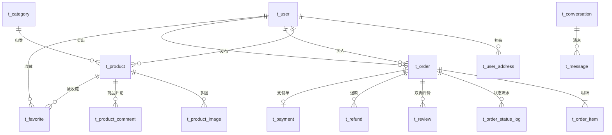
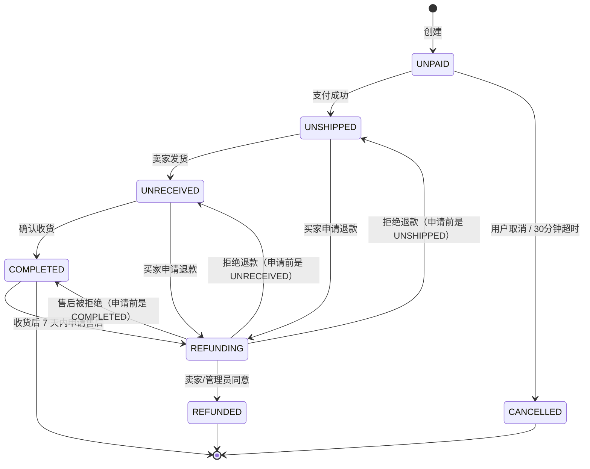

# 晴川二手市场 · 数据库设计文档

| 项 | 内容 |
|---|---|
| 文档编号 | MALL-DOC-02 |
| 版本 | v1.4（一致性审计修补：`t_order.freight_mode/same_city`、`t_product.lock_order_no`、`t_refund.before_status/uk_order`、组合索引、undo_log 收窄到 2 库；详见 §14） |
| 数据库 | MySQL 8.x（InnoDB / utf8mb4 / utf8mb4_general_ci） |
| 分库策略 | 单实例、5 个业务 schema + 1 个 Seata schema（服务数据私有） |
| 配套文档 | `01-总体开发文档.md`、`03-接口设计.md`、`04-前端设计文档.md` |

---

## 1 设计原则

| 原则 | 说明 |
|---|---|
| 一服务一库 | `mall_user` / `mall_product` / `mall_order` / `mall_payment` / `mall_message`，跨库不 JOIN |
| 表名 | `t_` 前缀 + 单数名词（`t_order`、`t_user_address`） |
| 主键 | `id BIGINT UNSIGNED AUTO_INCREMENT`。字段类型与雪花 ID 兼容，后续切分布式 ID 不改表 |
| 审计字段 | 业务主表必有 `create_time`、`update_time`、`deleted`；纯从属表按需（见下方"列白名单"） |
| 金额 | `DECIMAL(10,2)`（上限 99,999,999.99，本平台够用），禁止 `FLOAT/DOUBLE` |
| 枚举 | `VARCHAR(20)` 存英文常量（可读、可索引），中文由前端字典映射；最长取值 `BUYER_TO_SELLER`(15) 也放得下 |
| 时间 | `DATETIME`，应用层统一写 `GMT+8`，不用数据库 `DEFAULT CURRENT_TIMESTAMP`（由 MyBatis-Plus 填充，便于测试）；**SQL 示例里也不要写 `NOW()`**，一律 `#{now}` 传参或字面量 |
| 外键 | **一律不建物理外键**（`FOREIGN KEY`），跨库更不可能建；一致性靠应用层 + 事务保证，§2 的 ER 图只表达逻辑关系 |
| 快照 | 跨服务展示所需字段在下单时冗余进 `t_order_item`（商品标题/封面/价格），避免跨库查询 |
| 索引 | 外键列必建索引；组合索引遵循最左前缀；单表二级索引 ≤ 5 个 |
| 字符集 | 统一 `utf8mb4`，排序规则 `utf8mb4_general_ci` |

> **列白名单：哪些表故意没有 `update_time` 或 `deleted`**（不是漏写，别照着"每表必有"去补）
>
> | 表 | 缺字段 | 理由 |
> |---|---|---|
> | `t_product_image` | `update_time`、`deleted` | 图片只随商品整体增删，行本身永不更新；换图=删旧插新 |
> | `t_favorite` | `update_time`、`deleted` | 收藏是可撤销的布尔关系，取消即物理删除；不需要软删留证 |
> | `t_order_item` | `update_time`、`deleted` | 下单时一次写入的快照，之后只读 |
> | `t_order_status_log` | `update_time`、`deleted` | 追加型流水，只增不改不删（审计证据） |
> | `t_review` | `update_time` | 评价不可修改（`01 §BR`），只有 `reply` 会写入；要留痕就看 `reply_time` |
> | `t_refund` | `deleted` | 退款单不做软删，终态由 `status` 表达 |
> | `t_mq_local_msg` | `deleted` | 本地消息表只按 `status` 流转 |
> | `t_payment` | `deleted` | 支付单是不可删的凭证 |
> | `t_conversation` | `deleted` | 会话永不删（否则消息成孤儿），"删除会话"只清前端列表 |
> | `t_notice` | `update_time`、`deleted` | 只读通知，`read_flag` 是唯一可变位 |
>
> 反过来，**MyBatis-Plus 基类**只给主表用（`BaseEntity` 带三个字段）；上表里的从属表各自写实体，不继承带 `updateTime` 的基类，避免 `INSERT` 报 `Unknown column 'update_time'`。

---

## 2 库表总览



> ER 图只表达**逻辑关系**：所有表都没有物理外键；`t_order ||--o| t_payment` 是**跨库**关联（`mall_order` 与 `mall_payment`），实际靠 `order_no` 字符串对应，不是同库 JOIN。`t_user` 与 `t_order` 两条边分别表示"我买的"（`buyer_id`）和"我卖的"（`seller_id`）。

| 库 | 表 | 归属服务 | 说明 |
|---|---|---|---|
| mall_user | t_user | mall-user | 账号 + 资料 + 地区 + 签名 |
| mall_user | t_user_address | mall-user | 收货地址（省市区三级） |
| mall_product | t_category | mall-product | 分类树（管理员维护） |
| mall_product | t_product | mall-product | 商品（含草稿态） |
| mall_product | t_product_image | mall-product | 商品图 |
| mall_product | t_product_comment | mall-product | 商品评论区 |
| mall_product | t_favorite | mall-product | 收藏 |
| mall_order | t_order | mall-order | 订单 |
| mall_order | t_order_item | mall-order | 订单明细（快照） |
| mall_order | t_order_status_log | mall-order | 状态流水 |
| mall_order | t_review | mall-order | 双向评价（买卖各一条） |
| mall_order | t_refund | mall-order | 退款单 |
| mall_order | t_mq_local_msg | mall-order | 本地消息表（预留） |
| mall_payment | t_payment | mall-payment | 支付单（模拟支付 + 退款状态） |
| mall_message | t_conversation | mall-message | 会话 |
| mall_message | t_message | mall-message | 消息 |
| mall_message | t_notice | mall-message | 系统通知 |
| mall_product / mall_order | undo_log | Seata AT | 分支事务回滚日志（只有参与全局事务的两库要建，见 §9.1） |
| mall_seata | global_table / branch_table / lock_table / distributed_lock / vgroup_table | Seata Server | 官方脚本导入（本机已导入） |

> 共 **17 张业务表**。相比 v1.0 去掉了 `t_cart`（无购物车）、`t_wallet` / `t_wallet_flow`（无钱包）、`t_product_audit`（不审核），新增 `t_product_comment`（商品评论区）。

---

## 3 建库脚本

```sql
-- sql/01-schema.sql
CREATE DATABASE IF NOT EXISTS `mall_user`    DEFAULT CHARACTER SET utf8mb4 COLLATE utf8mb4_general_ci;
CREATE DATABASE IF NOT EXISTS `mall_product` DEFAULT CHARACTER SET utf8mb4 COLLATE utf8mb4_general_ci;
CREATE DATABASE IF NOT EXISTS `mall_order`   DEFAULT CHARACTER SET utf8mb4 COLLATE utf8mb4_general_ci;
CREATE DATABASE IF NOT EXISTS `mall_payment` DEFAULT CHARACTER SET utf8mb4 COLLATE utf8mb4_general_ci;
CREATE DATABASE IF NOT EXISTS `mall_message` DEFAULT CHARACTER SET utf8mb4 COLLATE utf8mb4_general_ci;
CREATE DATABASE IF NOT EXISTS `mall_seata`   DEFAULT CHARACTER SET utf8mb4 COLLATE utf8mb4_general_ci;

-- 应用账号（最小权限，仅业务库 DML）
CREATE USER IF NOT EXISTS 'mall_app'@'localhost' IDENTIFIED BY 'Mall@2026';
GRANT SELECT, INSERT, UPDATE, DELETE ON `mall_user`.*    TO 'mall_app'@'localhost';
GRANT SELECT, INSERT, UPDATE, DELETE ON `mall_product`.* TO 'mall_app'@'localhost';
GRANT SELECT, INSERT, UPDATE, DELETE ON `mall_order`.*   TO 'mall_app'@'localhost';
GRANT SELECT, INSERT, UPDATE, DELETE ON `mall_payment`.* TO 'mall_app'@'localhost';
GRANT SELECT, INSERT, UPDATE, DELETE ON `mall_message`.* TO 'mall_app'@'localhost';
-- Seata Server 在 store.mode=db 时用该账号读写全局事务表（见 01 文档附录 D.2）
GRANT SELECT, INSERT, UPDATE, DELETE ON `mall_seata`.*   TO 'mall_app'@'localhost';
FLUSH PRIVILEGES;
```

> Seata 2.5.0 的 `mall_seata` 表用官方脚本导入：`seata-server/script/server/db/mysql.sql`，实际建 **5 张**：`global_table`、`branch_table`、`lock_table`、`distributed_lock`、`vgroup_table`（2.5.0 新增分组表）。

> **本机已执行（2026-10-26）**：`mall_seata` 库已建、`mall_app`/`Mall@2026` 已授权、官方脚本已导入（5 张表）；Seata 以 `store.mode=db` 启动并注册进 Nacos `SEATA_GROUP`，`mall_app` 有 6 个连接挂在 `mall_seata`。下文 5 个业务库（`mall_user`/`mall_product`/`mall_order`/`mall_payment`/`mall_message`）**尚未建**，属代码阶段第 4 步。

> 生产环境账号密码放 Nacos，不写进代码/脚本库；上例仅本地开发。

---

## 4 mall_user（用户库）

### 4.1 t_user 用户表

| 字段 | 类型 | 允许空 | 默认 | 说明 |
|---|---|---|---|---|
| id | bigint unsigned | N | — | 主键 |
| username | varchar(32) | N | — | 登录名，唯一 |
| password | varchar(100) | N | — | BCrypt 密文 |
| nickname | varchar(32) | N | — | 昵称，注册时默认取 username |
| avatar | varchar(255) | N | '' | 头像 URL（**注册必填**，先调 A8 上传再提交） |
| phone | varchar(20) | Y | NULL | 手机号（脱敏展示） |
| email | varchar(64) | N | — | 邮箱，唯一，**注册必填**，可作为登录账号 |
| gender | tinyint | N | 0 | 0 未知 / 1 男 / 2 女 |
| province | varchar(32) | Y | NULL | 常驻地-省 |
| city | varchar(32) | Y | NULL | 常驻地-市（"同城"筛选与卖家卡片城市展示） |
| district | varchar(32) | Y | NULL | 常驻地-区/县 |
| signature | varchar(200) | Y | NULL | 个性签名（"我的"页面卡片） |
| credit_score | int | N | 100 | 信用分（0~150） |
| role | varchar(16) | N | USER | `USER` / `ADMIN` / `SUPER_ADMIN`（只能由 U17 提升，注册永远 USER） |
| status | varchar(16) | N | NORMAL | `NORMAL` / `BANNED`（封禁时配合 `ban_until`） |
| ban_until | datetime | Y | NULL | 封禁解封时间，`9999-12-31 23:59:59` 表示永久 |
| ban_reason | varchar(200) | Y | NULL | 封禁原因（弹窗与后台展示，可空） |
| can_publish | tinyint | N | 1 | 1 可上架 / 0 被限制上架 |
| publish_ban_until | datetime | Y | NULL | 上架权限解禁时间，`9999-12-31 23:59:59` 表示永久 |
| token_version | int | N | 0 | 令牌版本（封禁/解封/改角色时 +1，旧 JWT 立即失效） |
| last_login_time | datetime | Y | NULL | 最后登录 |
| create_time | datetime | N | — | |
| update_time | datetime | N | — | |
| deleted | tinyint | N | 0 | 0 正常 / 1 删除 |

```sql
CREATE TABLE `t_user` (
  `id`                bigint unsigned NOT NULL AUTO_INCREMENT COMMENT '主键',
  `username`          varchar(32)  NOT NULL COMMENT '登录名',
  `password`          varchar(100) NOT NULL COMMENT 'BCrypt 密文',
  `nickname`          varchar(32)  NOT NULL COMMENT '昵称',
  `avatar`            varchar(255) NOT NULL DEFAULT '' COMMENT '头像URL（注册必填）',
  `phone`             varchar(20)           DEFAULT NULL COMMENT '手机号',
  `email`             varchar(64)  NOT NULL COMMENT '邮箱（登录账号之一）',
  `gender`            tinyint      NOT NULL DEFAULT 0 COMMENT '0未知 1男 2女',
  `province`          varchar(32)           DEFAULT NULL COMMENT '常驻省',
  `city`              varchar(32)           DEFAULT NULL COMMENT '常驻市',
  `district`          varchar(32)           DEFAULT NULL COMMENT '常驻区县',
  `signature`         varchar(200)          DEFAULT NULL COMMENT '个性签名',
  `credit_score`      int          NOT NULL DEFAULT 100 COMMENT '信用分',
  `role`              varchar(16)  NOT NULL DEFAULT 'USER' COMMENT 'USER/ADMIN/SUPER_ADMIN',
  `status`            varchar(16)  NOT NULL DEFAULT 'NORMAL' COMMENT 'NORMAL/BANNED',
  `ban_until`         datetime              DEFAULT NULL COMMENT '封禁解封时间，9999-12-31 23:59:59=永久',
  `ban_reason`        varchar(200)          DEFAULT NULL COMMENT '封禁原因',
  `can_publish`       tinyint      NOT NULL DEFAULT 1 COMMENT '1可上架 0被限制上架',
  `publish_ban_until` datetime              DEFAULT NULL COMMENT '上架权限解禁时间，9999=永久',
  `token_version`     int          NOT NULL DEFAULT 0 COMMENT '令牌版本，封禁/改角色时+1',
  `last_login_time`   datetime              DEFAULT NULL COMMENT '最后登录时间',
  `create_time`       datetime     NOT NULL COMMENT '创建时间',
  `update_time`       datetime     NOT NULL COMMENT '更新时间',
  `deleted`           tinyint      NOT NULL DEFAULT 0 COMMENT '0正常 1删除',
  PRIMARY KEY (`id`),
  UNIQUE KEY `uk_username` (`username`),
  UNIQUE KEY `uk_email` (`email`),
  KEY `idx_status` (`status`),
  KEY `idx_role` (`role`)
) ENGINE=InnoDB DEFAULT CHARSET=utf8mb4 COMMENT='用户表';
```

> **索引取舍**：`idx_phone`、`idx_city` 已删——手机号全文无精确查询（后台 `keyword` 是 `LIKE '%kw%'`，前缀索引也帮不上），城市筛选用的是 `t_product.city` 而不是用户城市；留着只会拖慢写入。
> **唯一键 + 软删的坑**：`uk_username`/`uk_email` 遇到 `deleted=1` 仍占位，v1 **不做账号注销**（`01 §13.9` 列为演进），所以不冲突；真要做注销时得把 `email` 改写为 `deleted_{id}@qingchuan.local` 之类，或在唯一键里带上 `deleted`（MySQL 里 `UNIQUE(username, deleted)` 会被多行 `deleted=1` 卡住，需用"注销即改写用户名"的方案）。

> **账号治理字段说明**（谁改、何时改）：
>
> | 字段 | 写入方 | 触发场景 |
> |---|---|---|
> | `role` | U17 设置角色（仅 SUPER_ADMIN） | 普通用户 ↔ 普通管理员；**禁止**把任何人设为 `SUPER_ADMIN`，也禁止改动 `SUPER_ADMIN` 本身（返回 20008） |
> | `status` / `ban_until` / `ban_reason` | U14 封禁 / U15 解封 | 封禁：`status='BANNED'`、`ban_until=指定时间或 9999-12-31 23:59:59`、`token_version+1`、写 Redis `mall:user:banned:{id}`、推 WS `KICKED`；解封：`status='NORMAL'`、清 `ban_until`、`token_version+1`、删封禁标记 |
> | `can_publish` / `publish_ban_until` | U16 设置上架权限 | 限制：`can_publish=0`、`publish_ban_until=指定时间或 9999`；恢复：`can_publish=1`、清空时间 |
> | `token_version` | 上述三个接口 | 每次自增，网关比对 Redis 缓存，旧 token 全部失效 → 在线用户被强制下线 |
>
> `ban_until` 与 `publish_ban_until` 都是"到期即自动失效"的语义：定时任务每小时扫一次 `status='BANNED' AND ban_until <= NOW()` 自动改回 `NORMAL`，以及 `can_publish=0 AND publish_ban_until <= NOW()` 自动改回 `1`；登录与上架时再做一次即时判断，防止定时任务未跑到。

### 4.2 t_user_address 收货地址表

| 字段 | 类型 | 说明 |
|---|---|---|
| id | bigint unsigned | 主键 |
| user_id | bigint unsigned | 归属用户 |
| receiver | varchar(32) | 收货人 |
| phone | varchar(20) | 联系电话 |
| province | varchar(32) | 省（Cascader 第一级） |
| city | varchar(32) | 市（Cascader 第二级，运费判定用） |
| district | varchar(32) | 区/县（Cascader 第三级） |
| detail | varchar(255) | 详细地址（楼栋/门牌） |
| is_default | tinyint | 1 默认地址 |
| create_time / update_time / deleted | — | 审计 + 逻辑删除 |

```sql
CREATE TABLE `t_user_address` (
  `id`          bigint unsigned NOT NULL AUTO_INCREMENT,
  `user_id`     bigint unsigned NOT NULL COMMENT '用户ID',
  `receiver`    varchar(32)  NOT NULL COMMENT '收货人',
  `phone`       varchar(20)  NOT NULL COMMENT '联系电话',
  `province`    varchar(32)  NOT NULL COMMENT '省',
  `city`        varchar(32)  NOT NULL COMMENT '市',
  `district`    varchar(32)  NOT NULL COMMENT '区县',
  `detail`      varchar(255) NOT NULL COMMENT '详细地址',
  `is_default`  tinyint      NOT NULL DEFAULT 0 COMMENT '是否默认',
  `create_time` datetime     NOT NULL,
  `update_time` datetime     NOT NULL,
  `deleted`     tinyint      NOT NULL DEFAULT 0,
  PRIMARY KEY (`id`),
  KEY `idx_user` (`user_id`)
) ENGINE=InnoDB DEFAULT CHARSET=utf8mb4 COMMENT='收货地址表';
```

> 每个用户最多 10 条地址由业务层限制。省的"同城"判定发生在 `mall-order`：`address.city = product.city` → 同城运费 5 元，否则 10 元（见 §5.2 `freight_mode`）。

> 默认地址唯一性由业务保证：设置默认时先 `UPDATE ... SET is_default=0 WHERE user_id=?`。

---

## 5 mall_product（商品库）

### 5.1 t_category 分类表（树形）

```sql
CREATE TABLE `t_category` (
  `id`          bigint unsigned NOT NULL AUTO_INCREMENT,
  `parent_id`   bigint unsigned NOT NULL DEFAULT 0 COMMENT '父分类，0为顶级',
  `name`        varchar(32)  NOT NULL COMMENT '分类名',
  `icon`        varchar(255)          DEFAULT NULL COMMENT '图标',
  `sort`        int          NOT NULL DEFAULT 0 COMMENT '排序值，越小越前',
  `status`      tinyint      NOT NULL DEFAULT 1 COMMENT '1启用 0停用',
  `create_time` datetime     NOT NULL,
  `update_time` datetime     NOT NULL,
  `deleted`     tinyint      NOT NULL DEFAULT 0,
  PRIMARY KEY (`id`),
  UNIQUE KEY `uk_parent_name` (`parent_id`, `name`, `deleted`),
  KEY `idx_parent` (`parent_id`)
) ENGINE=InnoDB DEFAULT CHARSET=utf8mb4 COMMENT='商品分类表';
```

> **同级同名用唯一键挡**（P20/P21「同级不能重名」），不要只靠"先查再插"——两个管理员同时建"手机"就两条了。
> `deleted` 进唯一键是为了让删掉的名字还能再用（软删后 `deleted=1`，同名新分类 `deleted=0` 不冲突）；代价是同一名字最多软删一次，删第二次会撞键，此时业务上直接把旧行物理删除即可（分类删除很轻）。

### 5.2 t_product 商品表

| 字段 | 类型 | 说明 |
|---|---|---|
| id | bigint unsigned | 主键 |
| seller_id | bigint unsigned | 卖家 |
| category_id | bigint unsigned | 分类 |
| title | varchar(100) | 标题 |
| description | text | 描述（纯文本） |
| price | decimal(10,2) | 售价 |
| original_price | decimal(10,2) | 原价（参考） |
| condition_level | tinyint | 成色 1~10（10 全新） |
| cover_url | varchar(255) | 封面图 |
| province | varchar(32) | 发货地-省 |
| city | varchar(32) | 发货地-市（"同城"筛选 / 运费判定） |
| district | varchar(32) | 发货地-区县 |
| freight_mode | varchar(16) | FREE_SHIPPING 包邮 / DISTANCE 按距离估邮费 / SELF_PICKUP 仅自提 |
| status | varchar(20) | DRAFT 草稿 / ON_SALE 在售 / LOCKED 下单锁定 / SOLD 已售出 / OFF_SHELF 已下架 |
| lock_order_no | varchar(32) | 锁定该商品的订单号（`LOCKED` 时写，扣库存幂等 + 超时回补） |
| off_shelf_reason | varchar(200) | 下架原因（本人下架 / 管理员强制下架），前端"商品被下架"提示与后台审计用 |
| view_count | int | 浏览量 |
| favorite_count | int | 收藏数 |
| comment_count | int | 评论数 |
| stock | int | 库存，二手恒为 1 |
| sold_time | datetime | 售出时间 |
| version | int | 乐观锁版本 |

> **不设 `freight` 金额列**：运费规则是全局固定的（同城 5 元、跨城 10 元，见 §5.2 说明），下单时由 `mall-order` 依据"买家地址城市 vs 商品城市"算出并快照进 `t_order.freight`。商品只需记录 **收不收运费**（`freight_mode`）。

```sql
CREATE TABLE `t_product` (
  `id`              bigint unsigned NOT NULL AUTO_INCREMENT,
  `seller_id`       bigint unsigned NOT NULL COMMENT '卖家ID',
  `category_id`     bigint unsigned NOT NULL COMMENT '分类ID',
  `title`           varchar(100) NOT NULL COMMENT '标题',
  `description`     text COMMENT '描述',
  `price`           decimal(10,2) NOT NULL COMMENT '售价',
  `original_price`  decimal(10,2) DEFAULT NULL COMMENT '原价',
  `condition_level` tinyint      NOT NULL DEFAULT 9 COMMENT '成色1-10',
  `cover_url`       varchar(255) NOT NULL COMMENT '封面图',
  `province`        varchar(32)  NOT NULL COMMENT '发货地-省',
  `city`            varchar(32)  NOT NULL COMMENT '发货地-市',
  `district`        varchar(32)  NOT NULL COMMENT '发货地-区县',
  `freight_mode`    varchar(16)  NOT NULL DEFAULT 'DISTANCE' COMMENT 'FREE_SHIPPING/DISTANCE/SELF_PICKUP',
  `status`          varchar(20)  NOT NULL DEFAULT 'ON_SALE' COMMENT 'DRAFT/ON_SALE/LOCKED/SOLD/OFF_SHELF',
  `lock_order_no`   varchar(32)  DEFAULT NULL COMMENT '锁定该商品的订单号（LOCKED 时写入，用于扣库存幂等与超时回补）',
  `off_shelf_reason` varchar(200) DEFAULT NULL COMMENT '下架原因（本人下架或管理员强制下架，用于审计与通知卖家）',
  `view_count`      int          NOT NULL DEFAULT 0 COMMENT '浏览量',
  `favorite_count`  int          NOT NULL DEFAULT 0 COMMENT '收藏数（P15/P16 同事务 ±1）',
  `comment_count`   int          NOT NULL DEFAULT 0 COMMENT '评论数',
  `stock`           int          NOT NULL DEFAULT 1 COMMENT '库存（一件一单，恒为1；扣减即置0，回补置1）',
  `sold_time`       datetime     DEFAULT NULL COMMENT '售出时间（置 SOLD 时写）',
  `version`         int          NOT NULL DEFAULT 0 COMMENT '乐观锁版本',
  `create_time`     datetime     NOT NULL,
  `update_time`     datetime     NOT NULL,
  `deleted`         tinyint      NOT NULL DEFAULT 0,
  PRIMARY KEY (`id`),
  KEY `idx_cat_status` (`category_id`, `status`, `create_time`),
  KEY `idx_seller` (`seller_id`, `status`),
  KEY `idx_status_create` (`status`, `create_time`),
  KEY `idx_status_city_time` (`status`, `city`, `create_time`),
  KEY `idx_price` (`price`)
) ENGINE=InnoDB DEFAULT CHARSET=utf8mb4 COMMENT='商品表';
```

> `idx_status_city` 被 `idx_status_city_time` 取代（首页同城筛选要按时间排，两列索引会 filesort）；`sort=hot` 走 `view_count + favorite_count*3` 只能 filesort，数据量大时再上 ES（§13 演进已列），课程项目量级可接受。

**运费规则（写死在 `mall-order` 的 `FreightCalculator`，不建配置表）**

| freight_mode | 同城（买家 city = 商品 city） | 跨城 | 仅自提 |
|---|---|---|---|
| FREE_SHIPPING 包邮 | 0.00 | 0.00 | — |
| DISTANCE 按距离估 | 5.00 | 10.00 | — |
| SELF_PICKUP 仅自提 | 0.00（不走物流） | 不允许跨城自提，前端提示 | — |


**防超卖 SQL（L3 最终防线）**

```sql
UPDATE t_product
   SET status = 'LOCKED', stock = 0, lock_order_no = #{orderNo},
       version = version + 1, update_time = #{now}
 WHERE id = #{id} AND status = 'ON_SALE' AND version = #{version} AND deleted = 0
   AND (lock_order_no IS NULL OR lock_order_no = #{orderNo});
-- 影响行数 = 0 → 已被抢走，返回 30002
-- lock_order_no 让「同一订单重复扣减」幂等：Seata 分支重试时不会被误判成超卖
```

> 回补：`UPDATE t_product SET status='ON_SALE', stock=1, lock_order_no=NULL WHERE lock_order_no=#{orderNo} AND status='LOCKED'`（订单取消/超时/未发货退款时调用，天然幂等）。
> 时间字段由 MyBatis-Plus 填充 `#{now}`（GMT+8），**不要用数据库 `NOW()`**——与 §1 的"时间由应用写入"约定保持一致，避免服务器时区为 UTC 时整体差 8 小时。

### 5.3 t_product_image 商品图片

```sql
CREATE TABLE `t_product_image` (
  `id`          bigint unsigned NOT NULL AUTO_INCREMENT,
  `product_id`  bigint unsigned NOT NULL,
  `url`         varchar(255) NOT NULL COMMENT '图片地址',
  `sort`        int          NOT NULL DEFAULT 0,
  `create_time` datetime     NOT NULL,
  PRIMARY KEY (`id`),
  KEY `idx_product` (`product_id`)
) ENGINE=InnoDB DEFAULT CHARSET=utf8mb4 COMMENT='商品图片表';
```

### 5.4 t_product_comment 商品评论

商品详情页的评论区，**任何登录用户都能评**，不要求买过（与订单评价 `t_review` 是两回事，后者才计入卖家评分）。

| 字段 | 类型 | 说明 |
|---|---|---|
| id | bigint unsigned | 主键 |
| product_id | bigint unsigned | 商品 |
| user_id | bigint unsigned | 评论人 |
| parent_id | bigint unsigned | 回复的父评论 id，0 为一级评论 |
| content | varchar(500) | 评论内容 |
| images | json | 图片 URL 数组（最多 3 张） |
| status | tinyint | 1 正常 / 0 隐藏（管理员或本人删除后置 0） |
| create_time | datetime | |
| deleted | tinyint | 逻辑删除 |

```sql
CREATE TABLE `t_product_comment` (
  `id`          bigint unsigned NOT NULL AUTO_INCREMENT,
  `product_id`  bigint unsigned NOT NULL COMMENT '商品ID',
  `user_id`     bigint unsigned NOT NULL COMMENT '评论人',
  `parent_id`   bigint unsigned NOT NULL DEFAULT 0 COMMENT '父评论ID，0为一级',
  `content`     varchar(500) NOT NULL COMMENT '评论内容',
  `images`      json          DEFAULT NULL COMMENT '图片URL数组',
  `status`      tinyint       NOT NULL DEFAULT 1 COMMENT '1正常 0被管理员隐藏（不删除，仅前台不展示）',
  `create_time` datetime      NOT NULL,
  `update_time` datetime      NOT NULL COMMENT '至少管理员隐藏时更新',
  `deleted`     tinyint       NOT NULL DEFAULT 0 COMMENT '1=已删除（本人或管理员物理删除的软标记），查询必须同时带 status=1 AND deleted=0',
  PRIMARY KEY (`id`),
  KEY `idx_product_time` (`product_id`, `parent_id`, `create_time`),
  KEY `idx_user` (`user_id`)
) ENGINE=InnoDB DEFAULT CHARSET=utf8mb4 COMMENT='商品评论表';
```

> **两个标记各管一件事，别混用**：`deleted=1` 是"评论被删了"（`comment_count` 同步 -1，任何人都不再看到）；`status=0` 是"管理员隐藏了违规内容"（记录仍在、`comment_count` **不减**，只是前台过滤）。
> 所有列表 SQL 统一 `WHERE product_id=? AND parent_id=? AND status=1 AND deleted=0 ORDER BY create_time DESC`，少一个条件就会漏内容或露出违规内容。
> 评论数由 `t_product.comment_count` 冗余（新增 +1、删除 -1，同事务内用 `UPDATE ... SET comment_count = comment_count + 1`），避免详情页每次 `COUNT(*)`。

### 5.5 t_favorite 收藏

```sql
CREATE TABLE `t_favorite` (
  `id`          bigint unsigned NOT NULL AUTO_INCREMENT,
  `user_id`     bigint unsigned NOT NULL,
  `product_id`  bigint unsigned NOT NULL,
  `create_time` datetime     NOT NULL,
  PRIMARY KEY (`id`),
  UNIQUE KEY `uk_user_product` (`user_id`, `product_id`),
  KEY `idx_product` (`product_id`)
) ENGINE=InnoDB DEFAULT CHARSET=utf8mb4 COMMENT='收藏表';
```

---

## 6 mall_order（订单库）

### 6.1 t_order 订单表

| 字段 | 类型 | 说明 |
|---|---|---|
| id | bigint unsigned | 主键 |
| order_no | varchar(32) | 业务单号（唯一） |
| buyer_id | bigint unsigned | 买家 |
| seller_id | bigint unsigned | 卖家 |
| product_id | bigint unsigned | 商品（冗余，便于查询） |
| total_amount | decimal(10,2) | 商品总额 |
| freight | decimal(10,2) | 运费：包邮/自提 0、同城 5、跨城 10（下单时快照） |
| freight_mode | varchar(16) | **运费方式快照** `FREE_SHIPPING`/`DISTANCE`/`SELF_PICKUP`（商品改价或删除后订单仍要能解释运费怎么算的） |
| same_city | tinyint | **同城快照** 1 同城 / 0 跨城（取自下单时的商品城市与收货城市，商品城市被改也不影响历史订单） |
| pay_amount | decimal(10,2) | 应付 = 总额 + 运费 |
| status | varchar(20) | UNPAID / UNSHIPPED / UNRECEIVED / COMPLETED / CANCELLED / REFUNDING / REFUNDED |
| pay_type | varchar(16) | MOCK（模拟支付，v1 唯一渠道） |
| pay_time / ship_time / receive_time / finish_time / cancel_time | datetime | 各节点时间 |
| cancel_reason | varchar(255) | |
| logistics_no | varchar(64) | 物流单号 |
| remark | varchar(255) | 买家留言 |
| address_snapshot | json | 下单时地址快照 |
| buyer_reviewed | tinyint | 买家是否已评价（双向互评之一） |
| seller_reviewed | tinyint | 卖家是否已评价（双向互评之二） |
| version | int | 乐观锁 |

```sql
CREATE TABLE `t_order` (
  `id`               bigint unsigned NOT NULL AUTO_INCREMENT,
  `order_no`         varchar(32)  NOT NULL COMMENT '业务单号',
  `buyer_id`         bigint unsigned NOT NULL COMMENT '买家',
  `seller_id`        bigint unsigned NOT NULL COMMENT '卖家',
  `product_id`       bigint unsigned NOT NULL COMMENT '商品ID',
  `total_amount`     decimal(10,2) NOT NULL COMMENT '商品总额',
  `freight`          decimal(10,2) NOT NULL DEFAULT 0.00 COMMENT '运费',
  `freight_mode`     varchar(16)  NOT NULL DEFAULT 'DISTANCE' COMMENT '运费方式快照 FREE_SHIPPING/DISTANCE/SELF_PICKUP',
  `same_city`        tinyint      NOT NULL DEFAULT 0 COMMENT '同城快照 1是 0否',
  `pay_amount`       decimal(10,2) NOT NULL COMMENT '应付金额',
  `status`           varchar(20)  NOT NULL DEFAULT 'UNPAID' COMMENT '订单状态',
  `pay_type`         varchar(16)  DEFAULT NULL COMMENT 'MOCK 模拟支付',
  `pay_time`         datetime     DEFAULT NULL,
  `ship_time`        datetime     DEFAULT NULL,
  `receive_time`     datetime     DEFAULT NULL,
  `finish_time`      datetime     DEFAULT NULL,
  `cancel_time`      datetime     DEFAULT NULL,
  `cancel_reason`    varchar(255) DEFAULT NULL,
  `logistics_no`     varchar(64)  DEFAULT NULL,
  `remark`           varchar(255) DEFAULT NULL COMMENT '买家留言',
  `address_snapshot` json         DEFAULT NULL COMMENT '地址快照',
  `buyer_reviewed`   tinyint      NOT NULL DEFAULT 0 COMMENT '买家已评价',
  `seller_reviewed`  tinyint      NOT NULL DEFAULT 0 COMMENT '卖家已评价',
  `version`          int          NOT NULL DEFAULT 0,
  `create_time`      datetime     NOT NULL,
  `update_time`      datetime     NOT NULL,
  `deleted`          tinyint      NOT NULL DEFAULT 0,
  PRIMARY KEY (`id`),
  UNIQUE KEY `uk_order_no` (`order_no`),
  KEY `idx_buyer_status` (`buyer_id`, `status`, `create_time`),
  KEY `idx_seller_status` (`seller_id`, `status`, `create_time`),
  KEY `idx_status_create` (`status`, `create_time`),
  KEY `idx_product` (`product_id`),
  KEY `idx_create` (`create_time`)
) ENGINE=InnoDB DEFAULT CHARSET=utf8mb4 COMMENT='订单表';
```

**订单状态机**



### 6.2 t_order_item 订单明细（快照）

```sql
CREATE TABLE `t_order_item` (
  `id`            bigint unsigned NOT NULL AUTO_INCREMENT,
  `order_id`      bigint unsigned NOT NULL,
  `product_id`    bigint unsigned NOT NULL,
  `product_title` varchar(100) NOT NULL COMMENT '下单时标题快照',
  `product_cover` varchar(255) NOT NULL COMMENT '下单时封面快照',
  `price`         decimal(10,2) NOT NULL COMMENT '下单时单价',
  `quantity`      int          NOT NULL DEFAULT 1,
  `create_time`   datetime     NOT NULL,
  PRIMARY KEY (`id`),
  KEY `idx_order` (`order_id`)
) ENGINE=InnoDB DEFAULT CHARSET=utf8mb4 COMMENT='订单明细表';
```

### 6.3 t_order_status_log 状态流水

```sql
CREATE TABLE `t_order_status_log` (
  `id`            bigint unsigned NOT NULL AUTO_INCREMENT,
  `order_id`      bigint unsigned NOT NULL,
  `from_status`   varchar(20)  DEFAULT NULL,
  `to_status`     varchar(20)  NOT NULL,
  `operator_id`   bigint unsigned DEFAULT NULL,
  `operator_type` varchar(16)  NOT NULL COMMENT 'BUYER/SELLER/ADMIN/SYSTEM',
  `remark`        varchar(255) DEFAULT NULL,
  `create_time`   datetime     NOT NULL,
  PRIMARY KEY (`id`),
  KEY `idx_order` (`order_id`)
) ENGINE=InnoDB DEFAULT CHARSET=utf8mb4 COMMENT='订单状态流水表';
```

### 6.4 t_review 双向评价

一个订单最多 **2 条**：买家评卖家、卖家评买家，各一条，用 `direction` 区分。卖家/买家的"评分"只取对方评价自己的那一半（`direction = BUYER_TO_SELLER` 的 `rating` 平均）。

| 字段 | 类型 | 说明 |
|---|---|---|
| id | bigint unsigned | 主键 |
| order_id | bigint unsigned | 订单 |
| product_id | bigint unsigned | 商品 |
| direction | varchar(20) | BUYER_TO_SELLER 买家评卖家 / SELLER_TO_BUYER 卖家评买家 |
| reviewer_id | bigint unsigned | 评价人 |
| reviewee_id | bigint unsigned | 被评价人 |
| rating | tinyint | 1~5 星 |
| content | varchar(500) | 评价内容 |
| images | json | 图片 URL 数组（最多 3 张） |
| anonymous | tinyint | 匿名评价 |
| reply | varchar(500) | 被评价方回复（可选） |
| reply_time | datetime | 回复时间 |

```sql
CREATE TABLE `t_review` (
  `id`           bigint unsigned NOT NULL AUTO_INCREMENT,
  `order_id`     bigint unsigned NOT NULL,
  `product_id`   bigint unsigned NOT NULL,
  `direction`    varchar(20)  NOT NULL COMMENT 'BUYER_TO_SELLER/SELLER_TO_BUYER',
  `reviewer_id`  bigint unsigned NOT NULL COMMENT '评价人',
  `reviewee_id`  bigint unsigned NOT NULL COMMENT '被评价人',
  `rating`       tinyint      NOT NULL COMMENT '1-5星',
  `content`      varchar(500) DEFAULT NULL,
  `images`       json         DEFAULT NULL COMMENT '图片URL数组',
  `anonymous`    tinyint      NOT NULL DEFAULT 0,
  `reply`        varchar(500) DEFAULT NULL COMMENT '被评价方回复',
  `reply_time`   datetime     DEFAULT NULL,
  `create_time`  datetime     NOT NULL,
  `deleted`      tinyint      NOT NULL DEFAULT 0,
  PRIMARY KEY (`id`),
  UNIQUE KEY `uk_order_direction` (`order_id`, `direction`),
  KEY `idx_reviewee` (`reviewee_id`, `direction`),
  KEY `idx_reviewer` (`reviewer_id`),
  KEY `idx_product_time` (`product_id`, `create_time`)
) ENGINE=InnoDB DEFAULT CHARSET=utf8mb4 COMMENT='双向评价表';
```

> 索引对应三个查询：`idx_reviewee` → 卖家主页平均分与评价列表（O11）、`idx_reviewer` → "我的评价-我发出的"（O9 `role=sent`）、`idx_product_time` → 商品评价列表（O10，按时间倒序）。

> 卖家平均分计算（卖家主页 / 卖家卡片）：
> `SELECT ROUND(AVG(rating),2), COUNT(*) FROM t_review WHERE reviewee_id = ? AND direction = 'BUYER_TO_SELLER' AND deleted = 0`。
> 评价结果落 `mall_user` 的 `credit_score`（可选扩展），需要跨服务则走 MQ `mall-review-created` 异步更新。

### 6.5 t_refund 退款单

```sql
CREATE TABLE `t_refund` (
  `id`            bigint unsigned NOT NULL AUTO_INCREMENT,
  `refund_no`     varchar(32)  NOT NULL COMMENT '退款单号',
  `order_id`      bigint unsigned NOT NULL,
  `buyer_id`      bigint unsigned NOT NULL,
  `seller_id`     bigint unsigned NOT NULL,
  `amount`        decimal(10,2) NOT NULL,
  `reason`        varchar(255) NOT NULL,
  `status`        varchar(16)  NOT NULL DEFAULT 'APPLYING' COMMENT 'APPLYING/AGREED/REJECTED/REFUNDED/CLOSED',
  `before_status` varchar(20)  NOT NULL COMMENT '申请前订单状态（UNSHIPPED/UNRECEIVED/COMPLETED），拒绝时按它回退',
  `apply_time`    datetime     NOT NULL,
  `handle_time`   datetime     DEFAULT NULL,
  `handler_id`    bigint unsigned DEFAULT NULL,
  `handle_remark` varchar(255) DEFAULT NULL,
  `create_time`   datetime     NOT NULL,
  `update_time`   datetime     NOT NULL,
  PRIMARY KEY (`id`),
  UNIQUE KEY `uk_refund_no` (`refund_no`),
  UNIQUE KEY `uk_order` (`order_id`),
  KEY `idx_buyer_time` (`buyer_id`, `create_time`),
  KEY `idx_seller_time` (`seller_id`, `create_time`)
) ENGINE=InnoDB DEFAULT CHARSET=utf8mb4 COMMENT='退款单表';
```

> `uk_order`：**一个订单只能有一次退款/售后**（不同意后再申请就重复了，但课程项目不做"多轮协商"）。
> 这也顺带保证退款金额不会累加超过 `pay_amount`——提交时用 `uk_order` 撞键直接返回 40007（已申请过），不用先查再插。
> `before_status` 是"拒绝后回退到哪"的唯一依据：申请时把订单当前状态快照进来，`REJECT` 时**回写这个状态**而不是写死 `UNRECEIVED`（否则未发货退款被拒会变成"已发货待收货"）。

### 6.6 t_mq_local_msg 本地消息表（预留，v1 未启用）

```sql
CREATE TABLE `t_mq_local_msg` (
  `id`          bigint unsigned NOT NULL AUTO_INCREMENT,
  `msg_id`      varchar(64)  NOT NULL COMMENT '消息唯一ID',
  `topic`       varchar(64)  NOT NULL,
  `tag`         varchar(64)  DEFAULT NULL,
  `payload`     text         NOT NULL,
  `status`      varchar(16)  NOT NULL DEFAULT 'PENDING' COMMENT 'PENDING/SENT/FAILED',
  `retry_count` int          NOT NULL DEFAULT 0,
  `next_time`   datetime     DEFAULT NULL COMMENT '下次重试时间',
  `create_time` datetime     NOT NULL,
  `update_time` datetime     NOT NULL,
  PRIMARY KEY (`id`),
  UNIQUE KEY `uk_msg_id` (`msg_id`),
  KEY `idx_status_next` (`status`, `next_time`)
) ENGINE=InnoDB DEFAULT CHARSET=utf8mb4 COMMENT='本地消息表（预留）';
```

---

## 7 mall_payment（支付库）

> v1.1 起**不设钱包**：没有余额、充值、冻结、流水。"支付"是一个独立的支付单，用户点"立即支付"后由 `mall-payment` 生成 `MOCK` 渠道支付单并直接置成功（模拟第三方回调），再通过 MQ 通知 `mall-order` 改单。这样既保留了支付域（可替换为支付宝沙箱），又不需要资金账户模型。

### 7.1 t_payment 支付单

| 字段 | 类型 | 说明 |
|---|---|---|
| pay_no | varchar(32) | 支付单号（唯一） |
| order_no | varchar(32) | 关联订单号 |
| user_id | bigint unsigned | 付款人 |
| amount | decimal(10,2) | 支付金额 |
| channel | varchar(16) | MOCK（v1 唯一渠道；预留 ALIPAY/WECHAT） |
| status | varchar(16) | INIT / SUCCESS / FAILED / CLOSED / REFUNDED |
| trade_no | varchar(64) | 第三方交易号（MOCK 时由服务端生成） |
| refund_amount | decimal(10,2) | 已退金额 |
| refund_time | datetime | 退款完成时间 |
| pay_time / close_time | datetime | 支付/关闭时间 |

```sql
CREATE TABLE `t_payment` (
  `id`            bigint unsigned NOT NULL AUTO_INCREMENT,
  `pay_no`        varchar(32)  NOT NULL COMMENT '支付单号',
  `order_no`      varchar(32)  NOT NULL COMMENT '订单号',
  `user_id`       bigint unsigned NOT NULL COMMENT '付款人',
  `amount`        decimal(10,2) NOT NULL COMMENT '支付金额',
  `channel`       varchar(16)  NOT NULL DEFAULT 'MOCK' COMMENT 'MOCK/ALIPAY/WECHAT',
  `status`        varchar(16)  NOT NULL DEFAULT 'INIT' COMMENT 'INIT/SUCCESS/FAILED/CLOSED/REFUNDED',
  `trade_no`      varchar(64)  DEFAULT NULL COMMENT '第三方交易号',
  `refund_amount` decimal(10,2) NOT NULL DEFAULT 0.00 COMMENT '已退金额',
  `refund_time`   datetime     DEFAULT NULL COMMENT '退款时间',
  `pay_time`      datetime     DEFAULT NULL,
  `close_time`    datetime     DEFAULT NULL,
  `create_time`   datetime     NOT NULL,
  `update_time`   datetime     NOT NULL,
  PRIMARY KEY (`id`),
  UNIQUE KEY `uk_pay_no` (`pay_no`),
  UNIQUE KEY `uk_order_no` (`order_no`),
  KEY `idx_user` (`user_id`)
) ENGINE=InnoDB DEFAULT CHARSET=utf8mb4 COMMENT='支付单表';
```

> `uk_order_no` 唯一：一个订单只允许一张支付单，重复点击"支付"直接返回已成功的支付单（幂等）。
> **`close_time` 谁写**：订单超时取消（`mall-order-timeout`）时，`mall-order` 调 `Y7 /inner/payment/close` 把对应支付单 `INIT → CLOSED` 并写 `close_time`；已 `SUCCESS` 的支付单不关（那种情况走退款）。
> **退款幂等不加 `refund_no` 列**：一个订单只退一次，由两层保证——`t_refund.uk_order(order_id)` 挡住重复申请，`t_payment.status` 只能 `SUCCESS → REFUNDED` 单向转换（`UPDATE ... WHERE status='SUCCESS'` 影响 0 行即视为已退，直接返回）。所以 `refund_amount` 实际上只有 `0` 和 `amount` 两种值，不需要退款流水的幂等键。

---

## 8 mall_message（消息库）

### 8.1 t_conversation 会话

```sql
CREATE TABLE `t_conversation` (
  `id`          bigint unsigned NOT NULL AUTO_INCREMENT,
  `user_a_id`   bigint unsigned NOT NULL COMMENT '较小的userId',
  `user_b_id`   bigint unsigned NOT NULL COMMENT '较大的userId',
  `product_id`  bigint unsigned NOT NULL COMMENT '围绕的商品',
  `last_msg`    varchar(255) DEFAULT NULL COMMENT '最后一条消息摘要（纯文本，列表直接展示）',
  `last_msg_type`   varchar(16) DEFAULT NULL COMMENT '最后一条消息的类型 TEXT/IMAGE/PRODUCT/ORDER（M2 摘要规则用）',
  `last_card_type`  varchar(32) DEFAULT NULL COMMENT '最后一条如果是订单卡片，它的 card_type（前端决定摘要文案与图标）',
  `last_time`   datetime     NOT NULL COMMENT '最后一条消息时间（排序用；无消息时等于 create_time）',
  `unread_a`    int          NOT NULL DEFAULT 0 COMMENT 'a 的未读数',
  `unread_b`    int          NOT NULL DEFAULT 0 COMMENT 'b 的未读数',
  `create_time` datetime     NOT NULL,
  `update_time` datetime     NOT NULL,
  PRIMARY KEY (`id`),
  UNIQUE KEY `uk_conv` (`user_a_id`, `user_b_id`, `product_id`),
  KEY `idx_a_time` (`user_a_id`, `last_time`),
  KEY `idx_b_time` (`user_b_id`, `last_time`)
) ENGINE=InnoDB DEFAULT CHARSET=utf8mb4 COMMENT='会话表';
```

> `last_msg / last_msg_type / last_card_type / last_time` 四列在**写消息的同一事务内**一起更新（`M3`/`M4`/`M13` 都要改），否则会话列表摘要与时间会滞后。
> 会话列表查询是两个条件的并集（`user_a_id=me` 或 `user_b_id=me`），用 `UNION ALL` 各取 20 条再合并排序，才能用上 `idx_a_time`/`idx_b_time`；写成 `OR` 会全表扫。

> `user_a_id < user_b_id` 由服务端强制排序，保证同一对用户 + 同一商品只有一条会话（`uk_conv` 兜底）。
>
> **未读数的权威来源是 Redis**：`mall:msg:unread:{userId}` 是 Hash（`conversationId → count`），顶部红点、会话列表角标、`M7` 未读总数**全部读它**；`t_conversation.unread_a/unread_b` 只是**落库备份**——写消息时同事务 `+1`，标记已读时同事务清零，目的是 Redis 被清空/重启后能按 DB 重建（`M5` 的 `unreadTotal` 与 DB 对齐校验由定时任务每 10 分钟做一次）。两者不一致时**以 Redis 为准**，DB 只补不删。
>
> 会话由服务端**自动创建**，三个入口共用一个 `getOrCreateConversation(a, b, productId)`：
> ① 商品详情点"联系卖家"（`POST /message/conversation`）；
> ② 订单状态变更要发卡片（下单 / 支付 / 发货 / 收货 / 退款）；
> ③ 任一方从会话列表点进去继续聊。
> 多标签页或并发点击时，插入触发 `uk_conv` 冲突 → 回查已有记录返回，不报错。

### 8.2 t_message 消息

```sql
CREATE TABLE `t_message` (
  `id`              bigint unsigned NOT NULL AUTO_INCREMENT,
  `conversation_id` bigint unsigned NOT NULL,
  `from_id`         bigint unsigned NOT NULL,
  `to_id`           bigint unsigned NOT NULL,
  `content_type`    varchar(16)  NOT NULL DEFAULT 'TEXT' COMMENT 'TEXT/IMAGE/PRODUCT/ORDER',
  `card_type`       varchar(32)  DEFAULT NULL COMMENT '卡片子类型：ORDER_CREATED/ORDER_PAID/ORDER_SHIPPED/ORDER_RECEIVED/ORDER_CANCELLED/REFUND_APPLIED/REFUND_DONE（仅 content_type=ORDER 时有值）',
  `content`         varchar(2000) NOT NULL COMMENT 'TEXT/IMAGE 为文本或图片URL；PRODUCT/ORDER 为卡片 JSON',
  `status`          varchar(16)  NOT NULL DEFAULT 'SENT' COMMENT 'SENT/DELIVERED/READ',
  `client_msg_id`   varchar(64)  DEFAULT NULL COMMENT '客户端幂等ID；卡片消息写死为 CARD:{orderNo}:{cardType}',
  `create_time`     datetime     NOT NULL,
  `update_time`     datetime     NOT NULL COMMENT '至少 M5 置已读时会更新',
  `deleted`         tinyint      NOT NULL DEFAULT 0,
  PRIMARY KEY (`id`),
  UNIQUE KEY `uk_client_msg` (`from_id`, `client_msg_id`),
  KEY `idx_conv_id` (`conversation_id`, `id`),
  KEY `idx_to` (`to_id`, `status`)
) ENGINE=InnoDB DEFAULT CHARSET=utf8mb4 COMMENT='消息表';
```

> **订单卡片的幂等**：卡片写入时把 `client_msg_id` 填成 `CARD:{orderNo}:{cardType}`（例如 `CARD:O20261026193500004213:ORDER_SHIPPED`），
> 直接复用 `uk_client_msg(from_id, client_msg_id)`：MQ 重投、Seata 重试、同步兜底再调一次 `M13`，第二次都会撞唯一键 → 捕获后当作"已写"返回成功。
> 这样"同一订单同一卡类型只留一条"是**数据库保证**的，不是靠代码查一遍再插（并发下查了也挡不住）。

> **卡片消息的 `content` 结构**（`content_type` 为 `PRODUCT` / `ORDER` 时是 JSON 字符串，服务端只写不改）：
>
> ```jsonc
> // PRODUCT —— 点"联系卖家"时自动发的开场卡片
> { "productId": "1849...", "title": "九成新 iPad Air 5", "cover": "http://.../a.jpg", "price": "1299.00" }
>
> // ORDER —— 订单状态卡片，card_type 决定文案与按钮
> { "orderNo": "O20261026193500004213", "productId": "1849...", "productTitle": "九成新 iPad Air 5",
>   "productCover": "http://.../a.jpg", "amount": "1304.00", "statusText": "卖家已发货",
>   "actionText": "查看订单", "actionPath": "/orders?no=O20261026193500004213" }
> ```
>
> 卡片一律由**服务端**在业务事件发生时写入（下单 / 支付 / 发货 / 收货 / 退款），用户无法伪造；
> 前端只按 `card_type` 选样式，不去猜 `content` 里的键。

### 8.3 t_notice 系统通知

```sql
CREATE TABLE `t_notice` (
  `id`          bigint unsigned NOT NULL AUTO_INCREMENT,
  `user_id`     bigint unsigned NOT NULL,
  `type`        varchar(16)  NOT NULL COMMENT 'SYSTEM/ORDER/REFUND（v1.1 起无 AUDIT）',
  `title`       varchar(100) NOT NULL,
  `content`     varchar(500) NOT NULL,
  `biz_id`      varchar(64)  DEFAULT NULL COMMENT '关联业务ID（订单号 / 商品ID / 用户ID）',
  `biz_type`    varchar(16)  DEFAULT NULL COMMENT '关联业务类型 ORDER/PRODUCT/USER/NONE，M6 前端据此决定点击跳哪里',
  `read_flag`   tinyint      NOT NULL DEFAULT 0,
  `create_time` datetime     NOT NULL,
  PRIMARY KEY (`id`),
  KEY `idx_user_read` (`user_id`, `read_flag`),
  KEY `idx_user_time` (`user_id`, `create_time`)
) ENGINE=InnoDB DEFAULT CHARSET=utf8mb4 COMMENT='系统通知表';
```

---

## 9 Seata 相关表

### 9.1 undo_log（每个参与分支事务的库都要有）

`mall_product`、`mall_order` **两个库**各建一份。

> **为什么只有这两个**：Seata AT 只有"分支事务真正写了自己库"时才需要 `undo_log`。
> - 下单是唯一一处 `@GlobalTransactional`：`mall-product` 扣库存（`ON_SALE→LOCKED`）+ `mall-order` 建单 → 这两个库必须建。
> - **退款不走全局事务**：`mall-payment` 改支付单（本地事务）→ 发 `mall-order-refunded` → `mall-order` 消费后改订单状态（本地事务），用消息补偿而不是长事务，所以 `mall_payment` **不需要** undo_log。
> - `mall_user`、`mall_message` 从不参与 `@GlobalTransactional`（建会话、写卡片、发通知都是单库本地事务），也不需要；以后若把"写通知"塞进全局事务，再给 `mall_message` 加一张即可。

```sql
CREATE TABLE `undo_log` (
  `branch_id`     bigint       NOT NULL COMMENT '分支事务ID',
  `xid`           varchar(128) NOT NULL COMMENT '全局事务ID',
  `context`       varchar(128) NOT NULL COMMENT '序列化上下文',
  `rollback_info` longblob     NOT NULL COMMENT '回滚快照',
  `log_status`    int          NOT NULL COMMENT '0正常 1已提交',
  `log_created`   datetime(6)  NOT NULL,
  `log_modified`  datetime(6)  NOT NULL,
  UNIQUE KEY `ux_undo_log` (`xid`, `branch_id`)
) ENGINE=InnoDB DEFAULT CHARSET=utf8mb4 COMMENT='Seata AT 回滚日志';
```

### 9.2 Seata Server 表（mall_seata 库）

使用 Seata 2.5.0 发行包自带的 `script/server/db/mysql.sql` 导入，包含：

| 表 | 用途 |
|---|---|
| `global_table` | 全局事务 |
| `branch_table` | 分支事务 |
| `lock_table` | 全局锁 |
| `distributed_lock` | 集群选主锁 |

> 不手写这几张表，版本升级时随官方脚本走，避免字段不匹配。

---

## 10 数据字典

### 10.1 枚举值

| 字段 | 取值 | 含义 |
|---|---|---|
| t_user.role | USER / ADMIN / SUPER_ADMIN | 普通用户 / 普通管理员 / 超级管理员（注册只能落 USER） |
| t_user.status | NORMAL / BANNED | 正常 / 封禁（封禁配 `ban_until` 判到期；到期由定时任务或登录时自动改回 NORMAL） |
| t_user.ban_until | datetime | 封禁解封时间；`9999-12-31 23:59:59` = 永久封禁 |
| t_user.can_publish | 1 / 0 | 可上架 / 被限制上架（配 `publish_ban_until` 判到期） |
| t_user.publish_ban_until | datetime | 上架权限解禁时间；`9999-12-31 23:59:59` = 永久限制 |
| t_user.gender | 0 / 1 / 2 | 未知 / 男 / 女 |
| t_product.status | DRAFT | 草稿（不进首页，仅本人在"我的-草稿箱"可见） |
| | ON_SALE | 在售（发布即此状态） |
| | LOCKED | 下单锁定（他人正在支付） |
| | SOLD | 已售出 |
| | OFF_SHELF | 已下架（卖家主动 / 管理员强制） |
| t_product.freight_mode | FREE_SHIPPING / DISTANCE / SELF_PICKUP | 包邮 / 按距离估邮费 / 仅自提 |
| t_product.off_shelf_reason | 文本（可空） | 下架原因，本人下架与管理员强制下架都写；`ON_SALE` 时应为 NULL |
| t_order.status | UNPAID | 待支付 |
| | UNSHIPPED | 待发货（已支付） |
| | UNRECEIVED | 待收货（已发货） |
| | COMPLETED | 已完成 |
| | CANCELLED | 已取消 |
| | REFUNDING | 退款中 |
| | REFUNDED | 已退款 |
| t_order.pay_type | MOCK | 模拟支付（预留 ALIPAY/WECHAT） |
| t_payment.channel | MOCK / ALIPAY / WECHAT | 模拟 / 支付宝 / 微信（v1 只用 MOCK） |
| t_payment.status | INIT / SUCCESS / FAILED / CLOSED / REFUNDED | 初始化 / 成功 / 失败 / 关闭 / 已退款 |
| t_review.direction | BUYER_TO_SELLER / SELLER_TO_BUYER | 买家评卖家 / 卖家评买家 |
| t_product_comment.status | 1 / 0 | 正常 / 隐藏 |
| t_refund.status | APPLYING / AGREED / REJECTED / REFUNDED / CLOSED | 申请中 / 同意 / 拒绝 / 已退款 / 已关闭 |
| t_message.content_type | TEXT / IMAGE / PRODUCT / ORDER | 文本 / 图片 / 商品卡片 / 订单卡片 |
| t_message.card_type | ORDER_CREATED / ORDER_PAID / ORDER_SHIPPED / ORDER_RECEIVED / ORDER_CANCELLED / REFUND_APPLIED / REFUND_DONE | 订单卡片子类型（决定文案与按钮，仅 `content_type=ORDER` 时有值） |
| t_message.status | SENT / DELIVERED / READ | 已发送 / 已送达（对方在线收到）/ 已读 |
| t_notice.type | SYSTEM / ORDER / REFUND | 系统 / 订单事件 / 退款结果 |

### 10.2 编号规则

| 单号 | 规则 | 示例 |
|---|---|---|
| order_no | `O` + `yyyyMMddHHmmss` + 6 位随机 | `O20261026193500004213` |
| pay_no | `P` + `yyyyMMddHHmmss` + 6 位随机 | `P20261026193501008377` |
| refund_no | `R` + `yyyyMMddHHmmss` + 6 位随机 | `R20261027091200551208` |

> 生成器放在 `mall-common` 的 `BizNoGenerator`，单机用 `SecureRandom`；多实例需加实例位或用 Redis 自增（见 §13.2）。

---

## 11 初始化数据

```sql
-- sql/02-init-data.sql
USE `mall_user`;

-- ⚠️ 超级管理员：全系统唯一，只能由本脚本插入，注册接口与后台接口都不允许创建该角色（见 03 文档 A2 / U17）
-- 密码明文 Qingchuan@2026，务必用 BCryptPasswordEncoder(10) 现场生成后替换占位
INSERT INTO `t_user`
  (`username`,`password`,`nickname`,`avatar`,`email`,`role`,`status`,`can_publish`,
   `province`,`city`,`district`,`signature`,`credit_score`,`create_time`,`update_time`)
VALUES
  ('superadmin', '<BCRYPT_HASH_OF_Qingchuan@2026>', '超级管理员', '/static/avatar/superadmin.png',
   'superadmin@qingchuan.local', 'SUPER_ADMIN', 'NORMAL', 1,
   '湖北省', '武汉市', '江岸区', '平台超级管理员', 100, NOW(), NOW());

-- 普通管理员：密码同超管明文 Qingchuan@2026（8~20 位含字母数字，符合注册校验规则），务必现场生成后替换占位
INSERT INTO `t_user`
  (`username`,`password`,`nickname`,`avatar`,`email`,`role`,`status`,`can_publish`,
   `province`,`city`,`district`,`signature`,`credit_score`,`create_time`,`update_time`)
VALUES
  ('admin', '<BCRYPT_HASH_OF_Qingchuan@2026>', '平台管理员', '/static/avatar/admin.png', 'admin@qingchuan.local',
   'ADMIN', 'NORMAL', 1, '湖北省', '武汉市', '江岸区', '维护秩序，也修自行车', 100, NOW(), NOW());

-- 演示用户：普通用户仍可在后台被超管提升为 ADMIN（接口 U17），因此无需在 SQL 里写死管理员
INSERT INTO `t_user`
  (`username`,`password`,`nickname`,`avatar`,`email`,`role`,`status`,`can_publish`,
   `province`,`city`,`district`,`signature`,`credit_score`,`create_time`,`update_time`)
VALUES
  ('alice', '<BCRYPT_HASH_OF_Qingchuan@2026>', '爱丽丝', '/static/avatar/alice.png', 'alice@qingchuan.local',
   'USER', 'NORMAL', 1, '湖北省', '武汉市', '洪山区', '毕业清仓，可小刀', 100, NOW(), NOW()),
  ('bob',   '<BCRYPT_HASH_OF_Qingchuan@2026>', '小鲍', '/static/avatar/bob.png', 'bob@qingchuan.local',
   'USER', 'NORMAL', 1, '湖北省', '武汉市', '江夏区', '只卖自用，不议价', 98, NOW(), NOW());
```

> **四个演示账号明文密码统一为 `Qingchuan@2026`**（与 01 文档附录 D 一致，也符合"8~20 位含字母+数字"的注册校验），脚本里只放同一种 BCrypt 占位串 `<BCRYPT_HASH_OF_Qingchuan@2026>`，四行都替换成同一密文即可。早先写的 `123456` 既过不了注册校验、也和 01 冲突，已废弃。

> `email` 自 v1.2 起为 `NOT NULL UNIQUE`，初始化数据必须给全；`avatar` 为 `NOT NULL DEFAULT ''`，注册接口要求非空。
> 超管账号 `superadmin` 的**明文密码写在 01 文档附录 D 的本机启动说明里**（仅课程演示用），仓库脚本里只放 BCrypt 密文占位。

USE `mall_product`;

-- 顶级分类为主，二级分类按需；管理员可在后台继续增删改（接口见 03 文档 P20~P23）
INSERT INTO `t_category` (`id`,`parent_id`,`name`,`sort`,`status`,`create_time`,`update_time`) VALUES
 (1, 0, '数码电子', 1, 1, NOW(), NOW()),
 (2, 0, '教材书籍', 2, 1, NOW(), NOW()),
 (3, 0, '生活用品', 3, 1, NOW(), NOW()),
 (4, 0, '运动户外', 4, 1, NOW(), NOW()),
 (5, 0, '服饰鞋包', 5, 1, NOW(), NOW()),
 (6, 0, '乐器音响', 6, 1, NOW(), NOW()),
 (7, 0, '其他闲置', 9, 1, NOW(), NOW()),
 (101, 1, '手机', 1, 1, NOW(), NOW()),
 (102, 1, '电脑/平板', 2, 1, NOW(), NOW()),
 (103, 1, '耳机/外设', 3, 1, NOW(), NOW()),
 (201, 2, '专业课教材', 1, 1, NOW(), NOW()),
 (202, 2, '考研/考证', 2, 1, NOW(), NOW()),
 (301, 3, '宿舍神器', 1, 1, NOW(), NOW()),
 (302, 3, '小家电', 2, 1, NOW(), NOW()),
 (401, 4, '自行车', 1, 1, NOW(), NOW()),
 (402, 4, '球类/健身', 2, 1, NOW(), NOW()),
 (501, 5, '外套', 1, 1, NOW(), NOW()),
 (502, 5, '鞋靴', 2, 1, NOW(), NOW()),
 (601, 6, '吉他', 1, 1, NOW(), NOW());
```

> 测试数据（商品、订单）通过接口造，不写进 SQL，避免商品状态与 Redis 库存缓存不一致。

---

## 12 索引与 SQL 规范

| 规则 | 说明 |
|---|---|
| 唯一约束优先 | `username`、`email`、`order_no`、`pay_no`、`uk_user_product` 等用唯一索引兜底并发（注册并发重复邮箱由 `uk_email` 拦，业务层转 20006） |
| 避免函数索引退化 | 时间范围查询用 `create_time BETWEEN`，不要 `DATE(create_time)` |
| 分页深度 | 深分页改游标（`id < lastId ORDER BY id DESC LIMIT n`），接口已用 `lastId` 游标（消息、通知） |
| 计数 | 列表页 `COUNT(*)` 仅在需要 total 时执行；高并发场景改缓存计数 |
| 批量 | 批量插入用 `INSERT ... VALUES (...),(...)`，单批 ≤ 500 |
| 事务 | 事务内不做远程调用（Feign/MQ），Seata 分支事务例外且需评估超时 |
| 慢 SQL | 开启 `long_query_time=1`，dev 环境打印执行计划 |

---

## 13 容量与演进

| 表 | 预估量级（1 年） | 演进策略 |
|---|---|---|
| t_user | 万级 | 单表足够 |
| t_product | 十万级 | 按 `status + create_time` 分区或归档历史 |
| t_order | 百万级 | 按 `buyer_id` 取模分 4 表，或按月分表 |
| t_order_item | 百万级 | 随订单分表 |
| t_message | 千万级 | 按 `conversation_id` 哈希分表；冷数据归档 |
| t_product_comment | 百万级 | 随 `t_product` 归档；热点商品评论可走 Redis 缓存首页 |

**演进注意**

1. 分表键必须与主查询一致（`buyer_id` 查订单），否则跨表扫描。
2. 分表后 `order_no` 唯一性改由发号器（Redis/Leaf/雪花）保证，不用 DB 自增。
3. 单号生成器 `BizNoGenerator` 已抽成接口，切换实现不影响业务。
4. 若引入 Elasticsearch，`t_product` 只做写入源，搜索走 ES，通过 Canal/binlog 同步。

---

## 14 变更记录

| 版本 | 日期 | 变更 |
|---|---|---|
| v1.0 | 2026-10-26 | 初版：5 库 21 表 + Seata 表 |
| v1.1 | 2026-10-26 | 依据《项目需求.txt》收窄范围：删 `t_cart`、`t_wallet`、`t_wallet_flow`、`t_product_audit`；新增 `t_product_comment`；`t_user` 加 `signature` 与省市区、删 `campus/college`；`t_user_address`、`t_product` 的 `campus` 改省市区三级；`t_product` 删 `audit_status/reject_reason`、`trade_type` 改 `freight_mode`、加 `comment_count`；`t_review` 改双向（`direction` + `uk_order_direction`）；`t_order` 的 `review_flag` 拆成 `buyer_reviewed/seller_reviewed`、`pay_type` 只留 `MOCK`；`t_payment` 加退款字段。业务表 17 张 |
| v1.2 | 2026-10-26 | 账号与治理：`t_user` 的 `email` 改 `NOT NULL UNIQUE`、`avatar` 改 `NOT NULL DEFAULT ''`；`role` 扩为 `USER/ADMIN/SUPER_ADMIN`；新增 `ban_until`、`ban_reason`、`can_publish`、`publish_ban_until`、`token_version` 五列与 `idx_role`；字典补角色三级、封禁与上架权限字段；初始化 SQL 增加唯一超管 `superadmin` 并给所有账号补 `email/avatar`。表数量不变（17 张） |
| v1.3 | 2026-10-26 | 聊天与订单卡片：`t_message` 新增 `card_type`（订单卡片子类型）、`content` 扩到 `varchar(2000)` 并写明 TEXT/IMAGE 存文本或图片 URL、PRODUCT/ORDER 存卡片 JSON（附两种卡片的 JSON 样例）、新增 `UNIQUE KEY uk_client_msg (from_id, client_msg_id)` 保证重发幂等；`t_conversation` 补三个自动建会话入口（联系卖家 / 订单事件 / 继续聊）与 `uk_conv` 并发回查；`t_notice` 增 `idx_user_time` 支持聊天页"系统通知"分页、`type` 注释去掉 AUDIT；字典补 `t_message.card_type`、`t_message.status`。表数量不变（17 张） |
| v1.4 | 2026-10-26 | **四文档一致性审计后的修补**：`t_order` 补 `freight_mode`/`same_city` 与四条组合索引；`t_product` 补 `lock_order_no`（扣库存幂等）、重写防超卖 SQL、补 `idx_cat_status`/`idx_status_city_time`；`t_conversation` 补 `last_msg_type`/`last_card_type`、`last_time` 改 `NOT NULL`、索引改 `idx_a_time`/`idx_b_time`、写明"未读以 Redis 为准、DB 只做重建备份"；`t_message` 补 `update_time`、卡片幂等复用 `uk_client_msg`；`t_notice` 补 `biz_type`；`t_refund` 补 `before_status` 与 `uk_order`（一单一次售后）、索引；`t_category` 补 `uk_parent_name`；`t_product_comment`/`t_review` 补组合索引；`t_user` 删 `idx_phone`/`idx_city`；`t_order` 建单后索引对齐列表查询；**`undo_log` 收窄为 product/order 两库**（退款改走消息补偿，不再全局事务）；初始化账号密码统一 `<BCRYPT_HASH_OF_Qingchuan@2026>`。表数量不变（17 张） |
