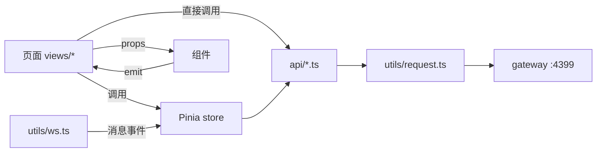

# 晴川二手市场 · 前端设计文档

| 项 | 内容 |
|---|---|
| 项目 | 晴川二手市场（校园 / 同城二手交易平台） |
| 文档版本 | **v1.4**（一致性审计修补：补齐找回密码两页、地址管理页；接口契约对齐 `PUT` 封禁/解封、`imageBase64`、`{url}` + `bizType`、WS `toId`/`ACK`/`createTime`、`M6` 按 `bizType` 跳转） |
| 依据 | `项目需求.txt`（用户第一手需求）+ `01-总体开发文档.md` + `03-接口设计.md` |
| 前端技术栈 | Vue 3.5 + TypeScript + Vite 7 + Element Plus 2.11 + Pinia 3 + Vue Router 4.5 + Axios + Sass |
| 设计分辨率 | 1440 × 900（PC 优先），最小支持 1200 |
| 配套文档 | `01-总体开发文档.md`、`02-数据库设计.md`、`03-接口设计.md` |

> 本文只描述**前端**：页面结构、视觉规范、交互规则、组件拆分、路由、状态、网络层。
> 所有接口路径、请求/响应字段以 `03-接口设计.md` 为唯一准绳，本文只做"哪个页面调哪个接口"的映射。
> **不写工期**（同 01 文档约定）。

---

## 1 范围与原则

### 1.1 页面清单（与需求逐条对应）

| 编号 | 页面 | 路由 | 访问 | 需求来源 |
|---|---|---|---|---|
| V1 | 首页（商品流） | `/` | **游客可看（只 20 条）** | 首页：居中导航 + 左侧分类 + 右侧排序 + 一行 5 个瀑布流卡片 + 右下发布按钮 |
| V2 | 发布商品 | `/publish`、`/publish/:id` | 登录 + 上架权限 | 发布页：图片 1~5、价格、原价、发货设置、发货地、描述、Split Button |
| V3 | 商品详情 | `/product/:id` | **登录**（游客跳登录） | 详情页：卖家横铺卡片 + 商品卡 + 收藏/购买/联系卖家 + 评论区 |
| V4 | 我的 | `/mine/:tab?` | 登录 | 我的：头像昵称 + 个性签名 + 编辑 + 左侧悬浮栏 + 4 列我的商品 |
| V5 | 购买 / 下单 | `/purchase/:id` | 登录 | 购买页：地址横向滚动卡片 + 订单信息卡 + 确认下单 |
| V6 | 我的订单 | `/orders` | 登录 | 下单后进"我的订单"，卖家发货、买家收货、双方互评 |
| V7 | 卖家主页（他人） | `/seller/:id` | 登录 | 详情页卖家卡片点进去 |
| V8 | 登录 / 注册 | `/login`、`/register` | 游客 | 注册：头像+用户名+邮箱+密码+确认密码；登录：用户名或邮箱 |
| V9 | 管理后台 | `/admin/**` | ADMIN / SUPER_ADMIN | 管理员：建分类、强制下架、**用户列表与治理**、订单、退款仲裁；**设置角色仅超管** |
| V10 | 聊天中心（v1.3） | `/chat`（`?cid=` 定位会话、`?tab=notice` 系统通知） | 登录 | 首页找一个位置进聊天页 + 详情页"联系卖家"创建双方聊天窗口 + 下单/收货等行为给对方发卡片提醒 + 双方打字聊天 |
| V11 | 找回密码（v1.4） | `/reset`（填邮箱取码）、`/reset/confirm`（填码与新密码） | 游客 | 01 F-34：邮箱收码 → 重置密码，成功后跳登录并预填 account |

> **v1.2 的访问差异**：V1 是唯一的"半公开"页面——游客能进来，但服务端只给 20 条、不能翻页；点任何卡片 → `/login?redirect=...`。V3/V7 对游客完全关闭（后端也 401，双保险）。

### 1.2 设计原则

1. **页面结构照抄需求**：需求写"左侧固定分类栏""右侧固定排序""一行 5 个"，就按这个做，不擅自改成下拉筛选。
2. **一张卡片一个组件**：首页卡片、订单卡片、我的商品卡片都是独立组件，改样式只改一处。
3. **接口只认 03 文档**：组件里不出现裸 URL，全部走 `api/*.ts`。
4. **状态可回退**：首页筛选（分类/排序/关键词/城市）写进 URL query，刷新和前进后退都能还原。
5. **空态、加载态、错误态三件套**：每个列表都必须有，不留白屏。
6. **不做无用动画**：只保留"图片淡入""按钮 loading""卡片 hover 上浮 2px"，其余不动。

---

## 2 路由与目录

### 2.1 路由表

```ts
// src/router/index.ts
const routes = [
  { path: '/', name: 'Home', component: () => import('@/views/home/index.vue') },          // V1 游客可看（20 条）
  { path: '/product/:id(\\d+)', name: 'ProductDetail', component: () => import('@/views/product/detail.vue'), meta: { requiresAuth: true } },
  { path: '/seller/:id(\\d+)', name: 'SellerHome', component: () => import('@/views/seller/index.vue'), meta: { requiresAuth: true } },
  { path: '/login', name: 'Login', component: () => import('@/views/auth/login.vue'), meta: { guestOnly: true } },
  { path: '/reset', name: 'ResetRequest', component: () => import('@/views/auth/reset.vue'), meta: { guestOnly: true } },
  { path: '/reset/confirm', name: 'ResetConfirm', component: () => import('@/views/auth/reset-confirm.vue'), meta: { guestOnly: true } },
  { path: '/register', name: 'Register', component: () => import('@/views/auth/register.vue'), meta: { guestOnly: true } },

  { path: '/publish', name: 'Publish', component: () => import('@/views/publish/index.vue'), meta: { requiresAuth: true, requiresPublishPermission: true } },
  { path: '/publish/:id(\\d+)', name: 'PublishEdit', component: () => import('@/views/publish/index.vue'), meta: { requiresAuth: true } },
  { path: '/purchase/:id(\\d+)', name: 'Purchase', component: () => import('@/views/purchase/index.vue'), meta: { requiresAuth: true } },
  { path: '/orders', name: 'Orders', component: () => import('@/views/orders/index.vue'), meta: { requiresAuth: true } },
  { path: '/chat', name: 'Chat', component: () => import('@/views/chat/index.vue'), meta: { requiresAuth: true, title: '消息' } },
  // query: cid=会话ID（从"联系卖家"或订单卡片跳进来）；tab=notice（系统通知页签）；不带 cid 时默认选中第一个会话
  {
    path: '/mine/:tab?',
    name: 'Mine',
    component: () => import('@/views/mine/index.vue'),
    meta: { requiresAuth: true },
    // tab 取值：profile | products | drafts | sold | bought | favorites | reviews | settings
    props: true
  },

  {
    path: '/admin',
    component: () => import('@/views/admin/layout.vue'),
    meta: { requiresAuth: true, roles: ['ADMIN', 'SUPER_ADMIN'] },
    children: [
      { path: '', redirect: '/admin/dashboard' },
      { path: 'dashboard', name: 'AdminDashboard', component: () => import('@/views/admin/dashboard.vue') },
      { path: 'categories', name: 'AdminCategories', component: () => import('@/views/admin/categories.vue') },
      { path: 'products', name: 'AdminProducts', component: () => import('@/views/admin/products.vue') },
      { path: 'users', name: 'AdminUsers', component: () => import('@/views/admin/users.vue') },
      { path: 'orders', name: 'AdminOrders', component: () => import('@/views/admin/orders.vue') },
      { path: 'refunds', name: 'AdminRefunds', component: () => import('@/views/admin/refunds.vue') },
      { path: 'payments', name: 'AdminPayments', component: () => import('@/views/admin/payments.vue') }
    ]
  },

  { path: '/:pathMatch(.*)*', name: 'NotFound', component: () => import('@/views/error/404.vue') }
]
```

### 2.2 路由守卫

```ts
router.beforeEach(async (to) => {
  const user = useUserStore()

  // 1. 已登录还去登录/注册页 → 回首页
  if (to.meta.guestOnly && user.isLogin) return { name: 'Home' }

  // 2. 需要登录
  if (to.meta.requiresAuth && !user.isLogin) {
    // 带 redirect，登录后原地回来（游客点商品卡片走的就是这条）
    return { name: 'Login', query: { redirect: to.fullPath } }
  }

  // 3. 有 token 但没资料 → 拉一次 /auth/me（失败则清 token 去登录）
  if (user.isLogin && !user.profile) {
    try { await user.fetchProfile() } catch { user.logout(); return { name: 'Login', query: { redirect: to.fullPath } } }
  }

  // 4. 角色校验（ADMIN / SUPER_ADMIN 都能进后台；'设置角色'按钮另按 SUPER_ADMIN 控制）
  if (to.meta.roles && !to.meta.roles.includes(user.profile.role)) {
    ElMessage.warning('无权限访问')
    return { name: 'Home' }
  }

  // 5. 上架权限闸门（只拦"新建发布"，编辑已有商品不拦）
  if (to.meta.requiresPublishPermission && !user.canPublish) {
    showPublishBlockedDialog(user.publishBanUntil)
    return { name: 'Home' }
  }

  // 6. 标题
  document.title = `${to.meta.title ?? ''} ${to.meta.title ? '·' : ''}晴川二手市场`
})
```

登录成功后：`router.replace(route.query.redirect || '/')`。

**游客态的三个落点**（缺一个就会被"绕过"）：

| 落点 | 做法 |
|---|---|
| 商品卡片点击 | `@click` 里判 `!user.isLogin` → `router.push({name:'Login', query:{redirect:`/product/${id}`}})`，**不要用 `<router-link>` 直连**（否则守卫才拦，体验上会闪一下） |
| 页面刷新时 | 守卫第 2 步兜底（`requiresAuth`），所以直接手敲 `/product/1` 也会跳登录 |
| 后端 401 | 游客 token 失效时 `request.ts` 统一处理（见 §17.3），双保险 |
| 聊天页 | 游客点「消息」按钮 / 手敲 `/chat` 都走守卫第 2 步（`requiresAuth`） |

### 2.3 目录结构

```
mall-web/
├─ public/                     # favicon、占位图
├─ src/
│  ├─ api/                     # 一个后端服务一个文件，只放函数
│  │  ├─ auth.ts  user.ts  product.ts  category.ts
│  │  ├─ favorite.ts  order.ts  payment.ts  message.ts
│  │  └─ admin.ts              # 后台聚合（复用上面各函数的 admin 版本）
│  ├─ assets/
│  │  ├─ images/               # logo、空态图、占位图
│  │  └─ styles/
│  │     ├─ variables.scss     # 设计变量（色/间距/圆角/阴影）
│  │     ├─ mixin.scss         # ellipsis / scrollbar / card
│  │     ├─ element.scss       # Element Plus 主题覆盖
│  │     └─ global.scss        # reset + 通用类
│  ├─ components/
│  │  ├─ common/               # 基础组件（与业务无关）
│  │  │  ├─ PriceText.vue  StarRating.vue  EmptyState.vue
│  │  │  ├─ PageContainer.vue  ImagePreview.vue  LoadingSkeleton.vue
│  │  │  └─ AppPagination.vue
│  │  ├─ layout/
│  │  │  ├─ AppHeader.vue  SearchBox.vue  UserDropdown.vue  GuestActions.vue
│  │  │  └─ MineSidebar.vue
│  │  ├─ auth/
│  │  │  ├─ AvatarPicker.vue          # 注册页头像选择 + 上传（调 A8）
│  │  │  ├─ BannedDialog.vue          # 封禁弹窗（全局单例，文案见 §12.4）
│  │  │  └─ PublishBlockedDialog.vue  # 上架受限弹窗（全局单例）
│  │  ├─ product/
│  │  │  ├─ CategorySidebar.vue  SortBar.vue  WaterfallCard.vue
│  │  │  ├─ WaterfallGrid.vue  PublishFab.vue  SellerCard.vue
│  │  │  ├─ CommentSection.vue  CommentItem.vue  ImageUploader.vue
│  │  │  └─ ConditionTag.vue  FreightTag.vue
│  │  ├─ order/
│  │  │  ├─ OrderCard.vue  OrderStatusTag.vue  OrderTimeline.vue
│  │  │  ├─ AddressCarousel.vue  AddressFormDialog.vue  ReviewDialog.vue
│  │  │  └─ PayDialog.vue
│  │  └─ chat/
│  │     ├─ ChatConversationList.vue  ChatMessageList.vue
│  │     ├─ ChatBubble.vue  ProductCardBubble.vue  OrderCardBubble.vue
│  │     └─ ChatInput.vue  PeerStatusDot.vue
│  ├─ views/
│  │  ├─ home/  product/  publish/  purchase/  orders/  mine/  seller/
│  │  ├─ auth/  chat/  admin/  error/
│  ├─ layouts/
│  │  └─ DefaultLayout.vue     # 顶部导航 + <router-view> + FAB（聊天是独立页 /chat，不再挂浮层）
│  ├─ router/index.ts
│  ├─ stores/
│  │  ├─ user.ts  product.ts  chat.ts  notice.ts
│  ├─ types/
│  │  ├─ api.d.ts              # R<T> / Page<T> / 各实体
│  │  └─ enum.ts               # 与后端字典一致的枚举常量 + 文案映射
│  ├─ utils/
│  │  ├─ request.ts            # axios 实例与拦截器
│  │  ├─ ws.ts                 # WebSocket 客户端（心跳/重连）
│  │  ├─ format.ts             # 价格/时间/距离/手机号脱敏
│  │  ├─ validate.ts           # 手机号、标题长度等校验器
│  │  └─ storage.ts            # localStorage 封装（带前缀）
│  ├─ App.vue
│  └─ main.ts
├─ .env.development
├─ .env.production
├─ vite.config.ts
├─ tsconfig.json
└─ package.json
```

---

## 3 视觉规范（Design Tokens）

### 3.1 颜色

```scss
// variables.scss
--mall-primary:        #FF6B35;   // 主色：暖橙，交易/闲置感，也用于价格强调的底
--mall-primary-hover:  #FF8557;
--mall-primary-active: #E85A26;
--mall-primary-light:  #FFF3EE;   // 选中背景、标签底
--mall-accent:         #2F54EB;   // 辅助色：链接、信息

--mall-success: #52C41A;
--mall-warning: #FAAD14;
--mall-danger:  #F5222D;
--mall-price:   #FF3B30;          // 金额专用，比 danger 更亮

--mall-text-1: #1F2329;           // 标题
--mall-text-2: #4E5969;           // 正文
--mall-text-3: #86909C;           // 辅助/时间/卖家名
--mall-text-4: #C9CDD4;           // 占位、禁用

--mall-bg:        #F7F8FA;        // 页面底色
--mall-bg-card:   #FFFFFF;
--mall-bg-hover:  #F2F3F5;
--mall-border:    #E5E6EB;
--mall-border-2:  #F2F3F5;
```

### 3.2 字号 / 间距 / 圆角 / 阴影

| Token | 值 | 用途 |
|---|---|---|
| 字号 | 12 / 13 / 14 / 16 / 20 / 28 / 36 | 12 辅助、14 正文、16 小标题、20 价格、28 详情价、36 大数字 |
| 行高 | 1.5（正文）/ 1.3（标题） | |
| 间距 | 4 / 8 / 12 / 16 / 24 / 32 / 48 | 8 的倍数为主 |
| 圆角 | 6（标签）/ 8（按钮、输入）/ 12（卡片）/ 16（大卡片）/ 50%（头像、FAB） | |
| 阴影 | `0 1px 2px rgba(0,0,0,.03)`（卡片常态）/ `0 4px 16px rgba(0,0,0,.08)`（hover）/ `0 8px 24px rgba(0,0,0,.12)`（浮层/FAB） | |

### 3.3 布局尺寸

| 项 | 值 |
|---|---|
| 顶部导航高度 | 64px（`position: sticky; top: 0; z-index: 100`） |
| 内容区最大宽 | 1440px，左右安全边距 24px，水平居中 |
| 首页三栏 | 左分类 200px ｜ 中间 自适应 ｜ 右排序 96px，栏间距 24px |
| 卡片间距 | 16px（横向与纵向一致） |
| 首页卡片宽 | `(主区宽 - 16×4) / 5`，1440 下约 208px |
| 发布页表单宽 | 720px 居中 |
| 详情页 | 左图区 640px ｜ 右信息区 自适应（gap 32） |
| 我的页 | 左悬浮栏 200px（sticky，top 88）｜ 右内容 4 列 |
| FAB | 64×64，距右 32、距底 48 |

### 3.4 断点

| 断点 | 首页列数 | 我的商品列数 | 左分类栏 | 说明 |
|---|---|---|---|---|
| ≥ 1440 | 5 | 4 | 常驻 | 设计稿基准 |
| 1200 ~ 1439 | 4 | 4 | 常驻 | 卡片自动变宽 |
| 992 ~ 1199 | 3 | 3 | 收进"分类"抽屉按钮 | 排序栏变顶部下拉 |
| < 992 | 2 | 2 | 抽屉 | 兜底，不作为交付重点 |

> 列数用 `grid-template-columns: repeat(var(--cols), minmax(0, 1fr))` + CSS 变量控制，JS 只在 `resize` 时改 `--cols`（防抖 200ms）。

---

## 4 全局框架（DefaultLayout）

```
┌──────────────────────────────────────────────────────────────────────┐
│ 晴川二手市场    [🔍 搜索你想要的二手好物…        ]      (👤 头像) 昵称 ▾ │ 64px sticky
├──────────────────────────────────────────────────────────────────────┤
│                                                                      │
│                         <router-view />                              │
│                                                                      │
│                                                     ╭────╮           │
│                                                     │ ＋ │  ← FAB    │
│                                                     ╰────╯           │
└──────────────────────────────────────────────────────────────────────┘
```

- `AppHeader` 在所有业务页复用（发布页、购买页也保留，方便回退）。
- `PublishFab` 只在 V1 首页出现（需求写明"首页右下角"）。
- 聊天是**独立路由页 `/chat`**（不是右下浮层）：任何页面点顶部「消息」按钮或「联系卖家」都直接进这一页；在线提醒靠 `AppHeader` 的红点 + WS `NOTICE`/`CARD`。

### 4.1 `AppHeader`

| 区域 | 内容 | 交互 |
|---|---|---|
| 左 | 文字 Logo「**晴川二手市场**」（20px / 700 / 主色） | 点击 → 回到 `/` 并**整页刷新**（不是普通 SPA 跳转） |
| 中 | `SearchBox`：480×40，圆角 20，浅灰底，内含放大镜图标 + placeholder | 回车或点图标 → 更新 URL `?keyword=xxx` 并回首页；输入 300ms 防抖做联想（调 `P1` 带 keyword，只取前 8 条，展示"图 + 标题 + 价"） |
| 右·未登录 | `GuestActions`：「登录」文字按钮 + 「注册」描边按钮 | 跳 `/login`、`/register`（带 `redirect` = 当前页，登录后回原地） |
| 右·已登录 | 圆形头像 36（`border: 2px solid #fff; box-shadow`）+ 昵称（最多 6 字省略）+ `▾` | 下拉菜单：个人主页 / 我的订单 / 我的收藏 / 管理后台（`ADMIN` 与 `SUPER_ADMIN` 显示）/ 退出登录 |
| 右·消息（v1.3） | 「消息」文字按钮 + 对话图标 + 红点未读数（= `mall:msg:unread` 总和，WS `CHAT`/`CARD` 到达即自增；未登录不显示） | 点击 → `/chat`（未读数取 `M1` 各会话 unread 之和）；上方铃铛 → `/chat?tab=notice` |

导航吸顶后加一层 `box-shadow: 0 1px 0 var(--mall-border)`，避免与内容粘连。

---

## 5 V1 首页

### 5.1 线框

```
┌──────────────────────────── AppHeader ────────────────────────────────┐
├───────────┬─────────────────────────────────────────────┬─────────────┤
│ 全部      │  ┌────┐ ┌────┐ ┌────┐ ┌────┐ ┌────┐        │  最新       │
│ 数码  ▾   │  │图片│ │图片│ │图片│ │图片│ │图片│        │  最早       │
│   手机    │  │    │ │    │ │    │ │    │ │    │        │  价格↑      │
│   电脑    │  └────┘ └────┘ └────┘ └────┘ └────┘        │  价格↓      │
│ 图书  ▸   │  标题两行…  标题…    标题…    标题…   标题…  │  最热       │
│ 服饰  ▸   │  ¥129  ¥88   ¥45     ¥299    ¥15         │  同城   ←active
│ 家居  ▸   │  👤小明 👤阿花 👤大宝  👤Kk    👤Lily        │             │
│ 运动  ▸   │  …（瀑布流，第二行高度不齐）                 │             │
│ 其他  ▸   │                                             │             │
│  ←200px→  │              ← 主区自适应 →                  │   ←96px→   │
└───────────┴─────────────────────────────────────────────┴─────────────┘
```

三栏用 `display: grid; grid-template-columns: 200px 1fr 96px; gap: 24px;`。
左、右两栏 `position: sticky; top: 88px; align-self: start; max-height: calc(100vh - 112px); overflow: auto;`（"固定"= 滚动时不动，不是 `fixed` 遮住内容）。

### 5.2 `CategorySidebar`（左）

- 数据：`GET /category/tree`（P19），进页面拉一次，存 `productStore.categoryTree`（会话内缓存）。
- 结构：第一项「全部」（无 id），其后一级分类（16px/600），二级分类缩进 12px（14px/400）。
- 交互：
  - 点击一级 → 选中并同时展开/收起其二级；再次点击**已选中**的项 → **取消筛选**（需求原话"再点取消筛选"），回到「全部」。
  - 选中项：文字主色 + `background: var(--mall-primary-light)` + 左侧 3px 主色竖条（`border-left`）。
  - 点击后写 URL：`?categoryId=12`，触发列表重新请求（重置到第 1 页）。
- 折叠：一级分类超过 8 个时，超出部分收进「更多 ▾」。

### 5.3 `SortBar`（右）

竖排 6 项，每项 32px 高、居中，hover 变主色；选中项加粗 + 主色 + 右侧短竖条。

| 文案 | `sort` 值 | 说明 |
|---|---|---|
| 最新 | `new` | 默认，按发布时间倒序 |
| 最早 | `oldest` | 发布时间正序 |
| 价格↑ | `price_asc` | 价格从低到高 |
| 价格↓ | `price_desc` | 价格从高到低 |
| 最热 | `hot` | 按浏览量/收藏量 |
| 同城 | `nearby` | 需要 `city` 参数；没有城市时先弹"选择城市"（默认取用户资料 `U1` 里的 `city`，可手填或从常用城市列表选，选完写入 `productStore.city` 与 URL） |

> 6 个排序是互斥单选，不是多选。

### 5.3.1 价格与成色筛选（v1.3 补，别漏）

`P1` 已经支持 `priceMin` / `priceMax` / `conditionLevel` 三个参数，但前面只有排序、没有控件——参数白写。放在排序栏下方一个**可折叠的「筛选」区**（默认收起，避免挤压 5 列布局）：

| 控件 | 绑定参数 | 规则 |
|---|---|---|
| 价格区间 | `priceMin` / `priceMax` | 两个数字输入框（`¥__` — `¥__`）+ 4 个快捷区间「0-50 / 50-200 / 200-1000 / 1000+」；`priceMin > priceMax` 时自动交换；都不填则不传 |
| 成色下限 | `conditionLevel` | 下拉：不限 / 7 成新以上 / 8 成新以上 / 9 成新以上（对应 7/8/9），选中才传 |
| 重置 | — | 一键清空三个参数并重拉第 1 页 |
| 同步 | — | 全部写进 URL（`?priceMin=&priceMax=&conditionLevel=`），刷新/分享可复原；与 `keyword/categoryId/sort/city` 用同一套 `syncQuery()` |

- 任何筛选变化都立即重拉第 1 页（不清空已加载数据，用骨架屏覆盖），并取消上一次未完成请求（`AbortController`，同 §5.6 防抖策略）。
- 游客同样可用（结果仍固定 20 条）。
- 折叠状态记在 `productStore.filterOpen`，不写 URL。

### 5.4 `WaterfallGrid` + `WaterfallCard`

**卡片构成（自上而下）**

1. 图片：宽 100%，高度按原图比例（`aspect-ratio` 由返回的 `width/height` 决定，缺省 4:3），`object-fit: cover`，圆角 12 12 0 0，懒加载。
2. 图片右下角小标签：成色（`ConditionTag`，如「9成新」，半透明黑底白字 12px）。
3. 标题：14px/1.4，最多 2 行，`-webkit-line-clamp: 2`，hover 变主色。
4. 价格行：`¥` 12px + 数字 20px/700/价格色；有原价时右侧灰色删除线 12px。
5. 卖家行：24px 圆形头像 + 昵称 12px 灰，`justify-content: space-between`，右侧显示城市（`同城`项高亮）。
6. 整卡：白底、圆角 12、`overflow: hidden`、hover `transform: translateY(-2px)` + 阴影加深 + 图片 `scale(1.03)`（`transition: .2s`）。

**瀑布流实现（关键）**

CSS 多列（`column-count`）会让"一行 5 个"的顺序变成列优先，不符合需求；`grid` 又做不出不等高。所以用**5 个 flex 列 + 最矮列优先分配**：

```ts
// WaterfallGrid.vue 核心逻辑
const COLS = computed(() => colCount.value)          // 5 / 4 / 3 / 2
const columns = ref<CardItem[][]>([])
const heights = ref<number[]>([])

function distribute(list: CardItem[]) {
  columns.value = Array.from({ length: COLS.value }, () => [])
  heights.value = new Array(COLS.value).fill(0)
  list.forEach(item => {
    const i = heights.value.indexOf(Math.min(...heights.value))  // 最矮列
    columns.value[i].push(item)
    heights.value[i] += estimateHeight(item)                     // 图高 + 文本高(约 96px)
  })
}
// 上拉加载时**只把新增项追加**进 columns（不重排已有项），避免跳动
```

- `estimateHeight = 卡片宽 / (imgW/imgH) + 96`；图片 `load` 后若实际高度差异 > 40px，用 `ResizeObserver` 修正该列高度。
- 首屏骨架：5 列 × 2 个 `LoadingSkeleton`（灰块 + 三条线），数据回来替换。
- 空态：`EmptyState`（插图 + "还没有商品，去发布第一个吧" + 按钮跳 `/publish`）。

### 5.5 交互与数据

| 项 | 规则 |
|---|---|
| 数据源 | `GET /product/page`（P1）：`pageNum`、`pageSize=20`、`keyword`、`categoryId`、`sort`、`city` |
| 加载方式 | 触底加载（`IntersectionObserver` 监听底部哨兵，提前 200px 触发）；加载中显示"加载中…"，到底显示"没有更多了" |
| 防抖 | 搜索关键词 300ms；切换分类/排序立即请求（取消上一次未完成请求：`AbortController`） |
| URL 同步 | `?keyword=&categoryId=&sort=new&city=`，用 `router.replace`，刷新可还原 |
| 返回时机 | 从详情页 `router.back()` 回来时，`productStore` 保留列表与滚动位置（`scrollBehavior` + `savedPosition`） |
| 卡片点击 | **未登录 → `/login?redirect=/product/:id`**；已登录 → `/product/:id`。卖家头像/昵称同理（`@click.stop`） |

### 5.5.1 游客态（v1.2 新增，需求原话"未登录用户只能查看首页前 20 条商品"）

| 项 | 规则 |
|---|---|
| 条数 | 服务端强制返回 20 条（`pageNum/pageSize` 被忽略），响应带 `guestLimited=true` |
| 翻页 | **完全不渲染**触底加载与分页器；列表底部换成一条"登录查看全部商品 ›"引导条，点击跳 `/login` |
| 搜索/筛选 | 允许（能搜索、能切分类、能改排序），但结果**仍然只有 20 条**，每次筛选都重拉第 1 页 |
| 卡片点击 | 不跳详情，跳登录 |
| 右下发布按钮 | 不显示（未登录无发布意义）或点击后弹"登录后才能发布" |
| 顶部导航 | `AppHeader` 右侧头像位换成「登录 / 注册」两个文字按钮（`GuestActions`） |
| 判断来源 | `userStore.isLogin === false`；**不要用 `profile` 判**（游客 profile 为空但与"加载中"无法区分） |

```ts
// views/home/index.vue 关键分支
const p = await productApi.page({ pageNum: 1, pageSize: 20, keyword, categoryId, sort, city })
list.value = p.records
guestLimited.value = p.guestLimited === true       // 服务端说了算，前端不自己算
if (!guestLimited.value) setupInfiniteScroll()      // 只有登录态才挂载触底加载
```

> 服务端返回 `guestLimited` 而不是让前端`if (!isLogin)` 自己推，是因为"谁是游客"最终由后端判定（token 过期瞬间前端还以为自己登录着）。

### 5.6 `PublishFab`（右下球形按钮）

- 64×64 圆形，主色渐变（`linear-gradient(135deg,#FF8557,#FF6B35)`），白色 `＋` 28px，`box-shadow: 0 8px 24px rgba(255,107,53,.35)`。
- hover：`scale(1.08)` + 阴影加深；点击：`scale(.95)` 回弹后跳 `/publish`。
- 未登录点击 → 弹确认"登录后才能发布"，跳 `/login?redirect=/publish`。
- **上架权限受限时**：按钮照常显示，但点击**不跳转**，弹 `PublishBlockedDialog`（文案见 §12.4），避免"点了进页面填完才发现不能发"。
- 滚动时始终固定在 `right: 32px; bottom: 48px`，`z-index: 90`。

---

## 6 V2 发布页

### 6.1 线框（720px 居中，从上到下，无左右分栏）

```
┌─────────────────────────────────────────────────────┐
│  发布闲置                                      [存草稿 ▾] │
├─────────────────────────────────────────────────────┤
│  图片 *（1~5 张，第一张为封面）                        │
│  ┌────┐┌────┐┌────┐  ┌────────────┐                 │
│  │ 图 ││ 图 ││ 图 │  │ ＋ 上传      │                 │
│  └────┘└────┘└────┘  └────────────┘                 │
│  * 标题 *  [ 例如：iPad 2021 64G 深空灰 9成新      ]   │
│  * 分类 *  [ 数码 ▾ 手机 ▾ ]                         │
│  * 价格 *  [ ￥ 1299         ]  原价 [ ￥ 3999      ]  │
│    成色    [ 95新 ▾ ]                                │
│  * 发货设置 ( ) 包邮  (•) 按距离估算  ( ) 仅自提       │
│  * 发货地 * [ 湖北省 ▾ 武汉市 ▾ 江岸区 ▾ ]            │
│    商品描述 [ 多行文本，选填，≤1000 字              ]  │
│                                                      │
│                          [  发布  | ▾  ]              │
└─────────────────────────────────────────────────────┘
```

### 6.2 字段规格

| 字段 | 控件 | 必填 | 规则 | 默认 |
|---|---|---|---|---|
| 图片 | `ImageUploader` | ✅ | 1~5 张；jpg/png/webp；单张 ≤ 5MB；可拖动排序；首图封面（**存草稿时可为 0 张**） | 空 |
| 标题 | `el-input` | ✅ | 4~60 字，禁纯空格 | 空 |
| 分类 | 两级 `el-cascader`（或两个 select 联动） | ✅ | 只能选到二级（`leafOnly`）；数据来自 P19 | 空 |
| 价格 | `el-input-number` | ✅ | 0.01~999999，两位小数 | 空 |
| 原价 | `el-input-number` | ❌ | 必须 > 价格，否则提示"原价应高于售价" | 空 |
| 成色 | `el-select` | ❌ | `NEW/95/90/80/70` 五档（字典 `P18`） | `90` |
| 发货设置 | `el-radio-group` | ✅ | `FREE_SHIPPING` / `DISTANCE` / `SELF_PICKUP`，各带副文案（见下） | `DISTANCE` |
| 发货地 | `RegionCascader` | ✅ | 省/市/区三级必选（写入 `province/city/district`） | 取用户 profile 的默认地区 |
| 描述 | `el-input type=textarea` | ❌ | ≤ 1000 字，右下角字数计数 | 空 |

**发货设置副文案**

| 值 | 文案 | 副说明 |
|---|---|---|
| `FREE_SHIPPING` | 包邮 | 运费由你承担，买家付 0 元运费 |
| `DISTANCE` | 按距离估算 | 同城 5 元、跨城 10 元，买家支付 |
| `SELF_PICKUP` | 仅自提 | 买家上门自取，不收运费；仅支持同城 |

> 选 `SELF_PICKUP` 时，若发货地与买家不同城，下单会被后端拒（40004），前端在购买页先做一次同城判断并提示。

### 6.3 图片上传（`ImageUploader`）
1. 选择文件 → 前端校验类型/大小/数量 → 逐个 `POST /product/upload`（P11，`multipart/form-data`，**必带 `bizType=product`**）。
1. 选择文件 → 前端校验类型/大小/数量 → 逐个 `POST /product/upload`（P11，`multipart/form-data`）。
2. 上传中显示进度条覆盖层；成功把返回 URL 加入 `form.images`；失败提示并可重试单张。
3. 网格 5 格（`grid-template-columns: repeat(5, 96px)`），每格 96×96 圆角 8；hover 出现「设为封面 / 删除」；拖拽换位用 `vuedraggable` 或原生 `draggable`。
4. 拖拽排序后第一张自动加「封面」角标（主色底白字 10px）。

### 6.4 Split Button（`SplitButton`）

```
┌───────────────┬─────┐
│    发 布      │  ▾  │
└───────────────┴─────┘
```

- 左半（宽 160，高 44，主色）：点「发布」→ 前端校验 → `POST /product`（P4，`status=ON_SALE`）→ 成功 toast「发布成功」→ 跳 `/product/:id`。
- 右半（宽 36，同高，主色深一档）：点开下拉，唯一项「存草稿」→ **只校验标题（4~60 字）**，图片/分类/价格/地区允许后补 → `POST /product`（`status=DRAFT`）→ toast「已存入草稿箱」→ 跳 `/mine/drafts`。
- **实现约束（2026-10-28 Codex 修复）**：新建发布和存草稿都必须调 `POST /product`；不存在 `/product/create`，误用会收到 `10007 服务器内部错误`。
- 提交中：左半 button `loading` 且禁用右侧箭头；防连点（`submitting` 标志）。
- 后端返回 30004（草稿发布缺字段）时：`message` 里带字段名，前端把该字段滚动到可视区并标红 + 聚焦。
- 编辑态（`/publish/:id`）：标题变「编辑商品」，按钮变「保存」+「下架」，走 `PUT /product/{id}`（P5）；若草稿点「发布」走 `PUT /product/{id}/publish`（P9）。

### 6.5 提交后

| 结果 | 前端行为 |
|---|---|
| 成功发布 | 跳详情页，首页列表缓存失效（`productStore.invalidateList()`） |
| 成功存草稿 | 跳 `/mine/drafts`，卡片右上角「草稿」标签 |
| 30004 | 定位缺失字段，提示原文 |
| 401 | 跳登录并回跳 |
| 网络错误 | 保留表单内容（不刷新页面），toast 可重试 |

---

## 7 V3 商品详情

### 7.1 线框

```
┌───────────────────────────────────────────────────────────────┐
│ ┌───────────────────────────────────────────────────────────┐ │
│ │ (👤) 小明同学   武汉市 · 3 天前登录 · 加入 128 天          │ │
│ │      ★★★★☆ 4.8 (32条)  已卖出 17 件   在售 5 件   [进主页]│ │
│ └───────────────────────────────────────────────────────────┘ │← 卖家横铺卡
│ ┌──────────────┬──────────────────────────────────────────┐  │
│ │ ┌──┐         │  ¥ 1299   原价 ¥ 3999（划线）             │  │
│ │ │缩│  ┌────┐ │  iPad 2021 64G 深空灰 9成新              │  │
│ │ │略│  │    │ │  [9成新] [包邮] [武汉市 江岸区]            │  │
│ │ │图│  │大图│ │  ─────────────────────────────           │  │
│ │ │列│  └────┘ │  描述：自用一年，无磕碰，配原装充电器…     │  │
│ │ └──┘         │  ─────────────────────────────           │  │
│ │  4 张         │  ☆ 收藏(23)     [ 购 买 ]  [联系卖家]     │  │
│ └──────────────┴──────────────────────────────────────────┘  │
│ ┌─────────────────────────┐  ┌────────────────────────────┐  │
│ │ 商品评论 (12)            │  │ 相似推荐                    │  │
│ │ …评论列表…               │  │ …4 个小卡…                  │  │
│ └─────────────────────────┘  └────────────────────────────┘  │
└───────────────────────────────────────────────────────────────┘
```

### 7.2 卖家横铺卡片（`SellerCard`）

- 容器：白底、圆角 16、内边距 20、`display: flex; align-items: center; gap: 20px`，鼠标悬停阴影加深。
- 左：头像 56 圆形（`border: 2px solid #fff; box-shadow: 0 2px 8px rgba(0,0,0,.08)`）。
- 中：昵称（16px/600）+ 一行灰色元信息（`武汉市 · 3 天前登录 · 加入 128 天`，12px，用 `·` 分隔）。
- 中右：评分 `StarRating`（只读，支持半星）+ `4.8`（16px/600 主色）+ `(32 条评价)`；右侧竖线分隔；「已卖出 17 件」「在售 5 件」。
- 右：`进入主页` 描边按钮 → `/seller/:id`。
- 数据来源：**一个接口拿全**——`GET /product/{id}`（P2）响应里的 `seller` 对象已包含 `avatar/nickname/city/lastLoginTime/registerDays/soldCount/avgRating/reviewCount/onSaleCount`（由 mall-product 后端 Feign 组装），前端不再并发请求 4 个接口。
- **跳转与本人判断（2026-10-29 Codex 修复）**：优先使用 P2 顶层 `sellerId`，并用 `seller.id` 兜底；整张卖家卡片和「进主页」都跳 `/seller/{sellerId}`。不要只读嵌套对象，接口漏字段时会导致卡片点击无反应。

| 展示位 | 字段 | 缺省文案 |
|---|---|---|
| 头像 | `seller.avatar` | 昵称首字圆形底 |
| 昵称 | `seller.nickname` | 「匿名用户」 |
| 城市 | `seller.city` | 不显示该段 |
| 上次登录 | `seller.lastLoginTime` | 「刚刚活跃」 |
| 注册时长 | `seller.registerDays` | 「新用户」 |
| 卖出件数 | `seller.soldCount` | 0 显示「暂无成交」 |
| 评分 | `seller.avgRating` + `reviewCount` | 无评价显示「暂无评分」 |

### 7.3 商品图区

- 左：缩略图列 72px 宽，每张 64×64 圆角 8，选中加主色 2px 边框；超过 5 张时纵向可滚动。
- 右：大图占满剩余宽度，`aspect-ratio: 1/1` 或按原图，圆角 12，点击打开 `ImagePreview`（全屏黑底、左右切换、ESC 关闭、支持缩放）。
- 图片加载：先显示主色浅底骨架，`load` 后淡入 200ms。

### 7.4 信息区

| 区块 | 内容 |
|---|---|
| 价格 | `¥` 20px + 数字 36px/700/价格色；原价 14px 灰色删除线，紧跟其后 |
| 标题 | 22px/600，最多 2 行 |
| 标签行 | `ConditionTag`（成色）、`FreightTag`（包邮 / 同城 ¥5 / 跨城 ¥10 / 仅自提）、地区 chip |
| 描述 | 15px/1.7，保留换行；超过 6 行折叠，显示「展开全部 ▾」 |
| 动作条 | 收藏（星形图标 + 数字，选中变主色填充，调 P15/P16）、`购买`（主按钮 160×44）、`联系卖家`（描边按钮，调 `M12` 建会话后 `router.push(`/chat?cid=${conversationId}`)`，见 §14.1） |
| 次要信息 | 发布时间、浏览量（12px 灰） |

### 7.5 商品评论区（`CommentSection`）

- 标题「商品评论 (12)」，数字取 `commentCount`。
- 发表框（登录后可见）：头像 + textarea（placeholder「说点什么…」，≤500 字，右下角字数）+ 图片按钮（≤3 张，走 P11）+「发布」按钮；未登录显示「登录后评论」。
- 列表：一级评论按时间倒序，`CommentItem` 含头像、昵称、时间（相对时间：刚刚/x 分钟前/x 天前）、内容、图片九宫格（点击预览）、操作行「回复 · 删除（仅自己的，ADMIN 也可）」。
- 回复：二级缩进 40px、浅灰底、只支持一层（后端 `parent_id` 最多指向一级评论）；点「回复」在下方展开输入框。
- 分页：每页 10 条，「加载更多」按钮（不用无限滚动，避免与页面滚动冲突）。
- 删除：调 P14，成功后本地移除并 `commentCount - 1`。

### 7.6 相似推荐

`GET /product/{id}/similar`（P3）→ 4 个小卡片（图 + 标题 + 价），点击跳新详情；无数据时整块不渲染。

### 7.7 状态与权限矩阵

| 场景 | 购买按钮 | 收藏 | 联系卖家 | 额外提示 |
|---|---|---|---|---|
| `ON_SALE` 且非本人 | 可点 | 可点 | 可点 | — |
| 本人发布的商品 | 隐藏，改「编辑商品」「下架」 | 隐藏 | 隐藏 | 顶部灰条「这是你发布的商品」 |
| `SOLD` | 置灰「已售出」 | 可收藏 | 可点 | 大图右上角「已售出」遮罩 |
| `OFF_SHELF` | 置灰「已下架」 | 可收藏 | 可点 | 顶部灰条「商品已下架」，本人可见原因 `offShelfReason` |
| `LOCKED`（他人下单未支付） | 置灰「他人拍下待支付」 | 可收藏 | 可点 | — |
| `DRAFT` 且非本人 | 直接 404 页 | — | — | 后端返回 30002 时前端跳空态 |

---

## 8 V4 我的

### 8.1 线框

```
┌──────────────────────────────────────────────────────────────────┐
│  (👤80)   小明同学                              [ 编辑资料 ]      │
│           这个人很懒，还没写个性签名…                            │← 资料卡
├────────────┬─────────────────────────────────────────────────────┤
│ 我的        │  我的商品 (12)          [ 全部 | 在售 | 已售出 | 草稿 ]│
│ 我的交易 ▾  │  ┌────┐ ┌────┐ ┌────┐ ┌────┐                      │
│   我发布的  │  │ 图 │ │ 图 │ │ 图 │ │ 图 │                      │
│   我卖出的  │  └────┘ └────┘ └────┘ └────┘   ← 4 列              │
│   我买到的  │  标题     标题    标题    标题                     │
│ 我的收藏    │  ¥129     ¥88    ¥45     ¥299                     │
│ 我的评价    │  [编辑][下架][删除] …                              │
├────────────┴─────────────────────────────────────────────────────┤
```

### 8.2 资料卡

- 头像 80 圆形（hover 显示相机图标和「更换头像」，点击选择图片；走 A8 上传后调 `PUT /user/profile` 保存 avatar，成功后立即刷新 `userStore.profile` 与顶部头像）。
- 昵称 22px/600；右侧「编辑资料」按钮 → 行内编辑（昵称、全国省/市/区 Cascader、个性签名）；点击资料地区文字也可直接进入编辑。
- **个性签名**：显示为一块横条（白底浅灰边框、圆角 8、内边距 12、14px），最长 200 字，超过一行省略并在 hover 时 tooltip 全文；为空显示占位灰字「这个人很懒，还没写个性签名…」。
  - 行内编辑：点横条右侧铅笔图标 → 变 textarea（自动高度，max 200 字计数）→ 回车或点√保存（`PUT /user/profile`，乐观更新）；ESC 取消。
- 统计条（资料卡右侧或下方一行）：`在售 5 · 已卖出 17 · 买到的 9 · 收藏 23 · 收到评价 32`（`GET /user/statistics`，U4）。

### 8.3 `MineSidebar`（左侧悬浮栏）

- `position: sticky; top: 88px;` 宽 200，白底圆角 12，内边距 8。
- 菜单项 44px 高、圆角 8、hover 浅灰；选中：主色文字 + `--mall-primary-light` 背景 + 左侧 3px 主色条。
- 结构：

```
我的                → /mine/profile
我的交易 ▾          → 折叠组（展开状态存 localStorage）
   我发布的          → /mine/products
   我卖出的          → /mine/sold
   我买到的          → /mine/bought
我的收藏            → /mine/favorites
我的评价            → /mine/reviews
收货地址            → /mine/address
```

- 「我的交易」的三角形图标随展开旋转 180°（`transition: .2s`）；默认展开。
- **「收货地址」是 v1.3 新加的入口**：`U5`~`U10` 六个接口和 `t_user_address` 表一直都在，但此前只有购买页的一个"新增"弹窗，地址填错后无处可改——补一个管理页（见 §8.9）。

### 8.4 我的商品（4 列）

- 网格 `repeat(4, minmax(0,1fr))`，间距 16。
- 卡片 208 宽：图（4:3，圆角 8）、标题 2 行、价格、状态标签（在售/已售出/已下架/草稿）、操作行（编辑 / 下架或重新上架 / 删除）。
- 顶部筛选 tab：全部 / 在售 / 已售出 / 草稿 → 映射 `GET /product/my/page`（P10）的 `status` 参数（`ON_SALE` / `SOLD` / `DRAFT`；「全部」不传）。
- 删除走二次确认（`ElMessageBox.confirm`），成功后移除卡片；有订单关联时后端拒绝，提示原文。
- 空态：每个 tab 独立文案（如草稿箱空 →「还没有草稿，发布时可以点『存草稿』」）。

### 8.5 我的交易

| tab | 接口 | 说明 |
|---|---|---|
| 我发布的 | `GET /product/my/page`（P10） | 与 8.4 同源，但以列表行展示（图 64 + 标题 + 状态 + 浏览/收藏数） |
| 我卖出的 | `GET /order/page?role=seller`（O2） | 复用 `OrderCard`（卖家视角按钮） |
| 我买到的 | `GET /order/page?role=buyer`（O2） | 复用 `OrderCard`（买家视角按钮） |

### 8.6 我的收藏

`GET /favorite/page`（P17）→ 4 列卡片，卡片右下角「取消收藏」星形（P16，点击后卡片淡出移除）；空态「还没有收藏」。

### 8.7 我的评价

- 两个 tab：「我收到的」`GET /order/review/mine?role=received`、「我发出的」`?role=sent`（O9）。
- 每条：评价人/被评价人头像 + 昵称、星级、内容、图片、时间、商品缩略；「我收到的」下方有「回复」按钮（O8）。
- 顶部汇总：`平均分 4.8 · 共 32 条`（`GET /order/review/user/{userId}`，O11）。

### 8.8 设置

改密码（`PUT /auth/password`，A7）、退出登录（`POST /auth/logout`，A5）。

### 8.9 收货地址管理（`/mine/address`，v1.3 新增）

购买页只解决了"新增"，填错/搬家/删掉多余地址没有入口——这里补齐。表 `t_user_address`（≤10 条、最多一条 `is_default=1`）与 `U5`~`U10` 六个接口都是现成的，**不需要新增后端**。

| 区域 | 内容 |
|---|---|
| 顶部 | 「新增地址」按钮（已有 10 条时禁用并提示「最多 10 个收货地址，请先删除」）+ 说明「默认地址会出现在购买页第一张卡片」 |
| 列表 | 每行一张卡（横向一行 12 间距）：收货人 + 手机号（脱敏 138****8888）+ `省 市 区` + 详细地址 + 「默认」徽标；右侧操作「设为默认」`U9` /「编辑」`U7` /「删除」`U8` |
| 表单弹窗 | 复用 `AddressFormDialog`（§9.3）：收货人 2~20、手机号 `/^1[3-9]\d{9}$/`、地区 `RegionCascader`（省/市/区三级必填）、详细地址 5~100；新增走 `U6`、编辑走 `U7`，提交成功后关闭并刷新列表 |
| 删除 | 二次确认；删除默认地址后由后端把最早的一条置为默认，前端**重新拉列表**而不是本地推断 |
| 空态 | 「还没有收货地址」+ 按钮跳新增 |
| 默认地址 | 同一时刻只允许一条；点「设为默认」后把其它行的徽标清掉（乐观更新，失败回滚） |

- 入口：`MineSidebar` 的「收货地址」（§8.3）、购买页卡片末位「+」旁的「管理」小链接、下单时 0 地址的引导文案。
- 权限：登录；只能看/改自己的（后端按 `X-User-Id` 过滤，前端不传 `userId`）。

---

## 9 V5 购买页

### 9.1 线框

```
┌───────────────────────────────────────────────┬────────────────────┐
│ 收货地址                                       │  订单结算           │
│ ‹ ┌──────────┐ ┌──────────┐ ┌──────────┐ ┌─┐ │  ┌──┬───────────┐  │
│   │ 张三 默认 │ │ 李四      │ │ 王五      │ │+│ │  │图│ iPad 2021│  │
│   │ 138****88│ │ 139****77│ │ 137****66│ │ │ │  │  │ ¥1299     │  │
│   │ 武汉市…  │ │ 武汉市…  │ │ 黄冈市…  │ │ │ │  └──┴───────────┘  │
│   └──────────┘ └──────────┘ └──────────┘ └─┘ │  ─────────────────  │
│                              ← 横向滚动 →      │  商品金额   ¥1299   │
│ ┌───────────────────────────────────────────┐ │  运费        ¥5    │
│ │ 订单信息                                   │ │  优惠        -¥0   │
│ │ 商品：iPad 2021 64G 深空灰 9成新           │ │  ─────────────────  │
│ │ 单价 ¥1299 × 1                             │ │  应付        ¥1304 │
│ │ 配送：武汉市 江岸区 → 武汉市 洪山区（同城）│ │  [ 确认下单 ]      │
│ │ 备注：[ 选填，给卖家留言…             ]    │ │  ☑ 我已阅读并同意… │
│ └───────────────────────────────────────────┘ │                    │
└───────────────────────────────────────────────┴────────────────────┘
```

两栏：左 `1fr`，右 360px（`position: sticky; top: 88px`），gap 24。

### 9.2 地址横向滚动（`AddressCarousel`）

- 一屏 3.5 张卡（露出半张提示可滚动），左右各一个 32px 圆形半透明箭头按钮（hover 显示，hover 卡区时常显）。
- 卡片 280×132：左上姓名（15px/600）+ 手机号打码；右上「默认」标签（主色浅底）；下方两行地址（省市区 + 详细地址，第二行省略）；选中：主色 2px 边框 + 右上角对勾；hover：阴影加深。
- **末位新增卡**：虚线边框 + 居中 `＋ 新增地址`，点击开 `AddressFormDialog`。
- 卡片操作：hover 右上角出现「编辑 / 删除」小图标（删除需确认）。
- 滚动：`scroll-behavior: smooth`，箭头点击 `scrollBy({ left: ±300 })`；自动隐藏 `overflow-x: auto` 的滚动条（`::-webkit-scrollbar { display: none }`）。
- 默认选中：`GET /user/addresses/default`（U10），无默认则选列表第一条；没有地址时**自动弹出**新增弹窗。

### 9.3 `AddressFormDialog`

| 字段 | 控件 | 校验 |
|---|---|---|
| 收货人 | input | 必填，2~20 字 |
| 手机号 | input | 必填，`^1[3-9]\d{9}$` |
| 所在地区 | `RegionCascader`（省/市/区三级） | 必填，三级都选 |
| 详细地址 | textarea | 必填，5~120 字 |
| 设为默认 | switch | 默认关 |

保存 → `POST /user/addresses`（U6）或 `PUT /user/addresses/{id}`（U7），成功后刷新列表并自动选中新地址。

### 9.4 订单信息卡

- 商品行：88×88 缩略图 + 标题（2 行省略）+ 单价 + `× 1`（二手一件一单，无数量选择器）。
- 配送行：`卖家发货地 → 收货地址`，右侧标注「同城 / 跨城」；若 `freightMode=SELF_PICKUP` 且跨城，这里直接显示红色提示「该商品仅支持同城自提」并禁用下单按钮。
- 备注：`el-input type=textarea`，≤100 字（写进 `O1` 的 `remark`）。

### 9.5 运费展示规则（与后端 BR-09 一致）

| 卖家设置 | 同城 | 跨城 |
|---|---|---|
| 包邮 `FREE_SHIPPING` | ¥0 | ¥0 |
| 按距离 `DISTANCE` | ¥5 | ¥10 |
| 仅自提 `SELF_PICKUP` | ¥0 | **不可下单（40004）** |

前端先算一遍用于展示，最终以 `O1` 返回的 `freight` 与 `payAmount` 为准（后端为准，前端回填）。

### 9.6 确认下单 → 模拟支付

1. 点「确认下单」→ 校验（地址已选、协议已勾）→ `POST /order/create`（O1，`{ productId, addressId, remark }`，带 `Idempotency-Key` 头）。
2. 成功 → 弹出 `PayDialog`：
   - 大号金额 `¥1304`、订单号（可复制）、倒计时「请在 30 分钟内完成支付」。
   - 两个按钮：「立即支付」（主）/「稍后支付」（文字按钮）。
3. 「立即支付」→ `POST /payment/pay`（Y1，只传 `orderNo`）→ 成功后：
   - 全屏 1.2s 成功动画（对勾 + 波浪），文案「支付成功」；
   - 关闭弹窗 → `router.replace('/orders?status=UNSHIPPED&role=buyer')`。
4. 按钮 loading 期间禁用，防连点（后端 `uk_order_no` 幂等，连点也只会有一张支付单）。
5. 失败分支：50002（订单非待付款）→ 提示「订单状态已变化」并刷新订单；50001 → 提示「支付失败，请重试」。

---

## 10 V6 我的订单

### 10.1 结构

```
┌──────────────────────────────────────────────────────────────┐
│ [ 全部 ][ 待付款 ][ 待发货 ][ 待收货 ][ 已完成 ][ 退款/售后 ]  │← tabs
│                 [ 我买到的 | 我卖出的 ]  ←  segmented 切换      │
├──────────────────────────────────────────────────────────────┤
│ 订单号 2026102612345  2026-10-26 21:03   [ 待付款 ]          │
│ ┌────┐ iPad 2021 64G 深空灰 9成新                            │
│ │ 图 │ ¥1299 + 运费 ¥5                          应付 ¥1304   │
│ └────┘                                                       │
│             [ 取消订单 ]  [ 去支付 ]  ← 右下角按钮组          │
└──────────────────────────────────────────────────────────────┘
```

- tabs 映射：**「退款/售后」不查订单表**，走 `GET /order/refund/page`（O14）直接展示退款单（状态 `APPLYING/AGREED/REJECTED/REFUNDED/CLOSED`）；其余 tab 走 `GET /order/page`（O2）的 `status`：不传 / `UNPAID` / `UNSHIPPED` / `UNRECEIVED` / `COMPLETED`。
- `role=buyer|seller` 由「我买到的/我卖出的」分段控件控制，写进 URL。
- 分页：每页 10 条，底部 `AppPagination`。

### 10.2 `OrderCard`

| 区域 | 内容 |
|---|---|
| 头部 | 订单号（可复制）、创建时间、右侧 `OrderStatusTag`（不同状态不同底色：待付款橙、待发货蓝、待收货紫、已完成绿、已取消灰、退款红） |
| 倒计时（仅 `UNPAID`） | 头部右侧 `剩余支付时间 12:34`，取 `O3` 的 **`expireTime`**（= 下单时间 + 30 分钟，后端计算返回，前端不自己加）；归零后卡片变「已超时取消」并刷新当前列表页（后端延迟消息已建单；刷新只是拿最新状态） |
| 主体 | 88×88 图 + 标题（点击进详情）+ 单价 + 运费 + 右侧大写「应付金额」 |
| 底部 | 按钮组（按状态与角色渲染，见 10.3） |

- 倒计时只做展示：不阻塞任何本地操作，不让前端决定"过期"——**服务端才是权威**（`O1`/`O3` 的 `status` 变了才是真变了）。

### 10.3 状态 × 角色 → 按钮矩阵

| 状态 | 买家看到的按钮 | 卖家看到的按钮 |
|---|---|---|
| `UNPAID` 待付款 | 取消订单、**去支付**（带 `mm:ss` 倒计时，见 10.2） | 提醒买家（仅 toast） |
| `UNSHIPPED` 待发货 | 提醒发货（toast）、申请退款 | **发货**（填物流单号，自提可空） |
| `UNRECEIVED` 待收货 | 查看单号、**确认收货**、申请退款 | 查看订单、联系买家 |
| `COMPLETED` 已完成 | 评价（未评时高亮）、再次购买、**申请售后**（`finishTime` 7 天内才显示） | 评价买家（未评时）、查看评价 |
| `REFUNDING` 退款中 | 查看进度、取消退款申请 | 处理退款（同意/拒绝） |
| `REFUNDED` 已退款 | 查看退款单 | — |
| `CANCELLED` 已取消 | 再次购买 | — |

> 说明：`REFUNDING` 的退款单本身也出现在「退款/售后」tab（O14），两处状态由同一张 `t_refund` 驱动，不会不一致。
> **「申请售后」与「申请退款」是同一个接口 `O12`**：`UNSHIPPED`/`UNRECEIVED` 是未收货退款，`COMPLETED` 是收货后 7 天内的售后，后端都转 `REFUNDING`；超过 7 天按钮不显示、后端返回 40007。这样"按钮有、接口没有"的矛盾就没了。

- 「评价」在 `buyerReviewed=false`（买家视角）/ `sellerReviewed=false`（卖家视角）时可用；已评后置灰「已评价」。
- 二次操作保护：点击后按钮立即 loading，成功后刷新当前列表项（不用整页刷新）。

### 10.4 动作明细

| 动作 | 接口 | 前端细节 |
|---|---|---|
| 取消订单 | `POST /order/{orderNo}/cancel`（O4） | 弹窗选原因（不想要了/信息填错/卖家要求），调接口后卡片状态变灰 |
| 去支付 | 复用 `PayDialog` | 同 9.6 |
| 发货 | `POST /order/{orderNo}/ship`（O5） | 弹窗填物流单号（`SELF_PICKUP` 时禁用输入并提示"自提无需物流单号"） |
| 确认收货 | `POST /order/{orderNo}/receive`（O6） | 二次确认「确认已收到商品？」→ 成功后状态变已完成后立即弹出评价引导 |
| 评价 | `POST /order/{orderNo}/review`（O7） | `ReviewDialog`，见 10.5 |
| 申请退款 | `POST /order/{orderNo}/refund`（O12） | 弹窗：退款原因（下拉）+ 说明（≤200）+ 金额（默认全额，不可超） |
| 处理退款 | `PUT /order/refund/{id}/handle`（O13） | 同意/拒绝 + 说明 |
| 再次购买 | 跳 `/product/{productId}` | 若商品已售出则提示 |

### 10.5 `ReviewDialog`（双向评价）

- 标题：买家看到「评价卖家」，卖家看到「评价买家」。
- 星级：5 个可点星（hover 预览 + 文案：1 非常差 … 5 非常好），必选。
- 内容：textarea ≤500 字，选填（给默认文案占位「说说这次交易体验…」）。
- 图片：≤3 张（走 P11）。
- 匿名：switch，说明「匿名后对方看不到你的昵称」。
- 提交 → 成功后关闭并把对应 `reviewed` 置 true；重复评价（40005）→ 提示「该方向已评价过，不可修改」。

### 10.6 订单详情

点卡片头部订单号 → 右侧抽屉（`el-drawer` 480px）：
- `OrderTimeline`：下单 → 支付 → 发货 → 收货 → 评价，节点取 `O3` 的 `timeline`。
- 地址（省市区 + 详细）、备注、物流单号、金额明细（商品/运费/实付）、双方信息。
- 底部同样渲染按钮组。

---

## 11 V7 卖家主页

- 结构复用「我的」的资料卡 + 4 列商品流，但**去掉编辑按钮与侧栏**，只保留：资料卡（头像、昵称、城市、注册时长、卖出件数、评分、个性签名）+ 在售商品（`GET /product/page?sellerId=`）+ 收到的评价（`O11`，只展示 `BUYER_TO_SELLER`）。
- 数据：`GET /user/{id}`（U3）。
- 与「我的」共用 `ProfileCard`、`ProductGrid`、`ReviewList` 三个组件，通过 `readonly` prop 控制。

---

## 12 V8 登录 / 注册

### 12.1 线框

```
        登录                                    注册
┌──────────────────────┐          ┌──────────────────────┐
│   晴川二手市场        │          │   晴川二手市场        │
│                      │          │      ┌──────┐        │
│  用户名 / 邮箱        │          │      │ 头像 │ ← 点选上传│
│  [________________]  │          │      └──────┘        │
│  密码                │          │  用户名 [__________]  │
│  [________________]  │          │  邮箱   [__________]  │
│  验证码 [______][图]  │          │  密码   [__________]  │
│                      │          │  确认密码 [________]  │
│  [      登 录      ]  │          │  验证码 [____][图]    │
│                      │          │                      │
│  还没有账号？去注册 →  │          │  [      注 册      ]  │
└──────────────────────┘          │  已有账号？去登录 ←    │
                                  └──────────────────────┘
```

居中卡片 400 宽，白底圆角 16，内边距 32；背景浅灰 + 右上角浅橙渐变装饰圆。

### 12.2 登录（`account` 一个输入框，用户名或邮箱都行）

| 字段 | 控件 | 规则 |
|---|---|---|
| `account` | `el-input` | 单输入框，label 写「**用户名 / 邮箱**」，placeholder「请输入用户名或邮箱」；不区分大小写（后端按 `@` 判定走哪条查询） |
| `password` | `el-input type=password` | 可切换明文 |
| `captchaCode` | 输入 + 图片 | 图片来自 `GET /auth/captcha`，返回 `{captchaKey, imageBase64}`；点图刷新；提交时带上 `captchaKey` |

- 错误提示：`20002` → 「用户名/邮箱或密码错误」（**不要**分别提示"用户不存在"与"密码错误"，会被撞库）；`20003` → **不弹 toast，直接弹 `BannedDialog`**（带解封时间）；`20004` → 「验证码错误或过期」并自动刷新验证码。
- 成功后按 `redirect` 回跳（默认首页）；**若 `redirect` 指向游客拦下来的详情页，登录后正好回到那里**——这是游客点卡片的主路径。

### 12.3 注册（五要素 + 验证码）

| 字段 | 控件 | 必填 | 规则 |
|---|---|---|---|
| 头像 | `AvatarPicker` | ✅ | 点击选择本地图片 → **立刻**调 `POST /auth/avatar`（A8）→ 返回 `{url}` 存到表单；上传中显示进度/loading；`jpg/png/webp`、≤2MB；失败提示「头像上传失败，请重试」 |
| 用户名 | `el-input` | ✅ | 4~20 位，字母/数字/下划线，失焦查重（`20001` 提示「用户名已存在」） |
| 邮箱 | `el-input` | ✅ | 合法邮箱、≤64 字符；`20006` 提示「该邮箱已被注册」 |
| 密码 | `el-input type=password` | ✅ | 8~20 位，**必须含字母与数字**；下方强度条（弱/中/强） |
| 确认密码 | `el-input type=password` | ✅ | 与前一个不一致 → 前端直接拦（后端也会返回 `20005`） |
| 验证码 | 同上 | ✅ | `20004` 刷新 |

- 提交按钮在**头像未上传完成**时禁用（没有 URL 就没法注册）。
- 管理员**不能**注册：注册页没有任何角色选项；请求体里也不带 `role`（后端会忽略，见 03 文档 A2）。
- 成功后：自动登录（拿注册返回的 token）或跳登录页二者选一——**本项目选"跳登录页并预填 account"**，因为注册时没有走验证码登录流程，语义更干净。

### 12.4 两个治理弹窗（全局单例，v1.2 新增）

**`BannedDialog`** —— 被封禁（登录返回 20003 / 网关返回 20003 / WS 收到 `KICKED`）

```
┌──────────────────────────────────────────────┐
│  账号已被封禁                            ✕   │
│                                              │
│  您因违反用户规则已被封禁，解封时间           │
│  2026-11-02 20:30:00                         │
│                                              │
│  （永久封禁时：解封时间 9999-12-31 23:59:59）  │
│                                              │
│  [        我 知 道 了        ]               │
└──────────────────────────────────────────────┘
```

- 文案严格用需求原话：**「您因违反用户规则已被封禁，解封时间yyyy-MM-dd HH:mm:ss」**（时间由后端 `data.banUntil` 格式化，前端不自己拼）。
- 点"我知道了" → `userStore.logout()` + `router.replace('/login')`；**不允许关闭后继续留在原页面**。
- 触发三处：登录响应 `20003`、任意接口响应 `20003`、WS `KICKED` 帧。三处都调同一个 `showBannedDialog(banUntil, reason)`。

**`PublishBlockedDialog`** —— 上架权限受限（点发布按钮 / `30009`）

```
┌──────────────────────────────────────────────┐
│  暂时无法发布                            ✕   │
│                                              │
│  您因违反用户规则暂时无法上架商品，解封时间   │
│  2026-11-02 20:30:00                         │
│                                              │
│  [        我 知 道 了        ]               │
└──────────────────────────────────────────────┘
```

- 文案同需求原话：**「您因违反用户规则暂时无法上架商品，解封时间yyyy-MM-dd HH:mm:ss」**。
- 触发两处：点 FAB / 点"发布"按钮时本地判断 `!userStore.canPublish`；后端 `30009` 返回时（防绕过）。
- 只关弹窗，**不清登录态**（能正常浏览与购买，只是不能卖）。

### 12.5 找回密码（v1.4 新增，`/reset` + `/reset/confirm`）

登录页密码框右侧固定一个「忘记密码？」文字链（`<router-link to="/reset">`），只在登录页出现。

**第一步 `/reset`（拿码）**

| 字段 | 控件 | 规则 |
|---|---|---|
| 邮箱 | 输入框 | 必填、格式校验；提交 `A9 POST /auth/reset-code` |

- 提交后进入"验证码已发送"状态：60 秒倒计时，期间按钮禁用（防连点触发 1 小时 3 次限流）。
- **邮箱不存在时后端同样返回成功**（不暴露注册状态），前端文案统一「如果该邮箱已注册，验证码已发送」。
- 开发环境（`mall.auth.reset-code-echo=true`）响应里带 `devCode`，前端直接显示一行灰色小字「开发环境验证码：123456」并把值填进下一步，**生产环境该字段为 null 不显示**。
- 点"下一步"跳 `/reset/confirm?email=xxx`（邮箱放 query，刷新不丢）。

**第二步 `/reset/confirm`（改密码）**

| 字段 | 控件 | 规则 |
|---|---|---|
| 验证码 | 输入框（6 位数字） | 必填；10 分钟内有效，过期返回 `20004`，就地提示"验证码已过期，请重新获取"并给「重新获取」链接回 `/reset` |
| 新密码 | 输入框 + 眼睛 | 8~20 位且同时含字母与数字，同注册规则 |
| 确认密码 | 输入框 | 与上一致；前端先拦，不一致不发请求 |

- 提交 `A10 POST /auth/reset-password`，成功后 `ElMessage.success('密码已重置，请重新登录')` → `router.replace({ path: '/login', query: { account: email } })`，登录页自动预填 `account`。
- 后端会 `token_version+1`，**旧会话全部失效**，前端不需要额外处理（下次请求自然 401）。
- 错误处理：`20004` 就地提示（不弹窗）、`20005` 在确认密码框下红字、`10001` 统一 toast。

---
---

## 13 V9 管理后台

### 13.1 布局

```
┌────────┬────────────────────────────────────────────┐
│ 晴川    │ 面包屑                        👤 admin ▾   │
│ 后台    ├────────────────────────────────────────────┤
│ 概览    │                                            │
│ 分类管理 │            内容区（卡片/表格）              │
│ 商品管理 │                                            │
│ 用户管理 │                                            │
│ 订单管理 │                                            │
│ 退款仲裁 │                                            │
│ 支付单   │                                            │
└────────┴────────────────────────────────────────────┘
```

侧栏 200 固定，顶栏 56，内容区 `padding: 24`；菜单选中项主色左条。

### 13.2 各页

| 页面 | 接口 | 要点 |
|---|---|---|
| 概览 | `GET /product/admin/statistics`（P26）+ `GET /order/admin/statistics`（O18）+ `GET /user/admin/page`（U12） | 4 个指标卡（商品总数/在售/订单总数/成交额）+ 2 个 ECharts（近 7 日订单量折线、分类商品数饼图） |
| 分类管理 | `GET /category/admin/tree`（P20）、`POST/PUT/DELETE /category/admin`（P21~P23） | 表格树（两级）；新增/编辑弹窗（名称、图标、排序、启用）；删除时若返回 30007 提示「该分类下还有商品，不能删除」 |
| 商品管理 | `GET /product/admin/page`（P24）、`PUT /product/admin/{id}/off-shelf`（P25） | 表格（图、标题、卖家、价、状态、时间）；统计卡可点击快速筛选全部/在售/交易中/已售出/已下架；「强制下架」需二次确认并填原因，成功后自动切到「已下架」筛选便于核对；卖家通知页可看到商品名与原因 |
| 用户管理 | `GET /user/admin/page`（U12）、`GET /user/admin/{id}`（U13）、封禁/解封/上架权限/角色（U14~U17） | **本页是 v1.2 的重点，单独见 §13.3** |
| 订单管理 | `GET /order/admin/page`（O16） | 表格 + 状态筛选；点击行开抽屉看 `O3` 详情 |
| 退款仲裁 | `GET /order/refund/page`（O14）、`POST /order/admin/refund/{id}/arbitrate`（O17） | 列表 + 「支持买家 / 支持卖家」两个按钮，填仲裁说明 |
| 支付单 | `GET /payment/admin/page`（Y6） | 只读表格（payNo、订单号、金额、渠道 MOCK、状态、时间） |

> 后台不做"商品审核"（本项目发布即上架），商品管理只保留"强制下架"这一个干预动作。

### 13.3 用户管理页（`/admin/users`）

**顶部搜索区**

| 控件 | 参数 | 说明 |
|---|---|---|
| 关键词输入框 | `keyword` | 命中 `username / email / nickname / phone`，placeholder「用户名 / 邮箱 / 昵称 / 手机号」 |
| 角色下拉 | `role` | 全部 / 普通用户 / 普通管理员 / 超级管理员 |
| 状态下拉 | `status` | 全部 / 正常 / 已封禁 |
| 上架权限下拉 | `canPublish` | 全部 / 可上架 / 已限制 |

**表格列**

| 列 | 字段 | 备注 |
|---|---|---|
| 用户 | 头像（32 圆）+ 昵称 + `@username` | 昵称下方灰字显示 username |
| 邮箱 | `email` | 脱敏 `ab***@qq.com` |
| 角色 | `role` | 标签：超管=金色「超级管理员」、管理员=蓝色「管理员」、普通=灰色 |
| 状态 | `status` + `banUntil` | 正常=绿；已封禁=红 + 悬浮显示「解封时间 2026-11-02 20:30:00」或「永久」 |
| 上架权限 | `canPublish` + `publishBanUntil` | 可上架/已限制（限制时显示到期时间） |
| 信用分 | `creditScore` | 数字 |
| 在售 / 卖出 | `onSaleCount` / `soldCount` | |
| 注册 / 最后登录 | `createTime` / `lastLoginTime` | |
| 操作 | 按钮组 | 见下 |

**操作按钮（权限差异是这一页的核心）**

| 按钮 | 谁能看到 | 接口 | 交互 |
|---|---|---|---|
| 封禁 | ADMIN / SUPER_ADMIN | `U14` | 弹窗：`el-radio` 选「定时封禁」或「永久封禁」；定时→`el-date-picker`（或快捷 1/3/7/30 天）+ 必填原因（≤200 字）；提交后行状态立刻变红 |
| 解封 | ADMIN / SUPER_ADMIN（`status=已封禁` 时） | `U15` | 二次确认；提示"解封后该用户需重新登录" |
| 限制上架 / 恢复上架 | ADMIN / SUPER_ADMIN | `U16` | 弹窗同封禁（定时/永久 + 原因）；恢复时二次确认 |
| 设置角色 | **仅 SUPER_ADMIN** | `U17` | `el-radio`：普通用户 / 普通管理员。**当前行的角色是"超级管理员"或目标是自己时，按钮禁用并提示**（后端 20008/20009 兜底） |

**前端必须做的行级保护**

```ts
const me = useUserStore().profile
const isSuper = computed(() => me.role === 'SUPER_ADMIN')

// 封禁/解封/上架权限：管理员都能做，但不能动超管、不能动自己
const canOperate = (row) => row.role !== 'SUPER_ADMIN' && row.id !== me.id
// 设置角色：只有超管，且不能改超管、不能改自己
const canEditRole = (row) => isSuper.value && row.role !== 'SUPER_ADMIN' && row.id !== me.id
```

> 这三行判断只是**体验优化**（按钮禁用/置灰 + tooltip「不能操作超级管理员账户」「不能对自己执行该操作」），**权限的最终裁定在后端**。前端的判断一定会在某天与后端不同步，所以不要用前端判断来省掉后端校验。

---

## 14 V10 聊天中心（`/chat`，v1.3 新增）

> 需求原话：`没做聊天界面，在首页找个位置加个按钮，点击进入到聊天页面`；`详情页点击联系卖家时创建两方的聊天窗口`；`用户有下单、收货等行为，会给对方发送一个卡片提醒`；`聊天界面双方也可以打字聊天`。
> 结论：聊天是**独立页面**（不是右下浮层），入口三个、消息四类、卡片七种。

### 14.1 三个入口

| 入口 | 位置 | 行为 |
|---|---|---|
| ① 顶部「消息」按钮 | `AppHeader` 右侧，始终可见（未登录不显示），带**未读红点**（=`mall:msg:unread` 总和） | `router.push('/chat')`；红点数字 = 各会话 `unread` 之和（`M2` 未带总数时用 `M10` 兜底） |
| ② 详情页「联系卖家」 | V3 动作条 | 先调 **`M12 POST /message/conversation`**（`{peerId, productId}`）→ 拿 `conversationId` → `router.push(`/chat?cid=${cid}`)`；首次建会话时服务端会写一条商品卡片当开场 |
| ③ 订单卡片 / 订单详情「联系卖家」 | V6 订单卡、订单详情 | 同样走 `M12`，`productId` 取该订单的商品 → 跳同一会话（同一对用户 + 同一商品永远同一条会话，`created=false`） |

- 未登录点 ①②③ 都先跳 `/login?redirect=...`（守卫第 2 步兜底）。
- 首页右侧悬浮的「消息」小气泡（可选）与顶部按钮等价，二者共用同一个未读数 store，避免两处数字不一致。

### 14.2 线框（左列表 280 + 右对话）

```
┌───────────────────────────────────────────────────────────────────────────┐
│ 🔔 消息                                                             [返回] │
├────────────────────┬──────────────────────────────────────────────────────┤
│ 🔍 搜索联系人       │ (👤) 小鲍同学   ● 在线          [查看商品] [查看订单] │
│ ─────────────────  ├──────────────────────────────────────────────────────┤
│ 📢 系统通知     ③  │                                                      │
│ ─────────────────  │                                    ┌───────────────┐ │
│ (👤) 小鲍同学  ②   │                                    │ [商品] iPad   │ │
│      卖家已发货    │                                    │ ¥1299  [查看] │ │
│      20:01         │                                    └───────────────┘ │
│ ─────────────────  │  ┌───────────────────────┐                           │
│ (👤) 张同学        │  │ 这个还在吗？能便宜点不 │  ← 对方（左，灰底）      │
│      [图片]  昨天  │  └───────────────────────┘                           │
│ ─────────────────  │                           ┌────────────────────────┐ │
│ (👤) 李同学  ①     │                           │ 在的，1299 包邮可以吗  │ │← 自己（右，主色）
│      在的… 3 天前  │                           └────────────────────────┘ │
│                    │  ┌─────────────────────────────────────────┐         │
│                    │  │ 🚚 卖家已发货                            │ ← 订单卡片
│                    │  │ 订单 20261026…1234                       │         │
│                    │  │ 卖家已发货，请注意查收      [查看订单]   │         │
│                    │  └─────────────────────────────────────────┘         │
│                    │                          已于 20:02 已读             │
├────────────────────┴──────────────────────────────────────────────────────┤
│ [🖼] │ 输入消息，Enter 发送，Shift+Enter 换行            │ 0/2000 │ [发送] │
└───────────────────────────────────────────────────────────────────────────┘
```

尺寸：整页 `height: calc(100vh - 64px)`，左栏固定 280、右栏自适应；消息区 `overflow-y:auto`、底部输入固定 56 + padding。

### 14.3 左栏 `ChatConversationList`

| 项 | 规则 |
|---|---|
| 第一项 | **固定「📢 系统通知」**（不参与排序、不显示头像），右侧显示未读数；点击切到 `?tab=notice`（列表由 `M6 GET /message/notices` 提供） |
| 会话项 | 头像 40 + 昵称（6 字省略）+ 最后一条消息摘要（单行省略）+ 相对时间（今天显示 `HH:mm`，昨天 `昨天`，更早 `MM-dd`）+ 未读红点 |
| 摘要规则 | `lastMsgType=TEXT` 直接显示；`IMAGE` 显示 `[图片]`；`PRODUCT` 显示 `[商品] {title}`；`ORDER` 显示 `[订单] {lastMsgCardType 文案}`（文案表见 §14.5） |
| 在线态 | `peerOnline=true` 时昵称左侧一个 6px 绿点（`PeerStatusDot`），收到 `ONLINE`/`OFFLINE` 帧即时切换 |
| 排序 | 服务端 `lastTime desc`；本地收到新消息/卡片后把该会话 `unshift` 到顶部（不重新请求） |
| 分页 | `M2` 一次 20 条，滚到底加载下一页（`hasMore`） |
| 搜索 | 顶部输入框本地过滤 `peerNickname`/`productTitle`（≤200 条时够用）；超过则调 `M2?keyword=` |
| 空态 | 「还没有聊天，去商品详情页点『联系卖家』开始吧」+ 按钮回首页 |
| 选中态 | 背景 `--mall-primary-light`、左侧 3px 主色竖条；未读项在 hover 前保持加粗 |

### 14.4 右栏 `ChatMessageList`

| 项 | 规则 |
|---|---|
| 加载 | 进页面 `M3 GET /message/history?conversationId=&size=20`（**倒序**：返回最新 20 条，前端 `reverse()` 后渲染） |
| 上拉加载 | 滚到顶部 `scrollTop < 40` 时按游标（`lastId`）再取 20 条，插入后**保持视觉位置**（记录 `scrollHeight` 差值回填 `scrollTop`） |
| 自动滚底 | 收到自己发的消息、或对方消息且"当前已在最底部"（距底 <80px）时才滚到底；否则只在底部显示「有新消息 ↓」浮标 |
| 气泡类型 | `TEXT` 文本（2000 字内自动换行，`pre-wrap`）、`IMAGE` 图片（最大 220×220，点击 `ImagePreview` 大图）、`PRODUCT` 商品卡片、`ORDER` 订单卡片 |
| 左右 | `msg.senderId === user.id` → 右侧、主色气泡、白字；否则左侧、灰底气泡；卡片类**不分左右底色**，统一白卡带边框 |
| 头像与昵称 | 只在「连续同一人的第一条」显示头像与时间；同一人 5 分钟内的后续消息不重复（分组规则） |
| 时间分隔 | 相邻消息间隔 > 5 分钟插入居中时间条（`今天 HH:mm` / `昨天 HH:mm` / `MM-dd HH:mm`） |
| 已读 | 自己最后一条消息下方显示「已读 / 未读」（对方 `READ` 帧或 `readTime`） |
| 发送中 | 乐观插入 + `sending` 半透明；`ACK` 回来置正式；超时 8s 显示「发送失败 · 重发」 |
| 空态 | 「和 {昵称} 打个招呼吧」+ 三个快捷短语（"还在吗？""能便宜点吗？""可以自提吗？"），点击填入输入框 |

### 14.5 订单卡片 `OrderCardBubble`（v1.3 核心）

卡片由**服务端**写入（`M13` 内部接口 / `cardType` 字段），前端**只渲染不可伪造**：输入框里发不出 `ORDER`，客户端发 `contentType=ORDER` 会被后端拒（60004）。

| `cardType` | 出现在谁的窗口 | 标题 | 副文案 | 按钮 |
|---|---|---|---|---|
| `ORDER_CREATED` | 买家 → 卖家 | 🛒 买家已下单 | 买家已下单，等待付款 | 查看订单 |
| `ORDER_PAID` | 买家 → 卖家 | 💰 买家已付款 | 买家已付款，请尽快发货 | 去发货 |
| `ORDER_SHIPPED` | 卖家 → 买家 | 🚚 卖家已发货 | 卖家已发货，请注意查收 | 确认收货 |
| `ORDER_RECEIVED` | 买家 → 卖家 | ✅ 买家已确认收货 | 买家已确认收货 | 查看订单 |
| `ORDER_CANCELLED` | 买卖双方 | ⚠️ 订单已取消 | 买家已取消订单 | 查看订单 |
| `REFUND_APPLIED` | 买家 → 卖家 | ↩️ 买家申请退款 | 买家申请退款，等待处理 | 去处理 |
| `REFUND_DONE` | 卖家 → 买家 | ✅ 退款已完成 | 退款已完成，金额将原路退回 | 查看订单 |

卡片结构（固定 4 行，宽度自适应但最大 320）：

```
┌─────────────────────────────────────┐
│ 🚚 卖家已发货                        │  第 1 行：图标 + 标题（16/600）
│ 订单 202610261200001234             │  第 2 行：单号（12/次要色，可省略中间）
│ 卖家已发货，请注意查收                │  第 3 行：statusText（13）
| 图片 | 🖼 按钮 → 选图 →（≤2MB，jpg/png/webp）→ `POST /product/upload`（`multipart/form-data`，字段 `file` + `bizType=chat`）拿 `{url}` → 发 `IMAGE` 帧，`content` 放 url；上传期间按钮锁定 |
│           [ 确认收货 ]  [ 查看订单 ]  │  第 4 行：按钮（最多 2 个）
└─────────────────────────────────────┘
```

- 卡片**不可删除、不可复制、不可回复成卡片**；hover 只上浮 2px。
- 按钮跳转：`查看订单` → `/orders?orderNo=xxx`；`去发货` → `/orders?tab=pendingShip`；`确认收货` → 调 `O6` 后刷新卡片为 `ORDER_RECEIVED`；`去处理` → `/orders?tab=refund`。
- 同一订单同一 `cardType` 只会出现一条（后端 `orderNo + cardType` 幂等），前端不做二次去重但**按 `msgId` 去重**。

### 14.6 商品卡片 `ProductCardBubble`

```
┌─────────────────────────────────────┐
│ ┌────┐ iPad Air 5 64G 深空灰         │
│ │ 图 │ ¥1299                        │
│ └────┘ [ 查看商品 ]                  │
└─────────────────────────────────────┘
```

- 由 `M12` 首次建会话时自动写入（`contentType=PRODUCT`），或用户从订单/商品页主动"发送给卖家"时由服务端写（v1.3 前端不提供发送入口）。
- 商品被下架/售出时卡片**不失效**：点击进入详情页会看到 `OFF_SHELF` / `SOLD` 状态与灰条。
- 价格用 `PriceText`（字符串金额），图片 `lazy`。

### 14.7 输入区 `ChatInput`

| 项 | 规则 |
|---|---|
| 输入 | `el-textarea` `autosize {minRows:1, maxRows:4}`，占位「输入消息…」；字数 0/2000 计数（超 2000 变红并禁用发送） |
| 发送键 | `Enter` 发送、`Shift+Enter` 换行；**输入法组合态不发送**（`e.isComposing` 判一下，否则中文输入法选词会误发） |
| 跳转 | 只看 `bizType`：`ORDER` → `/orders?orderNo={bizId}`；`PRODUCT` → `/product/{bizId}`；`USER` → `/admin/users?keyword={bizId}`（非管理员不显示跳转）；`NONE`/空 → 不跳，就地展开全文。**不要猜 `bizId` 的格式** |
| `clientMsgId` | `crypto.randomUUID()`（降级 `Date.now()+random`），随帧一起发；服务端按它去重，重连重发不会出双气泡 |
| 发送 | 优先 WS `CHAT` 帧；WS 未连上 → 降级 `M4 POST /message/send`（同一 `clientMsgId`）；请求失败进重发队列（最多 3 次，间隔 2s/4s/8s） |
| 禁用态 | 对方被封禁（60003）、会话只读（订单卡片会话也一样可聊，不限制） |
| 快捷语 | 空会话时展示三个短语（同 §14.4 空态） |

### 14.8 实时性、未读与断线

| 事件 | 处理 |
|---|---|
| 进入会话 | `PUT /message/read`（`M5`，`{conversationId, lastMsgId}`）→ 该会话未读清零，红点按 store 重算 |
| 收到 `CHAT`（当前会话） | 立即 `push` + 发 `READ` 帧（对方能看到"已读"）；已在最底部则滚底 |
| 收到 `CHAT`（其它会话） | 该会话 `unread+1`、`lastMsg` 更新、置顶；顶部红点 +1；`ElNotification` 轻提示（3 秒，点它跳会话） |
| 收到 `CARD`（当前会话） | 同 `CHAT`，但卡片插入后额外播一次提示音（可在设置里关） |
| 收到 `CARD`（其它会话） | 未读 +1、置顶、通知提示「你有新的订单消息」 |
| 收到 `READ` | 把对方已读位置之前的自己消息标为已读 |
| 收到 `NOTICE` | 顶部铃铛 +1，`/chat?tab=notice` 里插入一条（无需刷新） |
| 收到 `KICKED` | `reason=BANNED` → 弹 `BannedDialog`（文案见 §12.4）并 `logout()`；`reason=OTHER_LOGIN` → 提示"账号在其他设备登录"并 `logout()`；关闭 WS，不再重连 |
| `ONLINE` / `OFFLINE` | 更新该 peer 的在线小绿点 |
| 断线 | `ws.ts` 指数退避重连（1s→2s→4s→…上限 30s，最多 20 次）；重连成功 → 重新 `READ` 当前会话 + `M3?size=20` 重拉首屏与本地合并，`clientMsgId` 去重 |
| 切页 | 保持在 `/chat` 内切会话只换 `cid`（不重新建 WS）；离开 `/chat` 不关闭 WS（收消息仍要红点），只停止"滚底/已读"逻辑 |
| 页面标题 | 未读 > 0 时 `document.title = `(${n}) 消息 · 晴川二手市场``；清零还原 |

### 14.9 系统通知页签（`?tab=notice`）

| 项 | 规则 |
|---|---|
| 列表 | `M6 GET /message/notices?pageNum=&pageSize=20`，单行：图标（`type` 决定）+ 标题 + 内容（2 行省略）+ 时间 + 未读小圆点 |
| 已读 | 进入页签后调 `M5 PUT /message/read`（请求体 `{noticeIds:[...]}`，不传即全部已读），红点归零；单条点击也标该条已读 |
| 跳转 | `bizId` 有值且 `type=ORDER` → `/orders?orderNo=`；`type=REFUND` → `/orders?tab=refund`；`type=SYSTEM` → 不跳，就地展开全文 |
| 空态 | 「暂无通知」 |
| 刷新 | 下拉刷新 + 收到 `NOTICE` 帧时插到顶部 |

### 14.10 接口与状态映射

| 动作 | 用到的接口 / 帧 |
|---|---|
| 打开聊天页 | `M2`（会话列表）、`M10`（未读总数兜底） |
| 点会话 | `M3`（历史）、`M5`（已读）、WS `READ` |
| 发文字/图片 | WS `CHAT`（`clientMsgId`）→ 失败降级 `M4` |
| 收消息 | WS `CHAT` / `ACK` / `CARD` / `READ` / `NOTICE` / `ONLINE` / `OFFLINE` |
| 联系卖家 | `M12`（建/取会话） → `/chat?cid=` |
| 系统通知 | `M6`（列表）、`M5`（已读，按 notice 语义） |
| 订单卡片 | 只读；由 `mall-order` 经 `M13` / `mall-order-status` MQ 产生 |

`chatStore` 里放：`conversations`（列表）、`activeId`、`messages(activeId)`、`unreadTotal`、`notices`、`wsStatus`、`peerOnlineMap`；页面组件不放全局状态（会话切换、刷新、其它页面红点都要读）。

### 14.11 边界与自测点

| 场景 | 期望 |
|---|---|
| 游客直接手敲 `/chat` | 守卫跳 `/login?redirect=/chat`；后端同样 401 |
| 点自己的商品"联系卖家" | 不显示该按钮（§7.7 矩阵），接口层也会 60002 |
| 与已封禁用户建会话 | 60003 → toast「该用户已被封禁」，不跳转 |
| 对方在线/离线切换 | 小绿点 3 秒内变化（靠 `ONLINE`/`OFFLINE` 帧） |
| 输入中文按 Enter 选词 | 不发送（`isComposing` 判断） |
| 断网 30 秒再恢复 | 消息不丢、不出双气泡、未读数正确 |
| 连点两次"联系卖家" | 只有一条会话（`created=false`），不产生两条 |
| 同一订单重投卡片 | 聊天里只有一条同 `cardType` 卡片 |
| 手工构造 `ORDER` 帧 | 后端回 60004，对方窗口不出现伪造卡片 |
| 超 2000 字 / 非图片 / >2MB | 前端拦 + 后端 60005 |
| 1 秒内发 4 条 | 第 4 条回 60006，前端提示"发送太快了" |

---
## 15 组件设计

### 15.1 清单

| 组件 | 分类 | 职责 | 主要 props | 主要事件 |
|---|---|---|---|---|
| `PageContainer` | 基础 | 统一最大宽 1440 + 左右 24 边距 | `fluid?: boolean` | — |
| `PriceText` | 基础 | 统一金额样式（¥ 小、数字大、可选原价划线；入参为后端返回的字符串金额） | `value: string \| number`、`original?: string \| number`、`size?: 'sm'\|'md'\|'lg'` | — |
| `StarRating` | 基础 | 星级展示/打分 | `modelValue?: number`、`readonly?: boolean`、`showScore?: boolean` | `update:modelValue` |
| `EmptyState` | 基础 | 空态插图 + 文案 + 可选按钮 | `text`、`image?`、`actionText?` | `action` |
| `LoadingSkeleton` | 基础 | 骨架屏（卡片/列表两种形态） | `type: 'card'\|'row'`、`count?: number` | — |
| `ImagePreview` | 基础 | 全屏图片预览 | `urls: string[]`、`start?: number` | `close` |
| `AppPagination` | 基础 | 分页（total/pageNum/pageSize 双向） | `total`、`pageNum`、`pageSize` | `update:pageNum`、`change` |
| `AppHeader` | 布局 | 顶部导航 | — | — |
| `SearchBox` | 布局 | 搜索框 + 联想 | `modelValue?` | `search(keyword)` |
| `UserDropdown` | 布局 | 头像 + 下拉菜单 | — | — |
| `CategorySidebar` | 业务 | 首页左分类（含"再点取消"） | `modelValue?: number`、`tree` | `update:modelValue`、`change` |
| `SortBar` | 业务 | 右侧 6 种排序 | `modelValue: SortType` | `update:modelValue` |
| `WaterfallGrid` | 业务 | 5 列瀑布流分配 + 触底加载 | `list`、`cols`、`loading`、`finished` | `loadMore`、`click:item` |
| `WaterfallCard` | 业务 | 单张商品卡 | `item`、`showSeller?: boolean` | `click`、`click:seller` |
| `PublishFab` | 业务 | 右下球形发布按钮 | — | `click` |
| `ConditionTag` | 业务 | 成色标签 | `condition` | — |
| `FreightTag` | 业务 | 运费方式标签 | `mode`、`freight?` | — |
| `SellerCard` | 业务 | 详情页卖家横铺卡 | `seller: SellerVO` | `enter` |
| `CommentSection` | 业务 | 评论区（列表 + 发布 + 回复 + 删除） | `productId`、`count` | `change` |
| `CommentItem` | 业务 | 单条评论（含二级回复） | `comment`、`canDelete` | `reply`、`delete` |
| `ImageUploader` | 业务 | 图片上传/排序/封面 | `modelValue: string[]`、`max=5`、`maxSize=5` | `update:modelValue` |
| `SplitButton` | 业务 | 主按钮 + 下拉（发布/存草稿） | `mainText`、`items: {label,value}[]`、`loading` | `main`、`select(value)` |
| `RegionCascader` | 业务 | 省/市/区三级级联 | `modelValue: string[]`、`level?: 3` | `update:modelValue` |
| `AddressCarousel` | 业务 | 横向滚动地址卡 + 末位新增 | `modelValue?: number`、`list` | `update:modelValue`、`add`、`edit(id)`、`delete(id)` |
| `AddressFormDialog` | 业务 | 新增/编辑地址弹窗 | `visible`、`address?` | `update:visible`、`saved` |
| `OrderCard` | 业务 | 订单卡（含按钮矩阵） | `order`、`role: 'buyer'\|'seller'` | `action(type, order)` |
| `OrderStatusTag` | 业务 | 订单状态标签 | `status` | — |
| `OrderTimeline` | 业务 | 订单时间线 | `nodes: TimelineNode[]` | — |
| `ReviewDialog` | 业务 | 双向评价弹窗 | `visible`、`orderNo`、`targetName` | `update:visible`、`success` |
| `PayDialog` | 业务 | 模拟支付弹窗（含倒计时） | `visible`、`orderNo`、`amount`、`expireAt` | `update:visible`、`paid` |
| `ChatConversationList` | 业务 | 聊天页左侧会话列表（第一项固定「系统通知」） | `activeId`、`items`、`loading` | `select(id)` |
| `ChatMessageList` | 业务 | 消息流（倒序分页 + 自动滚底 + 分组时间） | `messages`、`selfId`、`loading` | `loadMore()` |
| `ChatBubble` | 业务 | 单条气泡：TEXT / IMAGE / PRODUCT / ORDER 四种渲染 | `msg`、`self` | — |
| `ProductCardBubble` | 业务 | 商品卡片（图片+标题+价+查看） | `card` | `view(productId)` |
| `OrderCardBubble` | 业务 | 订单卡片（`cardType` 图标+文案+按钮） | `card` | `go(detail)` |
| `ChatInput` | 业务 | 输入框 + 图片按钮 + Enter 发送 | `disabled`、`sending` | `send(payload)` |
| `MineSidebar` | 业务 | 我的左侧悬浮栏 | `active: string` | `change(tab)` |
| `GuestActions` | 布局 | 未登录时顶栏的「登录 / 注册」两个文字按钮（v1.2） | `compact?: boolean` | `login`、`register` |
| `AvatarPicker` | 业务 | 注册页头像选择 + 立传 A8，吐回 URL（v1.2） | `modelValue?: string`（URL） | `update:modelValue`、`error` |
| `BannedDialog` | 业务 | 封禁弹窗（全局单例，文案见 §12.4） | `visible`、`banUntil: string`、`reason?: string` | `update:visible`、`confirm` |
| `PublishBlockedDialog` | 业务 | 上架受限弹窗（全局单例） | `visible`、`publishBanUntil: string` | `update:visible` |

### 15.2 分层原则

- `common/` 只依赖 Element Plus 与工具函数，**不 import store**、不发请求。
- `product/`、`order/`、`chat/` 可以依赖 store 与 api。
- 页面（`views/`）负责编排：取数据 → 传给组件 → 处理事件后刷新。**页面里不写样式细节**，样式留在组件内（`scoped`）。
- 组件命名：文件 PascalCase，使用 kebab-case 或 PascalCase 均可，统一用 `<WaterfallCard />`。

### 15.3 `WaterfallGrid` 示例（组件契约）

```vue
<script setup lang="ts">
const props = withDefaults(defineProps<{
  list: ProductCardVO[]
  cols?: number
  loading?: boolean
  finished?: boolean
}>(), { cols: 5, loading: false, finished: false })
const emit = defineEmits<{
  (e: 'load-more'): void
  (e: 'click:item', item: ProductCardVO): void
  (e: 'click:seller', item: ProductCardVO): void
}>()
</script>

<template>
  <div class="waterfall">
    <div v-for="(col, i) in columns" :key="i" class="waterfall__col">
      <WaterfallCard
        v-for="item in col" :key="item.id" :item="item"
        @click="emit('click:item', item)"
        @click:seller="emit('click:seller', item)"
      />
    </div>
    <div ref="sentinel" class="waterfall__sentinel" />
    <LoadingSkeleton v-if="loading" type="card" :count="cols" />
    <EmptyState v-else-if="!list.length && !loading" text="还没有商品，去发布第一个吧" action-text="发布闲置" />
    <div v-else-if="finished" class="waterfall__end">— 没有更多了 —</div>
  </div>
</template>
```

---

## 16 状态管理（Pinia）

### 16.1 `userStore`

| 项 | 内容 |
|---|---|
| state | `accessToken`、`refreshToken`（持久化到 localStorage，前缀 `mall:`）、`profile: UserProfile \| null`、`addressList` |
| getters | `isLogin`（有 token）、`isAdmin`（`role` 为 `ADMIN` 或 `SUPER_ADMIN`）、`isSuperAdmin`（`role === 'SUPER_ADMIN'`）、**`canPublish`**（`profile?.canPublish ?? true`）、**`publishBanUntil`**、**`banUntil`**、`nickname`、`avatar` |
| actions | `login(form)` → `POST /auth/login`（`form = {account, password, captchaKey, captchaCode}`）；`register(form)` → `POST /auth/register`；`uploadAvatar(file)` → `POST /auth/avatar`（注册页用，未登录也能调）；`fetchProfile()` → `GET /auth/me`；`updateProfile(dto)` → `PUT /user/profile`；`refresh()` → `POST /auth/refresh`（并发去重，见 16.3）；`logout()` → `POST /auth/logout` 后清空并跳首页；`loadAddresses()` → `GET /user/addresses` |
| 治理相关 | `handleBanned(data)`：清 token + 弹 `BannedDialog`；`applyRoleChange()`：角色被管理员改过后旧 token 失效（10002），走正常"重新登录"路径即可，不需要特判 |

> `profile` 里必须有 `role / canPublish / publishBanUntil / banUntil / email` 五个字段（03 文档 U1/A3 已返回），这样首页 FAB 与后台按钮都能本地判断，少打一次接口。

### 16.2 `productStore`

| 项 | 内容 |
|---|---|
| state | `filters: { keyword, categoryId, sort, city }`、`categoryTree: CategoryVO[]`、列表缓存 `listCache: Map<string, {records, pageNum, total, scrollY}>` |
| actions | `loadCategories()`（会话内只拉一次）、`resetFilters()`、`invalidateList()`（发布/下架/编辑后调用，清空缓存） |

> 把筛选条件放 store + URL 双写：URL 是"真相"，store 是"快速回填"。

### 16.3 `chatStore`

| 项 | 内容 |
|---|---|
| state | `wsStatus`（`idle/connecting/open/closed`）、`conversations`、`activeConversationId`、`messages: Map<conversationId, Msg[]>`、`unreadTotal`、`notices`、`peerOnlineMap: Map<peerId, boolean>` |
| actions | `connect()`（token 变化时重建）、`disconnect()`、`openConversation(peerId, productId)`（调 `M12` 后返回 `conversationId`）、`send(conversationId, payload)`、`loadHistory(conversationId, cursor)`、`markRead(conversationId, lastMsgId)`、`loadConversations()`、`loadNotices()`、`onFrame(frame)`（统一处理 `CHAT/CARD/READ/NOTICE/KICKED/ONLINE/OFFLINE`） |
| getters | `unreadOf(conversationId)`、`activeConversation`、`peerOnline(peerId)`、`totalUnread`（顶部红点） |

### 16.4 `noticeStore`

未读通知数（`M10`）、通知列表（`M6 GET /message/notices`），WS 收到 `NOTICE` 帧时自增、置顶并 toast；聊天页"系统通知"页签直接读它。

### 16.5 数据流



约定：**列表数据放在页面局部**（`ref`），**跨页共享的数据放 store**（登录态、分类树、筛选条件、聊天）。不要把每个列表都塞进 store。

---

## 17 网络层

### 17.1 axios 实例

```ts
// src/utils/request.ts
import axios, { type AxiosRequestConfig } from 'axios'
import { ElMessage } from 'element-plus'
import { useUserStore } from '@/stores/user'
import router from '@/router'

const service = axios.create({
  baseURL: import.meta.env.VITE_API_BASE,   // '/api'，由 Vite/nginx 去掉前缀
  timeout: 10000
})
```

### 17.2 请求拦截

- 注入 `Authorization: Bearer {accessToken}`（白名单接口不注入）。
- 注入 `X-Trace-Id`（`crypto.randomUUID()` 去横线），便于与后端日志对齐。
- 需要幂等的接口（下单 `O1`、支付 `Y1`）自动加 `Idempotency-Key`（`dateNow + random`），同一表单实例复用同一个 key，避免重复下单。
- `upload` 请求改 `Content-Type: multipart/form-data` 且 `timeout: 60000`。

### 17.3 响应拦截

```ts
service.interceptors.response.use(
  (res) => {
    const r = res.data as R<unknown>
    if (r.code === 0) return r.data          // 直接解包，业务代码拿到的就是 data

    // ① 封禁：不 toast，直接弹窗（文案由后端 data.banUntil 驱动）
    if (r.code === 20003) {
      showBannedDialog((r.data as any)?.banUntil, (r.data as any)?.reason)
      useUserStore().logout()
      return Promise.reject(new BizError(r))
    }

    // ② 上架权限受限：弹窗，不清登录态
    if (r.code === 30009) {
      showPublishBlockedDialog((r.data as any)?.publishBanUntil)
      return Promise.reject(new BizError(r))
    }

    if (r.code === 10002) return handleAuthExpired(res.config)   // token 过期 → 刷新重放
    if (r.code === 10003) { ElMessage.error('无权限操作'); return Promise.reject(new BizError(r)) }
    ElMessage.error(r.message || '操作失败')
    return Promise.reject(new BizError(r))
  },
  (err) => {
    const status = err.response?.status
    if (status === 401) return handleAuthExpired(err.config)
    if (status === 429) ElMessage.warning('操作太频繁，请稍后再试')
    else if (status >= 500) ElMessage.error('服务开小差了，请稍后重试')
    else ElMessage.error(err.message || '网络异常')
    return Promise.reject(err)
  }
)
```

**两个治理类错误码必须先于 10002 处理**：`20003`（封禁）与 `30009`（上架受限）都是"登录态有效但被限制"，如果先走 10002 分支去刷新 token，会变成"刷新成功 → 重放 → 还是 20003 → 无限循环"。所以拦截器里的顺序是 **20003 → 30009 → 10002 → 其余**。

**`20003` 与 `30009` 的 `data` 形状**（03 文档 §1.10 已约定）：

```json
{ "code": 20003, "message": "您因违反用户规则已被封禁，解封时间2026-11-02 20:30:00",
  "data": { "banUntil": "2026-11-02 20:30:00", "reason": "发布违规商品" } }
{ "code": 30009, "message": "您因违反用户规则暂时无法上架商品，解封时间2026-11-02 20:30:00",
  "data": { "publishBanUntil": "2026-11-02 20:30:00" } }
```

> 弹窗文案**直接用 `data` 里的时间格式化**，不要用 `message` 整句（后端改了措辞前端就跟着变，不好控版式）。

**刷新 token 并发去重**：

```ts
let refreshing: Promise<string> | null = null
let queue: Array<(token: string) => void> = []

  upload: (file: File, bizType: 'product' | 'avatar' | 'review' | 'chat' = 'product') => { const fd = new FormData(); fd.append('file', file); fd.append('bizType', bizType); return request.post<{ url: string }>('/product/upload', fd) },
  const user = useUserStore()
  if (!user.refreshToken) { user.logout(); router.push('/login'); return Promise.reject(new Error('no token')) }

  if (!refreshing) {
    refreshing = user.refresh().finally(() => { refreshing = null })
  }
  const newToken = await refreshing
  queue.forEach(cb => cb(newToken)); queue = []

  config.headers = { ...config.headers, Authorization: `Bearer ${newToken}` }
  return service(config)       // 重放原请求
}
```

> 刷新失败（refreshToken 也过期）→ 清空登录态 + 跳登录页 + 提示「登录已过期，请重新登录」。

### 17.4 API 模块示例

```ts
// src/api/product.ts
export const productApi = {
  page: (q: ProductQuery) => request.get<Page<ProductCardVO>>('/product/page', { params: q }),
  detail: (id: string) => request.get<ProductDetailVO>(`/product/${id}`),
  create: (dto: ProductCreateDTO) => request.post<{ productId: string; status: string }>('/product', dto),
  update: (id: string, dto: ProductCreateDTO) => request.put<void>(`/product/${id}`, dto),
  publishDraft: (id: string) => request.put<void>(`/product/${id}/publish`),
  myPage: (q: { status?: string; pageNum: number; pageSize: number }) =>
    request.get<Page<ProductCardVO>>('/product/my/page', { params: q }),
  upload: (file: File) => { const fd = new FormData(); fd.append('file', file); return request.post<string>('/product/upload', fd) },
  offShelf: (id: string) => request.put<void>(`/product/${id}/off-shelf`),
  onShelf: (id: string) => request.put<void>(`/product/${id}/on-shelf`),
  comments: (id: string, q: PageQuery) => request.get<Page<CommentVO>>(`/product/${id}/comments`, { params: q }),
  addComment: (id: string, dto: CommentDTO) => request.post<void>(`/product/${id}/comments`, dto),
  delComment: (cid: string) => request.delete<void>(`/product/comments/${cid}`),
  similar: (id: string) => request.get<ProductCardVO[]>(`/product/${id}/similar`)
}
```

```ts
// src/api/auth.ts（v1.2：注册五要素 + 头像先传 + account 登录）
export const authApi = {
  captcha: () => request.get<{ captchaKey: string; imageBase64: string }>('/auth/captcha'),
  uploadAvatar: (file: File) => {
    const fd = new FormData(); fd.append('file', file)
    return request.post<string>('/auth/avatar', fd)          // A8，未登录可调
  },
  register: (dto: RegisterDTO) => request.post<void>('/auth/register', dto),
  login: (dto: { account: string; password: string; captchaKey: string; captchaCode: string }) =>
    request.post<LoginVO>('/auth/login', dto),
  refresh: () => request.post<LoginVO>('/auth/refresh'),
  me: () => request.get<UserProfile>('/auth/me'),
  logout: () => request.post<void>('/auth/logout')
}

// src/api/admin.ts（v1.2：用户治理，U12~U17）
export const adminUserApi = {
  page: (q: AdminUserQuery) => request.get<Page<AdminUserVO>>('/user/admin/page', { params: q }),
  detail: (id: string) => request.get<AdminUserVO>(`/user/admin/${id}`),
  ban: (id: string, dto: { banUntil?: string; permanent?: boolean; reason: string }) =>
    request.put<void>(`/user/admin/${id}/ban`, dto),
  unban: (id: string) => request.put<void>(`/user/admin/${id}/unban`),
  setPublishPermission: (id: string, dto: { canPublish: boolean; publishBanUntil?: string; permanent?: boolean }) =>
    request.put<void>(`/user/admin/${id}/publish-permission`, dto),
  setRole: (id: string, role: 'USER' | 'ADMIN') => request.put<void>(`/user/admin/${id}/role`, { role })
}

// api/message.ts（v1.3 增补聊天相关；WS 走 utils/ws.ts，不走 axios）
export const messageApi = {
  conversations: (q: PageQuery) => request.get<Page<ConversationVO>>('/message/conversations', { params: q }), // M2
  history: (conversationId: string, cursor?: string) =>
    request.get<{ records: MsgVO[]; hasMore: boolean; lastId: string }>('/message/history', { params: { conversationId, lastId: cursor, size: 20 } }), // M3
  send: (dto: { conversationId: string; contentType: 'TEXT' | 'IMAGE'; content: string; clientMsgId: string }) =>
    request.post<MsgVO>('/message/send', dto), // M4：WS 断开时的兜底
  read: (dto: { conversationId: string; lastMsgId: string } | { noticeIds?: string[] }) =>
    request.put<{ unreadTotal: number }>('/message/read', dto), // M5：聊天用 conversationId+lastMsgId，通知用 noticeIds
  notices: (q: PageQuery & { unreadOnly?: boolean }) => request.get<Page<NoticeVO>>('/message/notices', { params: q }), // M6
  unreadCount: () => request.get<{ total: number }>('/message/notices/unread-count'), // M10
  /** 建/取会话：详情页"联系卖家"、订单卡"联系卖家"都先调它 */
  openConversation: (dto: { peerId: string; productId: string; openWithProductCard?: boolean }) =>
    request.post<{ conversationId: string; created: boolean }>('/message/conversation', dto) // M12
}
```

### 17.5 类型约定（**必须与后端一致**）

```ts
// types/api.d.ts
export interface R<T> { code: number; message: string; data: T; traceId?: string; timestamp?: number }
export interface Page<T> { records: T[]; total: number; pageNum: number; pageSize: number; pages: number }
export interface PageQuery { pageNum: number; pageSize: number }
```

- **所有 Long 主键在 JSON 里是字符串**（后端已做序列化），前端类型一律 `string`，**禁止 `Number(id)`**（会丢精度）。
- **金额也是字符串**（后端 `BigDecimal` 序列化为 `"199.00"`），类型写 `string`，展示时 `formatMoney(v)`（内部 `Number(v).toFixed(2)`），**参与计算前先 `Number()`**，且只在前端做展示性估算（运费提示），**最终金额一律用后端返回值**。
- 时间字段是字符串（`yyyy-MM-dd HH:mm:ss`），需要相对时间时用 `formatRelative()`。

### 17.6 联调开关

`.env.development`：

```
VITE_API_BASE=/api
VITE_WS_BASE=ws://127.0.0.1:4399
VITE_USE_MOCK=false
```

`vite.config.ts` 代理：

```ts
server: {
  port: 5173,
  proxy: {
    '/api': { target: 'http://127.0.0.1:4399', changeOrigin: true, rewrite: p => p.replace(/^\/api/, '') },
    '/ws':  { target: 'ws://127.0.0.1:4399', ws: true, changeOrigin: true }
  }
}
```

---

## 18 WebSocket（私聊与通知）

### 18.1 连接

```ts
// utils/ws.ts
const url = `${import.meta.env.VITE_WS_BASE}/ws/chat?token=${encodeURIComponent(accessToken)}`
```

- 登录后建立，退出登录断开；token 刷新后重连一次（旧连接由后端踢掉）。
- 心跳：每 30s 发 `{type:'PING'}`，10s 内没收到 `PONG` 视为断开。
- 重连：指数退避 1s→2s→4s→…上限 30s，最多 20 次；恢复后对**当前会话重拉首屏**（`M3?size=20`）并与本地按 `msgId` / `clientMsgId` 合并去重，避免重复气泡；其它会话只刷新未读数。
- 页面不可见（`document.hidden`）时不停连，但收到消息只更新未读数、不弹 toast。

### 18.2 帧处理

| 下行 `type` | 处理 |
|---|---|
| `PONG` | 清心跳超时 |
| `CHAT` | `{conversationId, msgId, fromUserId, contentType, content, cardType?, createTime}` → 追加到 `messages[conversationId]`；当前会话则滚到底并回 `READ` |
| `ACK` | `{clientMsgId, msgId, createTime}` → 把本地"发送中"的消息转正（用 `clientMsgId` 匹配） |
| `CARD` | `{conversationId, msgId, cardType, content, createTime}` → 订单状态卡片（v1.3）：插入消息流；不在当前会话则未读 +1、置顶、弹提示 |
| `READ` | 对方已读 → 把自己的消息标为"已读" |
| `ONLINE` / `OFFLINE` | `{userId}` → 更新 `peerOnlineMap`，会话列表小绿点 |
| `NOTICE` | `{noticeId, title, type}` → `noticeStore` 未读 +1，右下角 toast（订单事件/退款结果/商品被下架） |
| `KICKED` | **两种原因**：`{reason:'BANNED', banUntil, message}` → 弹 `BannedDialog` 并退出登录；`{reason:'OTHER_LOGIN'}` → 提示"账号已在其他地方登录"并退出 |

> `KICKED` 的 `reason` 必须区分：封禁要把解封时间展示给用户，异地登录只是提示。旧文档只有一种处理，v1.2 起分两条路径。

### 18.3 发送

优先 WS（`{type:'CHAT', toId, conversationId, contentType:'TEXT', content, clientMsgId}`），`status !== OPEN` 时降级 `POST /message/send`（M4）。本地先插入"发送中"气泡，ACK 后转正，超时 10s 标红可重发。

### 18.4 与聊天页的配合（`/chat`）

- 聊天页是**独立路由页** `/chat`（布局见 §14.2），不再有右下浮层；`AppHeader` 的「消息」按钮在每个页面都能点到。
- 左栏会话列表、右栏消息流与输入框细节见 §14.3~§14.7；卡片渲染见 §14.5。
- 切会话只改 `query.cid`，**不重建 WS 连接**；离开 `/chat` 也不关连接（要继续收红点），只停掉"自动滚底 + 自动已读"逻辑。
- 从详情页点「联系卖家」→ 调 `M12` 建会话 → `router.push(`/chat?cid=`)`，进页面即定位该会话；同一商品重复点仍是同一会话（`created=false`）。

---

## 19 性能与体验

| 项 | 做法 |
|---|---|
| 图片 | 懒加载（`loading="lazy"` + `IntersectionObserver` 兜底）；列表图走缩略（上传时后端生成 `-thumb` 后缀或前端裁剪）；`object-fit: cover` |
| 路由 | 全部 `() => import()` 懒加载；后台单独分包 |
| 首屏 | 首页只请求第一页（20 条）；分类树与字典进页面并行拉 |
| 列表 | 触底加载不重复请求（`loading` + `finished` 双标志）；切换筛选用 `AbortController` 取消旧请求 |
| 交互 | 按钮点击 200ms 内给 loading；骨架屏代替 spinner |
| 缓存 | 分类树、字典（成色/状态）会话内缓存；详情页返回列表用 `savedPosition` |
| 体积 | Element Plus 按需引入（`unplugin-vue-components`）；只 import 用到的图标 |
| 错误 | 图片 `onerror` 换占位图；接口失败可点"重试" |

---

## 20 工程化

### 20.1 环境变量

| 变量 | dev | prod |
|---|---|---|
| `VITE_API_BASE` | `/api` | `/api` |
| `VITE_WS_BASE` | `ws://127.0.0.1:4399` | `wss://你的域名` |
| `VITE_USE_MOCK` | `false` | `false` |

### 20.2 代码规范

- ESLint（`@typescript-eslint` + `eslint-plugin-vue`）+ Prettier（单引号、无分号、100 列）。
- `vue-tsc --noEmit` 必须在构建前通过（`npm run type-check`）。
- 命名：组件 PascalCase、变量 camelCase、常量 UPPER_SNAKE、样式 BEM（`block__element--modifier`）。
- 禁止在模板里写复杂表达式（超过 1 个三元的抽成 computed）。

### 20.3 构建与部署

```bash
npm run dev        # 5173
npm run build      # 产物 dist/
npm run preview
```

nginx 片段：

```nginx
server {
  listen 80;
  root /usr/share/nginx/html;
  index index.html;

  location / {
    try_files $uri $uri/ /index.html;       # history 路由
  }

  location /api/ {
    proxy_pass http://127.0.0.1:4399/;      # 去掉 /api 前缀
    proxy_set_header Host $host;
    proxy_set_header X-Real-IP $remote_addr;
  }

  location /ws/ {
    proxy_pass http://127.0.0.1:4399/ws/;
    proxy_http_version 1.1;
    proxy_set_header Upgrade $http_upgrade;
    proxy_set_header Connection "upgrade";
    proxy_read_timeout 3600s;
  }
}
```

---

## 21 页面 × 接口对照总表（联调用）

| 页面 | 调用接口（按 03 文档编号） |
|---|---|
| V1 首页 | `P19` 分类树、`P1` 商品分页（**游客固定 20 条，读 `guestLimited`**）、`A6`（可选，判断登录态）；游客不调 P2 |
| V2 发布 | `P11` 上传、`P19` 分类、`P18` 字典、`P4` 新建（可能返回 **30009**）、`P5` 编辑、`P9` 草稿发布（可能 30009）、`P10`（编辑时回填） |
| V3 详情 | `P2` 详情（含 seller 组装，**需登录**）、`P15`/`P16` 收藏、`P12`/`P13`/`P14` 评论、`P3` 相似、`P11` 评论图上传、**`M12` 建会话（联系卖家）→ 跳 `/chat?cid=`** |
| V4 我的 | `U1` 资料、`U2` 改资料、`U4` 统计、`P10` 我的商品、`O2` 买卖列表、`P17` 收藏、`O9`/`O11` 评价、`A7` 改密码、`A5` 退出 |
| V5 购买 | `U5`~`U10` 地址、`P2` 商品、`O1` 下单、`Y1` 支付 |
| V6 订单 | `O2` 列表、`O3` 详情、`O4` 取消、`O5` 发货、`O6` 收货、`O7` 评价、`O8` 回复、`O12` 退款、`O13` 处理、`O14` 退款列表、`Y1` 支付 |
| V7 卖家主页 | `U3` 用户、`P1`（sellerId）、`O11` 评价 |
| V8 登录注册 | `A1` 验证码、**`A8` 注册头像上传**、`A2` 注册（可能 20001/20005/20006）、`A3` 登录（`account`，可能 **20003**）、`A4` 刷新、`A5` 退出、`A6` 当前用户 |
| V9 后台 | `P26`/`O18` 概览、`P20`~`P23` 分类、`P24`/`P25` 商品、**`U12` 用户列表/搜索、`U13` 用户详情、`U14` 封禁、`U15` 解封、`U16` 上架权限、`U17` 设置角色（仅超管）**、`O16` 订单、`O14`/`O17` 退款、`Y6` 支付单 |
| V10 聊天 | `M2` 会话列表、`M3` 历史、`M4` 发送兜底、`M5` 已读、`M6` 系统通知列表、`M10` 未读总数、`M12` 建/取会话、`M1` WS（`CHAT`/`ACK`/`CARD`/`READ`/`NOTICE`/`ONLINE`/`OFFLINE`/`KICKED`）；只读渲染订单卡片（`M13` 由 order 侧调用，前端不调） |
| 全局 | `A6` 当前用户（据 `canPublish`/`banUntil` 决定按钮）、`M10` 顶部红点；WS `KICKED` 全局弹窗 |

---

## 22 自测清单（每页交付前必须过一遍）

| 页面 | 检查点 |
|---|---|
| 首页 | 5 列在 1440 下正好一行 5 个；滚到第 100 条不卡；左分类再次点击确实取消；切换排序不闪空；刷新 URL 后筛选还在；未登录点 FAB 跳登录；**游客只看到 20 条、底部是"登录查看全部"、点卡片跳登录** |
| 发布 | 传 6 张被拦；单张 6MB 被拦；缺图发布被拦；存草稿只校验标题；发布成功跳详情；30004 能定位到字段；**上架权限受限时点 FAB 直接弹窗（不跳页面）** |
| 详情 | 卖家 7 个字段都有值（含无数据时的兜底）；自己商品不显示购买；已售出置灰；评论发布后计数 +1；回复只缩进一级；删除自己的评论生效；**游客手敲 URL 被弹回登录** |
| 我的 | 签名 200 字上限；编辑后不刷新页面即更新；4 列布局在 1200 下不变形；草稿 tab 与其它 tab 不串数据 |
| 购买 | 无地址自动弹窗；3.5 张卡露出半张且能左右滚；跨城自提被拦并提示；连点两次确认只生成一单；支付成功后订单变待发货 |
| 订单 | 六个 tab 与状态对应；买家/卖家按钮不串；发货后状态即时变；双向评价两个方向都能评且不能重复 |
| 登录注册 | **注册必须传头像、邮箱；同邮箱第二次注册提示 20006；用邮箱能登录**；`account` 输入框不区分大小写 |
| 治理 | **被封禁用户下次请求就弹窗（文案含解封时间）且被退出；永久封禁显示 9999；解封后旧 token 失效需重登；上架受限只弹窗不退出** |
| 聊天 | 顶部「消息」按钮有红点；点会话能拉到历史并自动滚底；发文字 1 秒内到对方；断网重连不出双气泡；「联系卖家」只建一条会话；订单四步依次冒出 4 张卡片；卡片不能自己发出去；游客进 `/chat` 跳登录 |
| 找回密码 | **登录页有「忘记密码？」入口；邮箱不存在也返回"已发送"（不暴露注册状态）**；验证码 10 分钟过期提示就地显示；两次密码不一致前端先拦；重置成功跳登录并预填 account；旧 token 再用返回 10002 |
| 地址管理 | 侧栏「收货地址」能进 `/mine/address`；满 10 条新增按钮禁用（20010）；删除默认地址后自动重设默认；三级级联不能只选到市；购买页「管理」能跳过来 |
| 后台 | 非 ADMIN 访问 `/admin` 被弹回首页；删有商品的分类报 30007 且提示友好；强制下架后首页列表里消失；**用户列表能搜到人；管理员看不到"设置角色"按钮，超管能看到；对超管与自己按钮禁用** |

---

## 23 变更记录

| 版本 | 变化 |
|---|---|
| v1.1 | 首版。按 `项目需求.txt` 定为 5 个主页面 + 我的订单 + 管理后台；首页 5 列瀑布流、左侧固定分类栏（再点取消）、右侧 6 种固定排序、右下球形发布按钮；发布页 Split Button（发布/存草稿）与运费三选一；详情页卖家横铺卡片（7 个展示位由后端一次返回）+ 商品评论区；我的页个性签名 + 左侧悬浮栏 + 4 列商品；购买页横向滚动地址卡 + 一步模拟支付；订单双向互评。与 01/02/03 的 v1.1 同步（无审核、无购物车、无钱包、项目名「晴川二手市场」）。 |
| v1.2 | 加**账号与治理**：①首页游客态（只 20 条、底部"登录查看全部"、卡片点击跳登录，§5.5.1）；②详情/卖家主页改为需登录；③注册页五要素 + 头像立传（`AvatarPicker` 调 A8）、登录改 `account` 单输入框（§12）；④两个全局治理弹窗 `BannedDialog` / `PublishBlockedDialog`，文案严格用需求原话（§12.4）；⑤拦截器新增 `20003`/`30009` 分支且必须排在 `10002` 之前（§17.3）；⑥后台用户管理页补齐搜索、封禁（定时/永久）、解封、上架权限、设置角色，并按 SUPER_ADMIN 控制可见性（§13.3）；⑦路由加 `requiresPublishPermission`、后台 `roles` 加 `SUPER_ADMIN`（§2）；⑧`userStore` 加 `canPublish/isSuperAdmin/publishBanUntil/banUntil`（§16.1）；⑨WS `KICKED` 区分封禁与异地登录（§18.2）；⑩自测清单与接口对照表同步。 |
| v1.3 | 加**聊天**（对应 01/02/03 的 v1.3）：①新增 V10 聊天中心 `/chat`（§14）：左会话列表（首项固定系统通知）+ 右消息流 + 输入区，取代原 `ChatPanel` 浮层；②三个入口：顶部「消息」按钮（未读红点）、详情页「联系卖家」、订单卡「联系卖家」，后者都先调 `M12` 建/取会话再跳 `?cid=`；③消息四类渲染 `TEXT`/`IMAGE`/`PRODUCT`/`ORDER`，订单卡片七种 `cardType` 文案与按钮（§14.5）；④发送走 WS `CHAT`（`clientMsgId` 去重），断开降级 `M4`；⑤新增 `CARD`（订单卡片推送）与 `ONLINE`/`OFFLINE` 帧处理（§18.2）；⑥新增「系统通知」页签走 `M6`，`noticeStore` 改读它；⑦`chatStore` 按 `conversationId` 组织并加 `peerOnlineMap`（§16.3）；⑧`api/message.ts` 补 M2~M6/M10/M12（§17.4）；⑨接口对照表新增 V10、V3 改 `M12`；⑩自测清单加「聊天」一行。 |
| v1.4 | 加**找回密码与地址管理**并对齐接口契约（对应 01/02/03 的 v1.4）：①新增 V11 找回密码两页 `/reset`、`/reset/confirm`（§12.5），登录页加「忘记密码？」；②新增 §8.9 收货地址管理 `/mine/address`，`MineSidebar` 加「收货地址」；③封禁/解封改 `PUT`；④验证码字段改 `imageBase64`；⑤上传统一 `multipart` + `bizType` 并返回 `{url}`；⑥WS 统一 `toId`/`ACK`/`createTime`，删 `CHAT_ACK`；⑦`openConversation` 的 `productId` 改必填；⑧`M6` 按 `bizType` 决定跳转；⑨首页加价格/成色筛选（§5.3.1）；⑩订单卡加支付倒计时（`O3.expireTime`）、`COMPLETED` 显示「申请售后」7 天窗口；⑪自测清单与变更记录同步。 |
