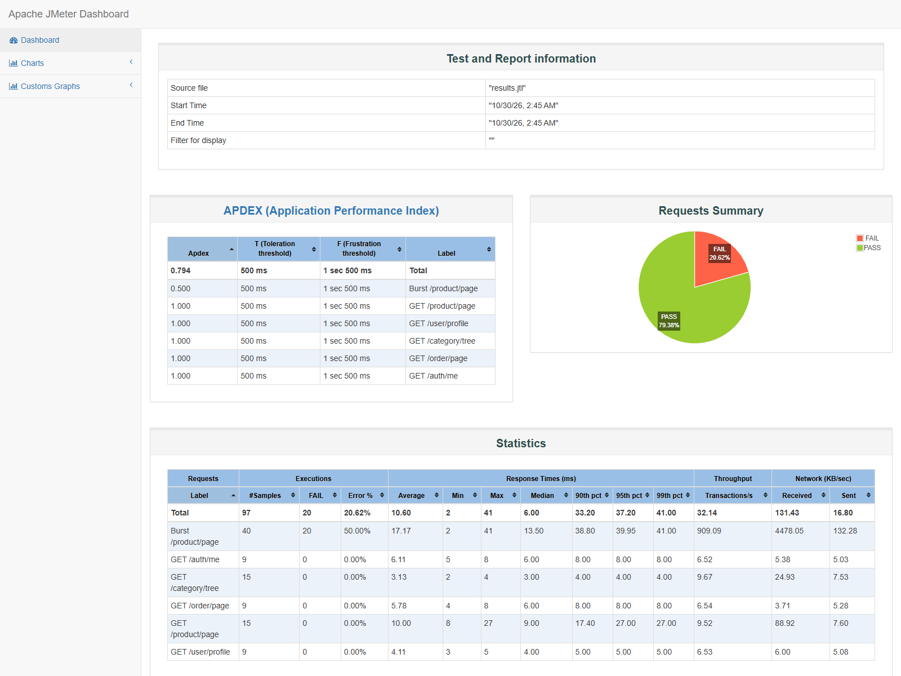

# 晴川二手市场 · 项目性能以及接口测试报告

| 项 | 内容 |
|---|---|
| 报告日期 | 2026-10-30 |
| 被测系统 | 晴川二手市场 Spring Cloud Alibaba 微服务项目 |
| 被测入口 | 网关 `http://127.0.0.1:4399` |
| 前端地址 | `http://127.0.0.1:5173` |
| 性能工具 | Apache JMeter 5.6.3 |
| 接口回归 | 项目 Node REST E2E + 浏览器 E2E |
| 测试环境 | Windows / JDK 21 / Node 22 / MySQL 8.1 / Redis / Nacos / Seata |

---

## 1. 测试结论

本轮测试结论：**项目核心接口和前后端功能正常，数据库连接正常，性能处于可用的本地开发水平；正常负载接口 0 错误。**

- REST 接口回归：**152/152 通过**
- 浏览器功能回归：**42/42 通过**
- JMeter 正常负载样本：**57/57 成功**
- JMeter Sentinel 突发样本：40 请求中 **20 个成功、20 个预期 429**
- MySQL、Redis、Nacos、Seata、Zipkin、Sentinel、Prometheus、Grafana：均正常
- 7 个后端服务和前端：均处于 `UP` 状态

> 说明：JMeter 总样本 97 个，其中 20 个 429 是 Sentinel 对 `/product/page` 的预期限流结果，不是系统故障；正常负载组没有错误。

---

## 2. 接口功能测试

接口功能使用项目现有的 REST E2E 套件执行，覆盖认证、用户、商品、订单、支付、消息和跨切面治理：

| 模块 | 用例数 | 通过 | 失败 |
|---|---:|---:|---:|
| A 认证与令牌 | 19 | 19 | 0 |
| U 用户与账号治理 | 29 | 29 | 0 |
| P 商品与分类 | 38 | 38 | 0 |
| O 订单与交易 | 24 | 24 | 0 |
| Y 支付与退款 | 10 | 10 | 0 |
| M 聊天与消息 | 17 | 17 | 0 |
| X 跨切面（网关/鉴权/错误码/可观测性） | 15 | 15 | 0 |
| **合计** | **152** | **152** | **0** |

重点接口验证结果：

- 用户名/邮箱登录、刷新 token、注销、改密、找回密码：通过
- OAuth2 discovery、JWKS、client_credentials、兼容 RSA access token：通过
- 商品发布、草稿、编辑、上下架、分类、评论、收藏：通过
- 下单、扣库存、模拟支付、发货、收货、评价、退款：通过
- 用户治理、管理员商品下架、订单/退款后台：通过
- WebSocket 握手、聊天 ACK、幂等发送、通知已读：通过
- Nacos 动态配置刷新：通过
- Prometheus 指标、Zipkin 调用链、Grafana health：通过
- 内部接口 `/inner/**` 隔离与 `X-Internal-Token` 校验：通过

浏览器端回归覆盖：

- 首页游客商品与分类：通过
- 登录、注册、找回密码：通过
- 个人中心、资料、头像、地址、收藏、评价、草稿箱：通过
- 商品列表、详情、发布、草稿保存：通过
- 购买、支付、订单、退款审批：通过
- 聊天、系统通知、订单卡片：通过
- 管理员用户、商品、分类、订单与退款页面：通过
- 浏览器回归结果：**42/42 通过**

---

## 3. JMeter 性能测试设计

JMeter 计划文件：

- `./performance-assets/project-performance.jmx`
- 原始结果：`./performance-assets/results.jtl`
- 汇总统计：`./performance-assets/statistics.json`
- JMeter HTML 报告：`.tmp/performance/html/index.html`

测试分为三组：

1. **公开接口负载**
   - `GET /product/page?pageNum=1&pageSize=20`
   - `GET /category/tree`
   - 5 个线程，2 秒 ramp-up，每组 3 次循环

2. **登录后接口负载**
   - `GET /auth/me`
   - `GET /user/profile`
   - `GET /order/page?role=bought&pageNum=1&pageSize=10`
   - 3 个线程，2 秒 ramp-up，每组 3 次循环
   - 使用本地 CSV 注入测试 token，token 未写入报告

3. **Sentinel 突发验证**
   - 40 个线程同时请求 `GET /product/page?pageNum=1&pageSize=1`
   - 验证网关 `/product/page` 的 20 QPS 限流策略

---

## 4. 性能测试结果

| 请求 | 样本数 | 错误数 | 错误率 | 平均响应 | P90 | P95 | 最大响应 |
|---|---:|---:|---:|---:|---:|---:|---:|
| GET /product/page | 15 | 0 | 0% | 10.00 ms | 17.40 ms | 27.00 ms | 27 ms |
| GET /category/tree | 15 | 0 | 0% | 3.13 ms | 4.00 ms | 4.00 ms | 4 ms |
| GET /auth/me | 9 | 0 | 0% | 6.11 ms | 8.00 ms | 8.00 ms | 8 ms |
| GET /user/profile | 9 | 0 | 0% | 4.11 ms | 5.00 ms | 5.00 ms | 5 ms |
| GET /order/page | 9 | 0 | 0% | 5.78 ms | 8.00 ms | 8.00 ms | 8 ms |
| **正常负载合计** | **57** | **0** | **0%** | **5.98 ms** | — | **10 ms** | **27 ms** |

正常负载组的全部 57 个请求均返回 HTTP 200，说明网关、OAuth2 鉴权、服务间调用和数据库读取链路正常。

### Sentinel 突发验证

| 指标 | 结果 |
|---|---:|
| 突发请求数 | 40 |
| 成功请求 | 20 |
| HTTP 429 | 20 |
| 429 比例 | 50% |
| 成功请求平均响应 | 约 17 ms |
| 结论 | 符合 `/product/page` 的 20 QPS 快速失败策略 |

JMeter 总览中出现的 20 个错误全部来自该突发组，属于课程要求的限流保护结果。

---

## 5. 数据库与基础设施检查

| 检查项 | 结果 |
|---|---|
| MySQL | UP，8.1.0 |
| `mall_user` | UP，可查询 |
| `mall_product` | UP，可查询 |
| `mall_order` | UP，可查询 |
| `mall_payment` | UP，可查询 |
| `mall_message` | UP，可查询 |
| `mall_seata` | UP，可查询 |
| Redis | UP |
| Nacos | UP，7 个服务已注册 |
| Seata | UP |
| Zipkin | UP |
| Sentinel Dashboard | UP |
| Prometheus | UP |
| Grafana | UP，`/api/health` 返回 `database=ok` |
| 后端 4399~4405 | 7/7 UP |
| 前端 5173 | HTTP 200 |

巡检时业务表可正常读取，数据库不是“端口连接成功但查询失败”的状态。

---

## 6. 佐证截图

### JMeter Dashboard



截图包含：

- APDEX 结果
- 总请求数、失败数和错误率
- 各接口平均响应、P90/P95/P99、最大响应
- 正常接口与 Sentinel 突发请求的区分

---

## 7. 限制与建议

1. 本报告是**单机本地开发环境**结果，不代表生产容量。
2. JMeter 只使用了 5/3/40 的小规模线程，未做长时间稳定性、峰值容量和分布式压测。
3. 当前数据库中保留了较多 E2E 测试数据，商品名和分类名可能带有“测试商品”“重复分类”等字样，这是测试数据问题，不是接口故障。
4. 后续若用于答辩，建议补充：
   - 10/50/100 并发的阶梯压测
   - 30 分钟稳定性测试
   - MySQL 慢查询和连接池监控
   - Sentinel 429、熔断、数据库异常场景的截图
   - 清理 E2E 测试数据后重新跑一组展示数据

---

## 8. 复现命令

启动完整环境后执行：

```powershell
node e2e/run.js
node e2e/browser/run.js
```

JMeter：

```powershell
D:\apache-jmeter-5.6.3\bin\jmeter.bat -n `
  -t .tmp\performance\project-performance.jmx `
  -l .tmp\performance\results.jtl `
  -e -o .tmp\performance\html
```

JMeter HTML 报告可用浏览器打开：

```text
D:\project\javaProject\spring_Cloud_QiMo\.tmp\performance\html\index.html
```